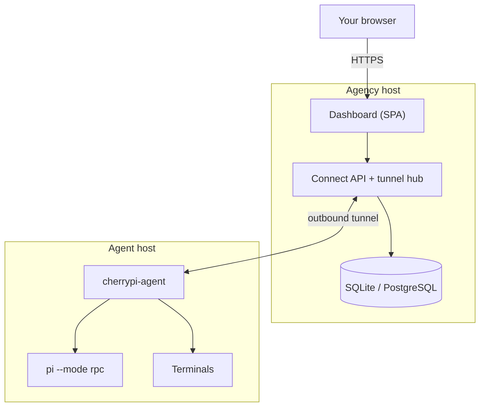

# What is CherryPi?

CherryPi is a self-hosted **agency** for a fleet of AI coding agents. You run
one agency — a Go server with an embedded Vue dashboard — and one or more
**agents** on the machines that should do the work. The agency is the only
public surface; agents dial out to it and serve their API over a tunnel.

Think of it as the control plane for long-running agent work:

- **The agency** owns people, teams, projects, tasks, scheduling, history,
  attachments and accounting.
- **An agent** owns a machine and the Pi sessions, terminals and desktop that
  run there. It is a headless worker: no listener, no local login.
- **The tunnel** joins them. It uses HTTP/2 where available and falls back to a
  WebSocket over HTTP/1.1, so an ordinary reverse proxy is enough.

## The moving parts

| Piece | What it is | Where it runs |
| --- | --- | --- |
| **Agency** | Go server + dashboard + scheduler + storage | A VPS, usually behind TLS |
| **Agent** | Headless worker that spawns Pi sessions and PTYs | Any machine that can reach the agency |
| **Pi** | The coding-agent harness the worker drives | Inside the agent's runtime |
| **Project** | A grouping of tasks with its own prompt and access rules | Agency |
| **Task** | One unit of work with a prompt, state, history and artifacts | Agency (executed on an agent) |
| **Team** | A group of users and agents; the primary way access is granted | Agency |
| **Tunnel** | The outbound connection an agent keeps to the agency | Between agency and agent |

## What happens to a task

1. You create a task in a project and write a prompt.
2. The scheduler finds an eligible **agent** — one you own or one shared with
   you through a team — that has capacity.
3. The agency sends the task to the agent over the tunnel. The agent starts a
   Pi session in `$CHERRYPI_DIR/sessions/<task id>`.
4. Pi's events stream back to the agency: messages, tool calls, questions,
   artifacts, usage and session history.
5. You can watch, answer questions, attach files, open a terminal or reassign
   the task. The agency keeps the history, so the task can continue on a
   different agent later.

## What CherryPi is not

- **Not a hosted service.** You own the data, the host and the credentials.
- **Not a model provider.** Pi brings its own model configuration; the agent
  only runs Pi.
- **Not a CI system.** A task is interactive work with a persistent session,
  not a one-shot build job.
- **Not a desktop environment.** The agent can expose an already-running X
  display, but it does not boot one.

## Next

- [Quickstart](/guide/quickstart) — get an agency and an agent running.
- [Concepts](/guide/concepts) — the vocabulary used throughout these docs.
- [Install the agency](/agency/install) — production installation.
