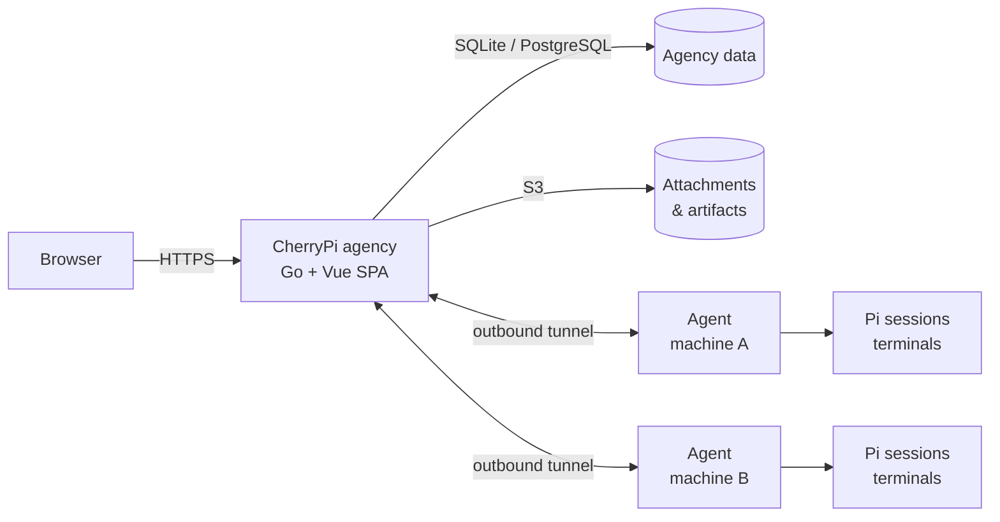

## Start here

<div class="vp-features">

### I want to try it

Run the single-box stack from the repository:

```sh
docker compose up -d --build
```

Then open <http://localhost:8080>. The bundled agent connects automatically.
Read the [quickstart](/guide/quickstart) for the details.

### I want to host it

Install the agency on a VPS, put it behind a TLS reverse proxy, and register
agents from the UI:

1. [Install the agency](/agency/install)
2. [Configure authentication and storage](/agency/configuration)
3. [Install an agent](/agent/install)

### I want to integrate

Use the typed [Connect API](/advanced/api) and the
[JavaScript SDK](/advanced/sdk), or drive it with the same personal access
tokens the browser and bundled Pi tools use.

</div>

## How it fits together



Only the agency is reachable from the outside. Agents connect to it, report
their health, and serve their task API over the same tunnel.
