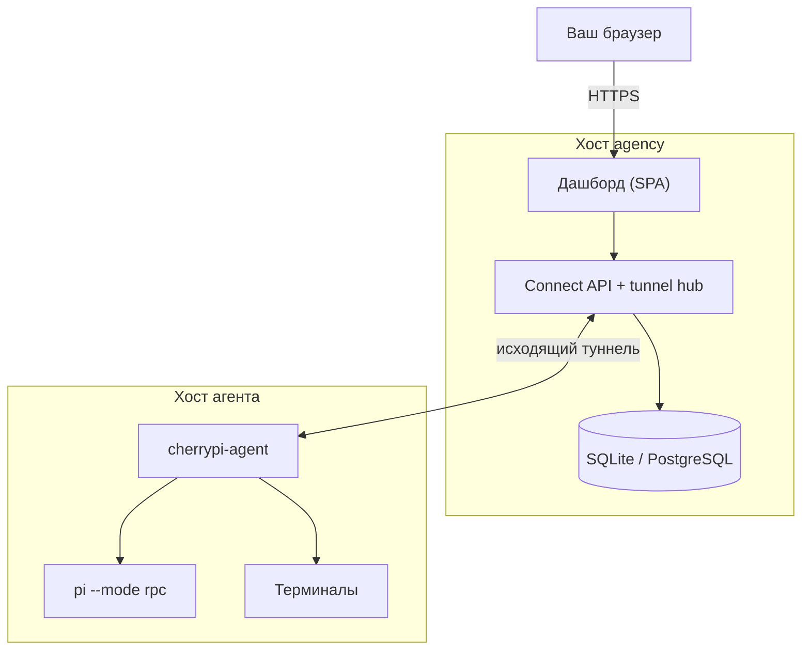

# Что такое CherryPi?

CherryPi — это self-hosted **agency** для парка ИИ-агентов. Вы запускаете одну
agency — Go-сервер со встроенным Vue-дашбордом — и одного или нескольких
**агентов** на машинах, которые должны выполнять работу. Agency — единственная
публичная поверхность; агенты подключаются к ней исходящим соединением и
отдают свой API через туннель.

Это control plane для долгой работы агентов:

- **Agency** владеет людьми, командами, проектами, задачами, планированием,
  историей, вложениями и учётом.
- **Агент** владеет машиной, сессиями Pi, терминалами и рабочим столом. Это
  headless-воркер: без слушателя и без локального входа.
- **Туннель** соединяет их. Он использует HTTP/2, где доступен, и
  откатывается на WebSocket поверх HTTP/1.1, поэтому достаточно обычного
  reverse proxy.

## Из чего состоит система

| Компонент | Что это | Где работает |
| --- | --- | --- |
| **Agency** | Go-сервер + дашборд + планировщик + хранилище | VPS, обычно за TLS |
| **Агент** | Headless-воркер, запускающий сессии Pi и PTY | Любая машина с доступом к agency |
| **Pi** | Harness кодирующего агента, которым управляет воркер | В окружении агента |
| **Проект** | Группа задач со своим промптом и правами | Agency |
| **Задача** | Единица работы с промптом, состоянием, историей и артефактами | Agency (выполняется на агенте) |
| **Команда** | Группа пользователей и агентов; основной способ выдачи доступа | Agency |
| **Туннель** | Исходящее соединение агента с agency | Между agency и агентом |

## Что происходит с задачей

1. Вы создаёте задачу в проекте и пишете промпт.
2. Планировщик находит подходящего **агента** — принадлежащего вам или
   доступного через команду — у которого есть свободный слот.
3. Agency отправляет задачу агенту по туннелю. Агент запускает сессию Pi в
   `$CHERRYPI_DIR/sessions/<task id>`.
4. События Pi возвращаются в agency: сообщения, вызовы инструментов, вопросы,
   артефакты, использование и история сессии.
5. Вы можете наблюдать, отвечать на вопросы, прикреплять файлы, открывать
   терминал или переназначать задачу. Agency хранит историю, поэтому задачу
   можно продолжить на другом агенте.

## Чем CherryPi не является

- **Не хостинговый сервис.** Данные, хост и учётные данные принадлежат вам.
- **Не провайдер моделей.** Pi использует собственную конфигурацию модели;
  агент лишь запускает Pi.
- **Не CI-система.** Задача — интерактивная работа с постоянной сессией, а не
  одноразовый билд.
- **Не рабочий стол.** Агент может показать уже запущенный X-дисплей, но не
  запускает его сам.

## Далее

- [Быстрый старт](/ru/guide/quickstart) — запустить agency и агента.
- [Основные понятия](/ru/guide/concepts) — словарь документации.
- [Установка agency](/ru/agency/install) — production-установка.
