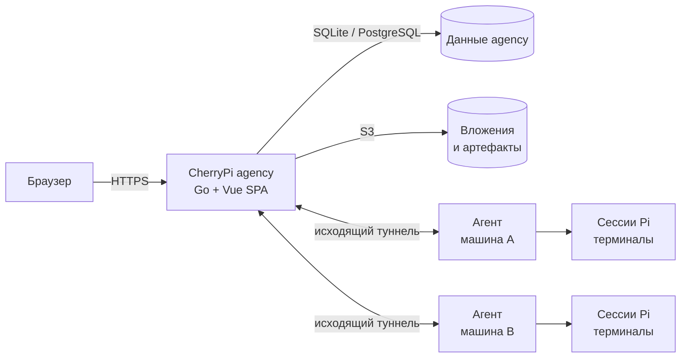

## С чего начать

<div class="vp-features">

### Хочу попробовать

Запустите стек на одной машине из репозитория:

```sh
docker compose up -d --build
```

Откройте <http://localhost:8080>. Встроенный агент подключится сам.
Подробности — в [быстром старте](/ru/guide/quickstart).

### Хочу разместить у себя

Установите agency на VPS, поставьте TLS-прокси и зарегистрируйте агентов в
интерфейсе:

1. [Установка agency](/ru/agency/install)
2. [Настройка аутентификации и хранилища](/ru/agency/configuration)
3. [Установка агента](/ru/agent/install)

### Хочу интегрироваться

Используйте типизированный [Connect API](/ru/advanced/api) и
[JavaScript SDK](/ru/advanced/sdk) либо те же personal access tokens, что и
браузер с встроенными инструментами Pi.

</div>

## Как это устроено



Снаружи доступна только agency. Агенты подключаются к ней, сообщают здоровье и
отдают свой API задач через тот же туннель.
