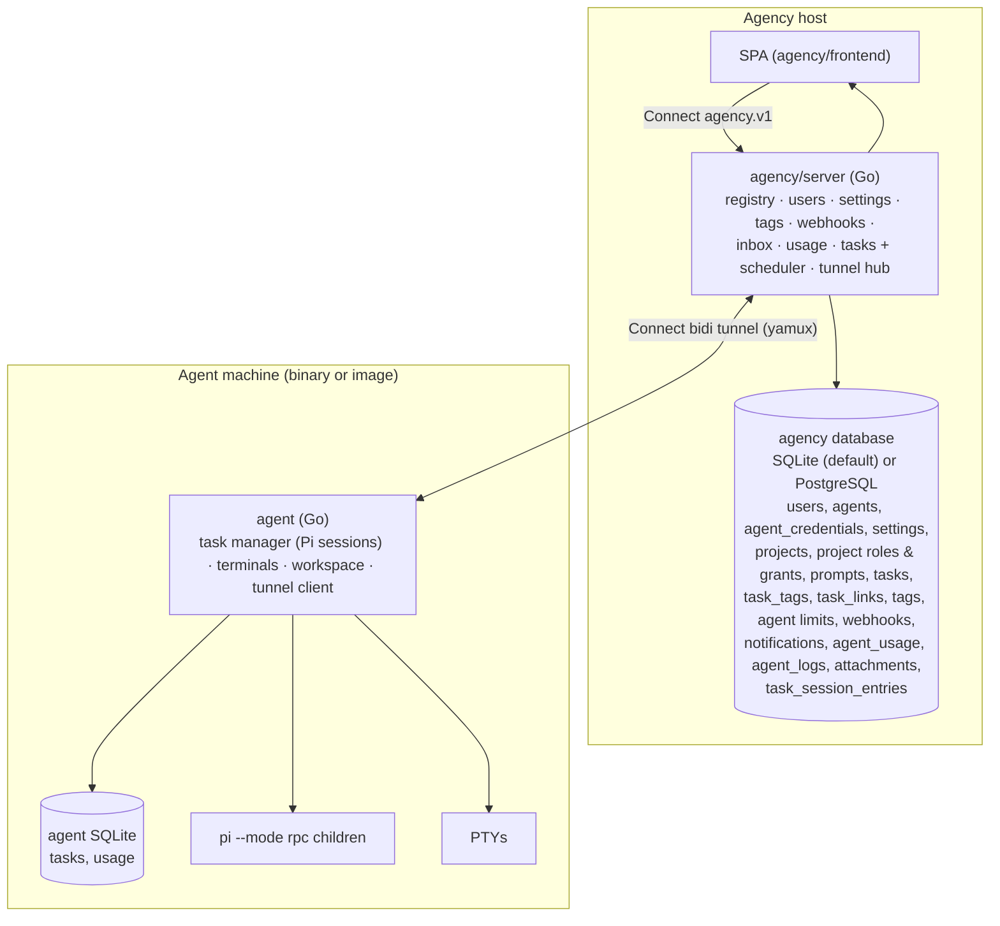

# Architecture

**CherryPi Agency** is a fleet of agents under one central web app. The
**agency** is a lightweight Go server + Vue SPA deployed to a VPS; each
**agent** is a long-running worker on its own machine that dials the agency and
serves its tasks (Pi sessions), terminals, and workspace over the resulting
tunnel. Work is tracked in the
[issue tracker](https://github.com/cherrypidotdev/cherrypi/issues); the
rework's design is [`agency-rework.md`](agency-rework.md), and how a task's Pi
conversation outlives its agent is [`session-history.md`](session-history.md).
Terms are in [`../VOCABULARY.md`](../VOCABULARY.md).

## Overview



The agency is the only public surface: one SPA, one login, one API. It is a
typed control router plus a stream relay. The agent has no web UI and no browser
auth; it is reached only over the tunnel.

## Modules

Three Go modules tied by a root `go.work`:

| Module | Path | Module path |
| --- | --- | --- |
| Agency | `agency/server` | `cherrypi.vladfaust.com/agency` |
| Agent | `agent` | `cherrypi.vladfaust.com/agent` |
| Shared | `shared` | `cherrypi.vladfaust.com/shared` |

`shared/` holds every proto (`agent.v1`, `agency.v1`, `tunnel.v1`), their
generated Go (`shared/gen`) and TypeScript (into `agency/sdk/js/src/gen`), plus
the `shared/tunnel` plumbing. Codegen runs once from `shared/buf.gen.yaml`;
each module's `go.mod` has a `replace` so Docker builds resolve `shared`
without the workspace file.

## Agency (`agency/server`)

A single `net/http` server. Browsers authenticate with an httpOnly session
cookie, SDK/CLI clients use a personal access token (`pat_…`), and legacy HTTP
Basic remains for compatibility; agent-facing routes authenticate with tunnel
credentials. Subsystems:

- **Agent registry** — the fleet's metadata and per-agent credentials
  (personal access tokens and the legacy `agent_credentials`), with presence
  and the reported build/protocol versions derived from the tunnel hub; see
  [`agent-compat.md`](agent-compat.md).
- **Tunnel hub** — tracks connected agents; each connection exposes typed
  Connect clients to the agent's `agent.v1` API.
- **Task lifecycle** — `agency.v1.TaskService` owns a task's states
  (draft/queued/running/input/settled/failed/completed/cancelled), its assignee,
  tags, priority, and archive, and forwards the runtime actions of a started
  task to its agent over the tunnel; `TagService` manages the per-project tags.
- **Scheduler** — an in-process drain loop (no queue table) that assigns
  `queued` tasks to eligible agents, honoring per-agent concurrency limits,
  atomically claims and starts them, and pins the prompt versions on the first
  run. Its periodic reconcile materializes `settled` for runs that finished. It
  is woken by task mutations, an agent connecting, and a periodic tick.
- **Control router** — the task/terminal/dashboard services forward
  agent-scoped calls over the tunnel, so the browser talks only to the agency.
- **Accounts** — the shared `actors` table (users and agents) plus user
  account state, e-mail credentials, browser sessions, single-use tokens
  (magic links, confirmations, resets), personal access tokens and TOTP
  (`internal/accounts`). The first administrator is created on first boot
  from `CHERRYPI_ADMIN_USERNAME`/`CHERRYPI_ADMIN_PASSWORD` (a random password
  is printed once when unset); `CHERRYPI_AGENCY_CREDENTIALS` still seeds user
  accounts for demos. See [`auth.md`](auth.md).
- **Settings** — agency name and primary color.
- **Webhooks** — agency-level, optional per-agent filter.
- **Notifications** — a persistent inbox fed by agents' attention signals and
  user-directed team invitations, with new entries pushed to authenticated
  browsers over `/api/rest/notifications/ws` so the tab badge, favicon, desktop
  notification, and chime fire without polling.
- **Projects & prompts** — agency-wide groupings of tasks (`projects`), their
  access (owner/member/viewer roles from direct grants and attached teams), and
  the versioned system prompts for the organization, agents, projects, and
  agent × project (`prompts`). A task records its project and the prompt
  versions it started with. Only an actor with a project role can run a task in
  a project; removing a member deletes its tasks there
  first. The scheduler resolves and composes those prompts when a task first
  starts, forwards one `append_system_prompt` to the worker, and pins the
  versions.
- **Agent logs** — the operational records an agent pushes on its event stream
  (task/session lifecycle and connectivity) land in `agent_logs` with a
  per-agent retention cap, and `AgentService.ListAgentLogs` serves them to the
  dashboard's per-agent Logs page. The agency also records the authoritative
  connect/disconnect lines itself.
- **Session history** — the agency keeps every non-header Pi session entry of
  a task in `task_session_entries` (`seq`, Pi's `entry_id`/`parent_id`/`type`,
  the verbatim `raw` line), pushed by the owning agent over
  `/api/rest/task-history`. `tasks.session_agent_id` records which agent owns
  the current Pi session. `GetTaskHistory` is served from this store, and a
  task reassigned to another agent is reconstructed from it into a fresh Pi
  session file, so agents are ephemeral. A task whose session predates
  automatic sync can be migrated on demand (`MigrateTaskHistory`), and the
  Cleanup tab marks which sessions the agency holds before deleting the
  agent-side copy. See [session-history.md](session-history.md).
- **Usage aggregate** — `agent_usage` receives deltas pushed by agents and
  survives agent downtime.
- **File storage** — a single S3-compatible bucket (`CHERRYPI_S3_*`) behind the
  `attachments` registry and its link tables. The agency proxies every upload
  and download; agents pull a task's files over the same route with their
  personal access token (or legacy tunnel credential), and Pi's bundled
  `uploadAttachment` tool uploads task attachments with the same agent token.
- **Stream relay** — terminal WebSockets at
  `/api/agents/<agentId>/terminal/<id>/ws`. The data plane is binary PTY bytes
  plus text control frames: `{"type":"control","controller":bool,"cols":…,"rows":…}`
  announces a consumer's role and the PTY size, and `{"type":"exit"}` is sent
  only when the shell exits (any other close is not an exit). The same relay
  carries the agent's shared desktop RFB stream at
  `/api/agents/<agentId>/desktop/ws`.

## Agent (`agent`)

The worker keeps the original session/terminal machinery:

- **Task manager** — the `internal/session` package spawns/drives/reaps
  `pi --mode rpc` children; one goroutine per task owns its stdin/stdout. Tasks
  are interactive or non-interactive; an input-waiting task reports
  `waiting_for_input`. Before a prompt is sent, the manager pulls the agency's
  `AttachmentRef`s into `<workspace>/attachments/`, hands images to Pi as
  `ImageContent`, and appends the on-disk paths; the next Pi spawn is given the
  agency URL, the task id and the path to the agent's personal access token
  (`CHERRYPI_AGENT_TOKEN_FILE`) for the `uploadAttachment` and `setTaskArtifacts`
  tools. Every child also loads the **bundled Pi extensions** (`--extension`):
  `setTaskUrls` appends a custom session entry the session forwards as a
  `task_link` event, `setTaskArtifacts` uploads file parts and appends an entry
  forwarded as a `task_artifact` event, and `agent_tools` registers
  `listTasks`/`getTask`/`getTaskHistory`/`createTask`/`updateTask`/`listProjects`,
  which call the agency's
  `/api/rest/agent-tools` surface with that same agent personal access token,
  read from the file on every call. The agent persists the task's stable
  `(project_id, seq)` reference on its task row and resolves it with the
  agency on every spawn, so a resumed session still finds a valid token and
  keeps working when a project prefix rename changes the rendered task id.
- **Terminals** — a root shell in the container over `creack/pty`.
  Several consumers may attach at once: the first controls
  (keyboard and PTY resize), later ones are read-only observers streaming the
  same output, and any observer can take control. Output is coalesced into
  frames of at most 32 KiB (a partial frame is flushed after 8 ms), so a chatty
  shell does not produce one WebSocket message per line. The controller's
  queue applies backpressure to the PTY — a slow browser slows the shell
  instead of losing output — while a read-only observer that cannot keep up
  is dropped. A bounded per-terminal scrollback is replayed to consumers that
  attach late.
- **Desktop** — a bridge to the operator's already-running X session; the
  agent never boots one. On the first browser attach it starts `x11vnc`
  against `$DISPLAY` and proxies its loopback RFB stream to the browser over a
  WebSocket. There is one shared desktop per agent, not per user — unlike
  terminals.
- **Store** — `sessions`, `usage`, `terminals` in agent SQLite (goose + sqlc).
- **Logging** — `internal/logging` installs a structured `slog` logger: text
  (or JSON via `CHERRYPI_LOG_FORMAT`) to stdout at `CHERRYPI_LOG_LEVEL`, with
  level and task/session attributes. Records mirror into the event hub so the
  agency persists them; tunnel connectivity is logged locally only, because
  the agency records its own authoritative connect/disconnect lines.
- **Event hub** — session events, usage deltas, attention signals, and
  structured log records are published to an in-process hub and streamed to
  the agency at `/api/rest/events` (newline-delimited JSON).
- **Session-history sync** — while Pi is alive a per-session watcher tails the
  local session JSONL and pushes new entries to the agency's
  `/api/rest/task-history`; at every spawn it reconciles the agency's tip with
  the local file, reconstructing a fresh Pi session from the stored history
  (continuing a task on another agent) or fast-forwarding a missing suffix.
  See [session-history.md](session-history.md).
- **Tunnel client** — `cherrypi-agent --agency-url <url> --auth <user>:<pass>`
  dials the agency, authenticates with a personal access token (or the legacy
  tunnel credential), runs yamux over the stream, and
  Connect stream, and serves its HTTP API on it. Reconnects with backoff.

## Tunnel

`tunnel.v1.TunnelService.Connect` is one long-lived **Connect bidi stream**
(HTTP/2; TLS in production, h2c locally) used as a full-duplex **byte pipe**.
After authenticating, the agent sends a **hello** frame (build + protocol
version); the agency validates it and refuses an incompatible binary before it
builds the pipe. The agent then runs a
[yamux](https://github.com/hashicorp/yamux) server on the stream and serves its
HTTP API over it; the agency runs the yamux client and
gives each connection an `http.Client` whose dialer opens yamux streams. The
agency therefore reuses its generated Connect clients and the agent keeps its
HTTP handlers (including WebSocket upgrades), with no per-method dispatcher.
See [`agent-compat.md`](agent-compat.md) for the version policy and rollout
order.

Why not WebSocket: connect-go cannot do bidi streaming over WS, and a raw byte
pipe makes terminals/desktop work unchanged.

The agency forwards the authenticated user as `X-CherryPi-User`; the agent's
tunnel server turns it back into request context so terminal ownership stays
per-user.

An agent has at most one **current** tunnel. A new connection supersedes the
older one (closing it and stopping its event consumer); only the current
connection updates presence, so a stream that a proxy holds open after a
reconnect can never mark the agent offline, and only its teardown logs
`agent disconnected` or clears the reported build versions.

## Frontend (`agency/frontend`)

Vue 3 + Pug + Tailwind + shadcn-vue, built by Vite, embedded into the agency
binary. The shell renders one **agency sidebar** with three collapsible
directories — users (with picture or jdenticon avatar, linking to their
profile), agents (avatars and presence), and a flat project list — above a
Tasks, Usage, Inbox, and Settings rail pinned next to the signed-in user.
Every agent page
(`/agents/:username/...`) shares an **agent header** carrying the agent
identity and links to its root terminals, RDP desktop, logs, usage, and
settings. Neither
sidebar lists tasks; the task tables do.
Agency-level pages: tasks, projects, agents, teams, users, inbox, and the
admin-only organization settings (General, Auth, Integrations, and embedded
user/team/project/agent management). Personal preferences live in **User
settings** (profile, security, auth, tokens, notifications).
Per-agent views are keyed by the agent's **username** at
`/agents/:username/...`; the index lists its tasks and member projects. The
canonical task routes are `/tasks` and `/tasks/:id` (a one-row header, a details
drawer with the lifecycle actions, and the console); a draft task is edited in
place. New tasks are created from the express form on the tasks, agent, and project
pages, or from the **+** in the sidebar header, which opens the same composer in
a modal that stays open after each create so several tasks can be queued in a
row. Project detail lives at `/projects/:slug` with Overview, Usage, and
Settings tabs (General, Tasks, Access, Danger zone). Agent pages use
`/agents/:username` with Overview, Usage, Terminals, RDP, and Settings tabs;
Settings holds General, Projects, Tasks, and Security. The SDK is used in
ambient-auth mode.

## Data model

**Agency database** (`agency/server/sql`): the same schema in two dialect trees, `sql/sqlite` (default) and `sql/pg` (PostgreSQL). The logical model below is shared.

- `users` — basic-auth credentials for the dashboard/SDK.
- `agents` — id, username, display name, description, timestamps.
- `agent_credentials` — bcrypt tunnel credentials (≥1 generated at creation),
  the legacy fallback for the agent's personal access token.
- `settings` — key/value (`agency_name`, `primary_color`).
- `projects` — id, name, immutable unique slug, unique task prefix, description,
  archived_at, `parent_project_id` (one parent; strict tree).
- `project_ancestors` — materialized ancestor closure
  `(project_id, ancestor_id, depth)`, rebuilt whenever a parent link changes;
  access and reference queries join it instead of recursing.
- `project_parent_invitations` — consented parent links, answered by a child
  owner (or linked directly through a shared owner team / admin).
- `project_actor_memberships` / `project_team_memberships` — project access
  roles (owner/member/viewer): the direct exception path and the attached-team
  path. Only an actor with a role can run a task in the project.
- `project_team_invitations` — consented team attachments, approved by an owner
  of the invitee team.
- `task_logs` / `agent_domain_logs` / `project_logs` / `team_logs` / `user_logs`
  — scoped domain logs of mutations, unioned by the admin events explorer
  (`agent_logs` is the separate operational log stream). See
  [`OBSERVABILITY.md`](OBSERVABILITY.md).
- `prompts` — append-only, versioned system prompts keyed by scope + agent +
  project (org rows have NULL owners); the latest version is live.
- `tags` — project-scoped task tags (project, name, description, color), the
  name unique within its project, soft-deleted via `archived_at`.
- `tasks` — the work item. Internally a stable integer `rowid` (the table
  primary key) is the reference used by every child table; `seq` is the
  per-project sequence (1..N) and the public `id` is _rendered_ as
  `<project prefix>-<seq>` and renamed when the prefix changes. Also: prompt,
  name, project, assignee + pinned flag,
  priority, state, the agent-side Pi session id, the pinned prompt versions,
  the start options, a `pending_prompt` (a follow-up stashed while the task
  rests), and timestamps. Draft and queued tasks have no session; running,
  input, settled, and failed tasks keep a warm session and hold the agent's
  slot. Archiving is a per-task boolean that hides it and cleans up its
  agent-side session.
- `task_tags` — `(task_rowid, tag_id)` task ↔ tag associations.
- `task_links` — `(task_rowid, url)` labeled URLs an agent attached to its task;
  a `setTaskUrls` call replaces the task's whole set.
- `task_references` — `(task_rowid, referenced_task_rowid, blocking)` directed
  edges; a **blocking** reference makes the referencing task wait until the
  referenced task is `completed`, while a non-blocking one is informational.
  Both sides are rowids, so a prefix change never touches the graph.
- `agent_task_limits`, `agent_tag_limits`, `agent_project_limits`,
  `agent_project_tag_limits` — per-agent concurrency caps, enforced by the
  scheduler. `agent_tag_limits` is keyed by tag **name** (global across
  projects), the rest by id.
- `attachments` — the S3-backed blob registry: rowid, storage key, filename,
  content type, size, audit. It has **no owner columns**.
- `task_attachments` — `(task_rowid, attachment_id)` task tray; includes agent
  artifacts. `task_messages` is the agency's ordered log of the user prompts it
  sent a task, and `message_attachments` links a message to its files.
  `projects`/`agents` carry a `picture_attachment_id` for their picture.
- `webhooks` — url, events, secret, optional `agent_id` filter.
- `notifications` — inbox entries (agent, session, kind, severity, read_at).
- `agent_usage` — usage deltas pushed by agents.
- `agent_logs` — operational log lines pushed by agents (`level`, `message`,
  `task_id`, `session_id`, `attrs_json`), pruned to the newest 2000 per agent.

**Agent SQLite** (`agent/sql`): `tasks`, `usage`.

The agency's database is selected by DSN: a `postgres://` or `postgresql://`
URL opens PostgreSQL, anything else is a SQLite file. Both implement one
`store.Store` interface independently: `SqliteStore` and `PgStore` each have
their own method set and call their own sqlc-generated package. The interface
and services speak only the dialect-neutral types in
`internal/store/types.go`; the field converters are generated by
`internal/store/gen` for the types both engines happen to shape the same way.

Store methods are **use-case operations, not query wrappers**. A method may run
a transaction and may use several queries: `RegisterAgent` writes the actor,
agent row, first owner and first credential atomically; `TransitionTask` maps
one lifecycle event to whichever query the dialect wants. Different engines are
therefore free to use different SQL, types and optimisations for the same
operation. Every timestamp/counter is a `BIGINT` and every boolean a `BIGINT`
0/1 in both trees where the shapes are shared.
PostgreSQL foreign keys are intentionally omitted: SQLite runs with
`PRAGMA foreign_keys=OFF` and the store deletes child rows explicitly, so
enforcing them only on one dialect would change behaviour.

Switching an existing deployment from the default SQLite file to PostgreSQL
starts from an empty PostgreSQL database with the current schema; rows are not
copied automatically.

SQLite opens with WAL journaling so concurrent readers run against the last
committed snapshot while the writer is active, a 5s `busy_timeout`, and a
driver wrapper that retries a transient `SQLITE_BUSY`/`SQLITE_LOCKED` (see
`internal/store/sqlite.go` in each module). This is what keeps a task-chat read
from failing while the scheduler and event consumer write. PostgreSQL uses a
bounded `database/sql` pool over pgx.

## Endpoints

| Path | Transport | Purpose |
| --- | --- | --- |
| `/api/grpc/…` | Connect gRPC(-web) | Agency API: agents, agent logs, users, settings, tasks, tags, terminals, dashboard, webhooks, notifications, and the agent tunnel |
| `/api/rest/health` | HTTP | Liveness (unauthenticated) |
| `/api/rest/events` | HTTP (agent, tunnel-internal) | Agent event stream consumed by the agency |
| `/api/rest/notifications/ws` | WebSocket (browser) | Realtime attention stream: each new inbox entry is pushed as it is created |
| `/api/rest/attachments` | HTTP (user/agent PAT or credential) | Upload/lookup/delete blobs; content served inline for images, as a download otherwise |
| `/api/rest/agent-tools/token` | HTTP (agent PAT or credential) | Mint/rotate the agent's personal access token (the legacy-credential bootstrap) |
| `/api/rest/agent-tools/tasks/resolve` | HTTP (agent PAT or credential) | Resolve a task's current display id from its stable `(project_id, seq)` reference |
| `/api/rest/task-history` | HTTP (agent PAT or credential) | Push/fetch a task's canonical Pi session entries, resolving the task from its stable `(project_id, seq)` reference |
| `/api/rest/agent-tools/…` | HTTP (agent PAT or credential) | The bundled task/project tools: list/create/update tasks and list projects, gated by the agent's per-project permissions |
| `/api/agents/<id>/terminal/<tid>/ws` | WebSocket | Terminal relay |
| `/api/agents/<id>/desktop/ws` | WebSocket | Desktop (RFB) relay |
| `/` | HTTP | Embedded SPA |

## Task lifecycle

```mermaid
sequenceDiagram
  participant C as SPA / SDK
  participant A as Agency (scheduler)
  participant G as Agent

  C->>A: createTask(prompt, project_id, assignee?, tags, priority)
  A-->>C: Task (draft or queued)
  Note over A: a queued task waits for an eligible agent with a free slot
  A->>A: pick agent, claim (state=running), resolve + pin prompts
  A->>G: agent.v1.CreateTask(append_system_prompt) (over tunnel)
  G-->>A: session_id
  A->>A: store session_id
  C->>A: watchTask(id)
  A->>G: agent.v1.WatchTask (over tunnel)
  G-->>A: TaskEvent stream
  A-->>C: TaskEvent stream
  Note over A: the reconcile tick mirrors waiting_for_input -> input and a finished run -> settled
  C->>A: addToTask(id, follow-up) (steers a running task; every resting state re-queues and resumes the warm session)
  C->>A: archiveTask(id) (stops a live run, hides the task, cleans up the session)
  C->>A: closeOutTask(id, outcome) (completed/cancelled, releases the slot)
```

A task holds its agent's concurrency slot while it is `running`, `input`,
`settled`, or `failed`, and releases it when it is closed out as
`completed`/`cancelled`, returns to backlog/draft, or is archived. A run that
finishes marks the task `settled` but keeps the slot; a run blocked on an
extension dialog is marked `input`. A follow-up to any resting task
(`settled`, `failed`, `completed`, `cancelled`) re-queues it with the prompt
stashed: the scheduler resumes the warm Pi session (or starts a fresh one when
the session is gone) and delivers the prompt once the agent is reachable. The
send therefore never waits on a live tunnel, which keeps it working while an
agent reconnects after a restart. Prompt edits are append-only and
never touch a
task that has started: the composed system prompt is persisted with the task on
the agent and the agency keeps the pinned version ids. A project can only be
deleted once every one of its tasks has been deleted; archiving a project hides
its tasks without changing their states.

## Compatibility of credentials

- **Users** sign in with a browser session cookie, or authenticate SDK/CLI
  calls with a personal access token (`pat_…`); legacy HTTP Basic is still
  accepted while the accounts migration completes.
- **Agents** authenticate their tunnel and their REST calls (tools, artifact
  uploads, history sync) with a personal access token; the legacy tunnel
  credential remains a fallback and boots the agent's first token.
- The agent has no auth layer of its own.

## Security

- The agency API sits behind session/PAT/Basic auth; public build and auth
  routes pass through.
- The tunnel authenticates agents itself; the user-auth middleware skips that
  route.
- Secrets (password hashes, PAT hashes, webhook secrets) are never returned by
  the API.

## Directory layout

```
agency/
  server/     Go module (cmd/agency, proto→shared, sql, internal)
  frontend/   Vue 3 SPA (Pug, Tailwind, shadcn-vue, Monaco, xterm.js)
  sdk/js/     @cherrypi/sdk
agent/        Go module (cmd/agent, internal, sql, Dockerfile)
shared/       Go module (proto/, gen/, tunnel/)
go.work       ties the three modules
```

## Tech stack & alternatives

| Concern | Default | Alternative (why not now) |
| --- | --- | --- |
| RPC | Connect (connect-go) | plain gRPC (no browser), OpenAPI |
| DB | modernc.org/sqlite (pure Go), PostgreSQL optional | a second database engine costs a dialect tree and a CI matrix |
| Migrations | goose | golang-migrate (cgo for SQLite) |
| Codegen | buf + sqlc | hand-written |
| Tunnel | Connect bidi + yamux | custom frame codec, WebSocket |
| Editor | Monaco | CodeMirror |
| Terminals | xterm.js + Go PTY/ws | ttyd |
| Desktop | x11vnc + noVNC over the tunnel (reuses the host X session) | xrdp, Guacamole |
| Pi control | `pi --mode rpc` (JSONL) | SDK via Node sidecar |
| Auth | basic HTTP, username–password pairs | OAuth2/tokens |
