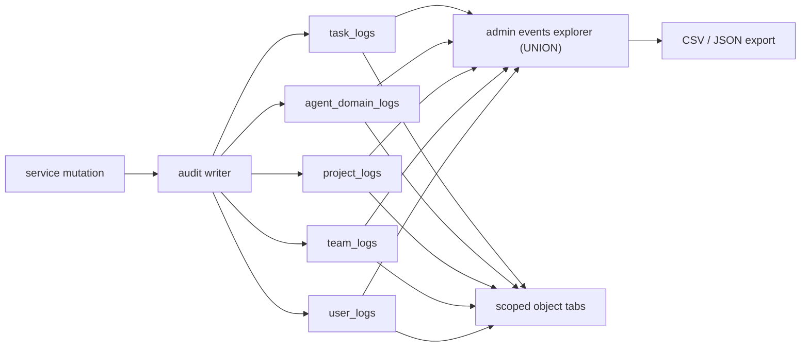

# Observability

CherryPi aims to **observe as much as possible**: if something changes, the
agency should be able to answer _who_ changed _what_, _when_, and _where it
happened_ — without shelling into an agent or grepping logs. This document is
the map of that machinery and the checklist for extending it.

The surrounding design is in [`ARCHITECTURE.md`](ARCHITECTURE.md), the audit
epic in [`auth.md`](auth.md) (phase 7), the terms in
[`../VOCABULARY.md`](../VOCABULARY.md).

## The model: scoped domain logs, no central table

Every mutation is appended to the **domain log of the object it concerns**. A
task change lands in `task_logs`; a team change in `team_logs`; an account
change in `user_logs`. There is deliberately **no central events table** — a
single table would couple every module to one hot write path and lose the
object-scoped indexes and role rules.

The five scopes are `task`, `agent`, `project`, `team` and `user`. The
**operational** `agent_logs` stream (`level`, debug/info/warn/error, migration 019) is a different concern: it carries what an agent _did_ at runtime, not what
an actor _changed_.

### Shared shape

The five domain logs carry the same columns, so the explorer can `UNION` them:

| Column | Meaning |
| --- | --- |
| `id` | Autoincrement row id, the per-scope pagination cursor. |
| scope column | The object the entry concerns: `task_rowid`, `agent_actor_id`, `project_id`, `team_id`, `user_actor_id`. |
| `at` | Epoch milliseconds; the explorer's primary sort key. |
| `actor_id` | The **acting** actor (nullable: deleting an actor keeps the history). |
| `kind` | The action, e.g. `created`, `login`, `password_change` (`internal/audit/kinds.go`). |
| `field` / `old_value` / `new_value` | Pre-rendered change pair for display. |
| `message` | Pre-rendered human summary. |
| `data_json` | Kind-specific structured payload for rich rendering. |

### What is logged

- **Mutations plus auth events; reads are never logged.**
- Task, project and team mutations write their own logs (phases 4–6).
- Project hierarchy links and parent invitations write `hierarchy` entries on
  **both** projects (parent and child), so either project's Logs tab tells the
  story.
- Task ownership: changing a task's **owning teams** (`teams`) or **leads**
  (`leads`) is logged from `tasks.logOwnership`. **Subscription changes are not
  logged** — an actor's opt-in to a task's updates is a private preference, not
  an audited mutation.
- `user_logs`: sign-in, failed sign-in, sign-out, magic link, password reset
  request/completion, and every account mutation (profile, password, e-mail,
  TOTP, recovery codes, sessions, personal access tokens, invitations, admin
  user changes, provider/LDAP/SMTP/auth settings).
- `agent_domain_logs`: agent creation, rename, credentials, tokens, ownership
  and limits.
- Operational lines (agent connectivity, task/session lifecycle) go to
  `agent_logs`, not the audit explorer.

Writers are best-effort: a failed audit insert is logged and **never rolls back
the mutation it describes**.

## Where it is rendered

- **Admin explorer.** Settings → **Events** (administrator-only) filters the
  `UNION` of all five logs by actor, scope, kind, date range and message
  substring, pages with an `at:scope:id` cursor, exports **CSV/JSON**, and edits
  the retention. REST: `GET /api/rest/events`, `/events/export.csv|json`,
  `GET|PUT /events/settings`.
- **Scoped tabs.** Each object page shows its own log: the task **Logs** tab,
  the project access **Logs**, the team **Logs** tab, the account **Activity**
  tab and the agent settings **Activity** tab. REST examples:
  `GET /api/rest/account/logs`, `GET /api/rest/agents/{id}/logs`.

### Scoped visibility

Locked rule: an **owner** (or administrator) sees the full scoped log; a plain
member sees their **own** entries plus **lifecycle** events (`created`,
`deleted`, `archived`). The shared helper is `audit.ScopedVisible`.

### Retention

`audit.retention_days` (default **90**) is a settings value, editable from the
Events tab. The scheduler's periodic cleanup calls `audit.Prune`, which deletes
entries older than the window from all five logs. The operational `agent_logs`
keeps its separate per-agent line cap.

## Extending observability (do this per feature)

Observability is part of the definition of done, not a follow-up. On every new
feature or behaviour change, **ask the owner whether the observability mechanics
need to change** — and if there is any doubt, propose the entry rather than
skipping it. Concretely:

1. **Pick the scope.** Which object does the change concern? Reuse an existing
   scope when possible; a genuinely new object may need a new
   `*_logs` table (shared shape + scope index + `at`/actor indexes) and a new
   value in `internal/audit.Scope`.
2. **Add a kind.** Add a `Kind…` constant in
   `agency/server/internal/audit/kinds.go` and a friendly label in the frontend
   (`DomainLogList.vue`).
3. **Write it.** Call the writer after the mutation succeeds — `s.auditUser` /
   `s.auditActor` (accounts), `r.logAgent` (agents), or the package's own
   `writeLog`. Add the acting actor via the request context; never log a read.
4. **Render it.** The entry appears in the admin explorer automatically. If the
   object has a scoped page, add or extend its log tab, and decide the scoped
   visibility (`owner` full vs. member own + lifecycle).
5. **Test it.** A migration round-trip when the schema changes, plus a service
   test that asserts the mutation wrote exactly one entry of the right kind. A
   scoped-REST test when a new endpoint is involved.
6. **Ask about retention/privacy.** If the entry carries sensitive data, keep it
   out of `data_json` or shorten the retention; secrets are never logged.

> When in doubt, ask in the task: _"Should this change add an observability
> entry — which scope, kind, and where should it render?"_

## Pointers

| Concern | Where |
| --- | --- |
| Shared shape, writers, prune, visibility | `agency/server/internal/audit/{audit,query,export,kinds}.go` |
| Admin explorer + export + retention REST | `agency/server/internal/audit/http.go` |
| Account/auth logging | `agency/server/internal/accounts/{audit.go,accounts.go,admin.go,…}` |
| Agent logging | `agency/server/internal/agents/{audit.go,agents.go,owners.go}` |
| Task/project/team logs | `internal/{tasks/logs.go,projects/access.go,teams/teams.go}` |
| Schema | `agency/server/sql/sqlite/migrations/018,038,040,042,043,044` |
| Frontend renderers | `agency/frontend/src/components/audit/DomainLogList.vue`, `components/settings/EventsPanel.vue`, `components/account/ActivityPanel.vue`, `components/settings/AgentActivityPanel.vue` |
