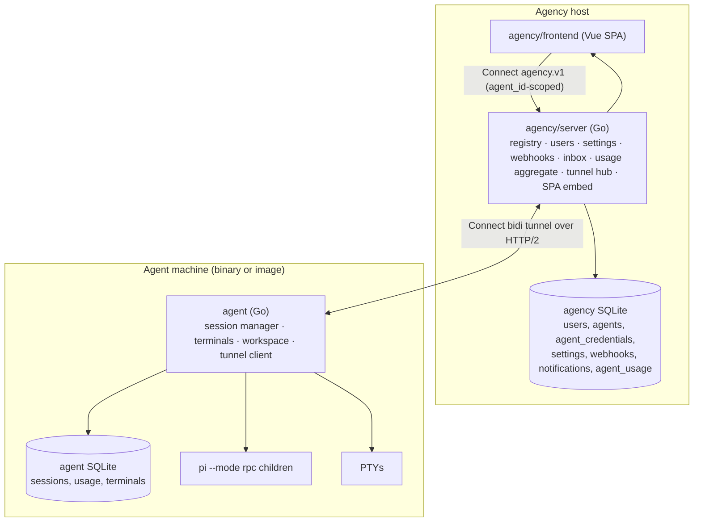

# CherryPi Agency — rework

Status: **accepted plan** (historical). Some navigation described below was
superseded by the CHPI-173 interface rework; see [`LEGACY.md`](LEGACY.md) for
the redirects and retired surfaces.

CherryPi stops being a single-agent-single-app and becomes an **agency of
agents**: one central web app (the **agency**) that manages, monitors, and
routes to many long-running agents connected from independent machines.

Terms live in [`../VOCABULARY.md`](../VOCABULARY.md); work is tracked in the
[issue tracker](https://github.com/cherrypidotdev/cherrypi/issues).

## Decisions (locked)

1. **Outbound tunnel.** An agent dials the agency and stays connected; no
   inbound port is needed on the agent machine.
2. **Agency-only UI.** One Vue SPA served by the agency. Per-agent views are
   routes under the selected agent. The agent binary ships no frontend.
3. **Agent-owned state, pushed aggregates.** Sessions/usage/workspaces stay on
   the agent; the agent pushes usage and event deltas to the agency, which keeps
   an aggregate for cross-agent charts and history that survives downtime.
4. **Agency-managed basic auth.** Dashboard/SDK user credentials live in the
   agency. Agent tunnel credentials are a separate per-agent list.
5. **Connect bidi tunnel.** Agency↔agent runs over one long-lived Connect bidi
   stream; logical requests and terminal byte-streams are typed messages.
6. **Two Go modules** (`agency/server`, `agent`) plus a small **`shared`**
   module holding the protos and generated stubs.
7. **Image + binaries, multi-arch, for both** agency and agent.
8. **Greenfield break** on `epic/agency`: no compatibility shims, no data
   migration, `plugins/` and Gitea dropped, Memory/Extensions removed.
9. **Persistent notifications inbox** in the agency in addition to webhooks.
10. **Desktop streaming deferred** to a future direct/P2P path; only terminals
    ride the tunnel for now.
11. **No embedded agent**; `compose.yaml` ships an agency service plus a simple
    agent service for single-box DX.
12. **Minimal renaming**: keep `@cherrypi/sdk` and `cherrypi.vladfaust.com/...`
    module paths, suffixed `/agency`, `/agent`, `/shared`.

## Target architecture



The agency is the only public surface: one SPA, one login, one API. It is a
typed control router plus a stream relay. The agent is a pure worker reached
only over the tunnel.

## Repo & modules

```
agency/
  server/              Go module  cherrypi.vladfaust.com/agency   (agency/server/go.mod)
    cmd/agency/        entrypoint + embedded SPA
    proto/agency/v1/   browser-facing protos (agent_id-scoped)
    sql/               agency migrations + queries (sqlc)
    internal/          gen · agents · auth · settings · webhook · inbox · usage · tunnel
  frontend/            Vue 3 SPA (multi-agent)
  sdk/js/              @cherrypi/sdk (agency API)
  Dockerfile           slim image (Go binary + embedded SPA)
agent/                 Go module  cherrypi.vladfaust.com/agent    (agent/go.mod)
  cmd/agent/           `cherrypi-agent --agency-url … --auth user:pass`
  internal/            session · terminal · store · workspace · tunnelclient
  Dockerfile           full runtime image (Pi + Node + Xvfb/Xfce/VNC)
shared/                Go module  cherrypi.vladfaust.com/shared   (shared/go.mod)
  proto/agent/v1/      worker capability protos (Session/Terminal/…)
  proto/tunnel/v1/     tunnel envelope + event messages
  gen/                 generated Go
buf.yaml / buf.gen.yaml (repo root)  single buf workspace
go.work                ties the three modules for local dev
```

Deleted: `server/` (old location), `plugins/`, all Gitea references, Memory and
Extensions (views, protos, SDK methods, backend handlers).

## Backend split

| Current concern | New home |
| --- | --- |
| `internal/session` (Pi harness, manager, history, events) | `agent` |
| `internal/terminal` (PTY manager) | `agent` |
| `internal/store` + `sql/` for sessions/usage/terminals | `agent` |
| `internal/webhook` | `agency` (payloads gain `agent_id`) |
| `internal/auth` | `agency` (users) + new per-agent credentials |
| `internal/dashboard` usage/disk read | usage read in `agent`; aggregation in `agency` |
| `internal/dashboard` memory/extensions | **deleted** |
| `cmd/server/grpc/*` handlers | `agent`, adapted to the tunnel dispatcher |
| `cmd/server/appcontext`, main, SPA embed | `agency` |
| `server/frontend` | `agency/frontend` |
| `sdk/js` | `agency/sdk/js` |

New agency-side code: agent registry, tunnel hub, control router, stream relay,
usage aggregator, notifications inbox, agency settings.

New agent-side code: tunnel client + dispatcher, and a `Stream` abstraction so
the PTY manager attaches to a tunnel stream instead of a `*websocket.Conn`.

## Data model

**Agency SQLite** (`agency/server/sql`):

- `users` — username, password_hash, timestamps (the old `credentials` table).
- `agents` — id, username (unique), display_name, description, timestamps.
- `agent_credentials` — agent_id, username (unique), password_hash,
  created_at, last_used_at. ≥1 generated at agent creation; rotate/revoke.
- `settings` — key/value (`agency_name`, `primary_color`).
- `webhooks` — url, events, secret, optional `agent_id` filter, timestamps.
- `notifications` — id, agent_id, session_id, kind, severity, title, body,
  created_at, read_at (the persistent inbox).
- `agent_usage` — agent_id, session_id, model, input_tokens, output_tokens,
  cost, active_ms, at (deltas pushed by agents).

Agent presence (`online`/`offline`/`busy`) is derived from the tunnel hub in
memory; `last_seen_at` is persisted.

**Agent SQLite** (`agent/sql`): `sessions`, `usage`, `terminals` — the current
schema minus `users`, `webhooks`, and `settings`.

## Protocol

### Tunnel (agent ↔ agency)

One long-lived **Connect bidi stream**, agent as the client:

```proto
service TunnelService {
  rpc Connect(stream AgentMessage) returns (stream AgencyMessage);
}
```

- **Why HTTP/2, not WS.** connect-go cannot do bidi streaming over WebSocket
  (WebSocket is HTTP/1.1; gRPC-Web/WS tops out at unary + server streaming).
  Running bidi over HTTP/2 (TLS in production, h2c locally) is simpler than
  hand-rolling a WS frame codec and keeps the transport typed.
- **Auth.** The stream carries the agent credential (`Authorization: Basic`).
  The agency resolves username → agent at connect time.
- **Messages.** `AgentMessage`/`AgencyMessage` carry: `hello` (agent id,
  version, capabilities), `rpc_request`/`rpc_response` (request id, service,
  method, protobuf payload, error), `stream_*` for terminal bytes (stream id,
  data/close), `event` (session events, usage deltas, attention signals), and
  `ping`. Server-streaming control (e.g. `WatchSession`) is multiple messages
  with the same request id, then a close.
- The agent reconnects with backoff; presence flips offline when the stream
  drops.

### Agency API (`agency/v1`)

Browser-facing typed services, each per-agent request carrying `agent_id` and
reusing the worker messages:

```proto
service SessionService {
  rpc CreateSession(CreateSessionRequest) returns (CreateSessionResponse);
  rpc WatchSession(WatchSessionRequest) returns (stream agent.v1.SessionEvent);
}
message CreateSessionRequest {
  string agent_id = 1;
  agent.v1.CreateSessionRequest request = 2;
}
message CreateSessionResponse { agent.v1.Session session = 1; }
```

Services: `AgentService` (list/get/create/update/delete, credential
create/list/revoke), `SessionService`, `TerminalService`, `DashboardService`
(aggregated usage; disk proxied), `SettingsService` (agency name/color),
`WebhookService` (agency-level, optional agent filter), `AuthService` (users +
`WhoAmI`), and a global events stream for presence + attention badges.

The agency forwards `{service, method, protobuf payload}` over the tunnel; the
agent dispatches with the same generated `agent.v1` types.

### Streams

The browser opens `/api/agents/<agentId>/terminal/<terminalId>/ws`; the agency
relays bytes over the tunnel to the agent's PTY. Desktop is deferred (future
direct/P2P path).

## Frontend (`agency/frontend`)

- `AppShell` keeps a single vertical sidebar with four collapsible directories — projects, agents, teams, and users (no per-project task tree). Each directory header leads with its entity icon; the open/closed state is per-tab (session storage), and projects start open. Collapsing the sidebar replaces the per-entity rows with one entity icon per directory that links to its collection page (`/projects`, `/agents`, `/teams`, `/users`). The collection pages keep their create form below the list. Each agent page renders a shared **agent header** (jdenticon avatar, display name, presence dot, and Root terminals / Logs / Usage / Settings). Avatars seed from the id via `jdenticon` unless an uploaded picture is set.
- Routes: `/agents`, `/agents/:agentId/sessions`, `/agents/:agentId/sessions/:id`,
  `/agents/:agentId/root-terminals`, `/usage`, `/webhooks`, `/credentials`,
  `/settings`, and an `/inbox` notifications view.
- Composables (`useSessions`, `useTerminals`, `useUsage`, `useSettings`) accept
  `agentId`.
- Terminal WS base becomes `/api/agents/<id>/terminal/...`; xterm/IndexedDB/
  localStorage layout code is unchanged.
- **Removed:** `MemoryView`, `ExtensionsView`, per-agent name setting.

## Auth

- Users: basic HTTP auth, registry in the agency, seeded by
  `CHERRYPI_AGENCY_CREDENTIALS` (transient) and persisted via `AuthService`.
- Agents: `agent_credentials`, bcrypt, validated on the tunnel stream. Shown
  once at creation (write-only thereafter).
- The agent has no auth layer of its own.

## Notifications

- The agent emits attention signals (input requested, errors) and state/usage
  events over the tunnel.
- The agency fans out to (a) the `notifications` inbox, surfaced in the web UI
  with an unread badge, and (b) configured webhooks (payloads include
  `agent_id`). The inbox means notifications survive long absences even with no
  webhooks configured.
- Authenticated browsers subscribe to the inbox over
  `/api/rest/notifications/ws`: new entries are pushed as they are created, and
  the SPA answers with a tab title/favicon badge, a Notification API desktop
  notification, and a chime. The stream is an additive hint — the inbox stays
  the source of truth, so the client refetches on every frame.

## Docker, CI/CD

- `agency/server/Dockerfile` — slim runtime (Go binary + embedded SPA).
- `agent/Dockerfile` — the heavy runtime (Pi, Node/NVM, Xvfb/Xfce/x11vnc/noVNC,
  optional VirtualGL) + `cherrypi-agent`.
- `compose.yaml` — agency service + a simple agent service.
- CI (`.github/workflows/ci.yml`), one ordered job: `format` → `shared`
  (buf) → `lint` → `agent` (build + test) → `agency/server` (build + test) →
  `agency/sdk` → `agency/frontend`.
- On a green push to `main`, the CI workflow's `dev-images` job builds and
  pushes the `-origin` images (`linux/amd64`, per-commit `dev-<sha>` tag plus
  the floating `dev` alias). Public releases are cut explicitly and are built
  by the public repository (see `docs/CI.md`). There is no deploy job.

## Future-proofing (design ahead, do not build)

- **Agent-to-agent / A2A:** every session/event carries an owning `agent_id`
  already; the agency keeps an addressing/router seam so an A2A endpoint can
  map an agent address to a tunnel session.
- **Agentic tasks:** keep "sessions, no tasks/locks"; a task becomes an
  agency-level grouping across agents, added later.
- **Hierarchy:** a `manager_agent_id` column can be added when needed.

## Phases

Each phase ends runnable and CI-green. Progress is tracked in the
[issue tracker](https://github.com/cherrypidotdev/cherrypi/issues).
