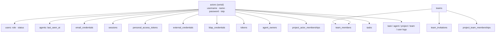

# Authentication, teams & governance

Status: **implemented** — phases 0, 1, 1.5, 2, 3, 4, 5, 6 and 7 have
landed. Phase 0
(serial actors, full agent-id migration) is in `main` (migration 025); phase 1
(accounts, sessions, TOTP, personal access tokens) is in `main` (migrations
026–031); phase 1.5 (agents and their tools on personal access tokens) is in
`main`; phase 2 (generic OIDC discovery, the generic OAuth2 shim, multiple LDAP
providers and per-method TOTP) is implemented (migrations 032–033); phase 3
(invitations, the user lifecycle, admin user management, org auth toggles and
SMTP) is implemented (migration 036); phase 4 (teams, team invitations, agent
ownership and team logs) is implemented (migrations 037–038); phase 5 (project
roles, direct grants, team approvals and project logs) is implemented
(migrations 039–040); phase 6 (task creator and ownership, message and log
attribution, the Pi envelope) is implemented (migrations 042–043); phase 7
(domain-log completion, retention pruning and the admin events explorer) is
implemented (migration 044). **Task comments were dropped** from phase 6 — see
the note in [Task collaboration](#task-collaboration).

Round 1 (identity, transport, e-mail, OIDC, LDAP, task messages) and round 2
(teams, governance, tasks, observability, security, invites, federation) are
answered and locked into this document.

Terms are defined in [`../VOCABULARY.md`](../VOCABULARY.md); the surrounding
design is in [`ARCHITECTURE.md`](ARCHITECTURE.md).

## Decisions (locked)

Round 1 answers and the ten fundamental follow-ups:

| Area | Decision |
| --- | --- |
| Actor id | **Serial** integer primary key; every agent-referencing column migrates to it |
| Agent columns | Mirrored `agents` identity columns are migrated and dropped inside the create-actors migration |
| Username namespace | Globally unique across users and agents; usernames are the primary login id but **may be renamed by admins**; all references use the actor id |
| Task assignee | Unified `assignee_actor_id`; strictly an agent for now (users later) |
| Password | `actors.password_hash BLOB NULL`; e-mail credentials carry no password |
| Avatars | `actors.picture_attachment_id` for users and agents |
| Browser session | httpOnly cookie + CSRF |
| SDK / CLI | Personal access tokens (`pat_…`) |
| Legacy credentials | Migrated to a user actor + password + a primary e-mail credential |
| First boot | Auto-create the first admin from env (default); optional insecure open registration |
| E-mail confirmation | Configurable, default off |
| Invite delivery | Copyable link when SMTP is unavailable |
| OIDC | Generic discovery **plus** a generic OAuth2 shim |
| LDAP | Full support, **multiple** providers, invite-only by LDAP username |
| Task visibility | All project members |
| Roles | `admin` / `member`, plus project roles |
| Project access | Teams first, **direct grants as exceptions** |
| Agent eligibility | Via a member team **or** a direct grant |
| Agent task flags | Removed; derived from the team's / grant's project role |
| Project roles | `owner` / `member` / `viewer`; an agent team may own |
| Agent owners | Any actor kind; the creator is the first owner |
| Admin powers | Invite/revoke users, rewrite passwords, see every task |
| Task ownership | One or more owning project teams; their members may prompt |
| Task leads | Zero or more project members (or owning-team members): shown, prompted and notified by default |
| Comments | **Dropped** from the phase 6 plan; the task console is the only place prompts live. Tracked as a future task in the agency. |
| Pi message shape | Always `{sendingActor, messageBody}` |
| messageBody | Plain text + structured attachment descriptors (`id`, `filename`, `path`); images also sent as `ImageContent` |
| Legacy messages | Author backfilled to the task creator, else a placeholder |
| Agent tools | Use the agent's personal access token — no minted token |
| Event store | Extend the **domain logs** (task, agent, project, team, user), no central table |
| TOTP | Per-method org toggles + recovery codes |
| Migration tests | Required for every migration in this epic |

## Current state

Findings from `main@4f97142`:

- Dashboard login is ambient HTTP Basic over a flat
  `users(username, password_hash)` credential list — no sessions, roles, TOTP,
  OIDC/LDAP or CSRF story.
- `agents(id TEXT UUID, username UNIQUE, …)` is a separate namespace with
  `agent_credentials` for the tunnel; every reference uses the mutable TEXT id.
- There is **no authorization**: any valid credential can call every method.
- Projects use `project_agents` with per-agent `can_list/create/update_tasks`
  flags; there are no users or teams.
- Tasks have no creator, no participation level and no comments;
  `task_messages` has no author; `task_logs.actor` is the coarse string
  `"user" | "agent" | "system"`.
- The agent-tool Pi extension mints a short-lived agent+task token under
  `/api/rest/agent-tools/mint`.

## Architecture

One identity table feeds everything. A **team** groups actors and is the primary
way access is granted; a **project** is owned and used by teams (with direct
grants as exceptions); a **task** runs on an **agent** actor and is visible to
the project's members.



### Access resolution

A user's or agent's effective role on a project is the strongest of a direct
grant in `project_actor_memberships` and the best role among their teams'
`project_team_memberships`. Admin bypasses everything. The scheduler resolves
eligible agents from the same two sources.

### Agent ownership

`agent_owners` maps an agent actor to any actor kind. Owners may edit the agent's
identity and settings (including the default model and thinking level), approve
its team invitations, and add or remove owners. Only owners and administrators
may open the agent's root terminals; everyone else can still watch the shared
desktop through a view-only bridge. Creating an agent makes its creator the
first owner. Per-task model and thinking overrides are separate from the
agent's defaults: any actor who may prompt the task may set them, while the
defaults remain owner-managed.

### Org-wide toggles

Stored in the key/value `settings` table, admin-only to change: password login,
magic link, e-mail confirmation, TOTP per method (e-mail/OIDC/LDAP), session and
token TTLs, whether members may invite users / create agents / create teams,
whether project and team deletion is admin-only, and the SMTP configuration.

## Data model

Additive goose migrations on top of `023_task_session_deleted`. Full SQL is in
the planning site; the shape:

| # | File | Summary |
| --- | --- | --- |
| 025 | `actors` | Serial actors; backfill agents; rewrite every agent-referencing column to the actor id; drop the mirrored agent columns. |
| 025 | `users` | `role` (admin/member), `status` (invited/active/disabled). |
| 026 | `email_credentials` | Multiple e-mails per actor; `confirmed_at`; no password. |
| 027 | `sessions` | Hashed session tokens, login method, TOTP verification, expiry. |
| 028 | `tokens` | Magic links, e-mail confirmation, resets, invitational and provider state; single-use, pruned when expired. |
| 029 | `invitations` | Four kinds (username / e-mail / OIDC / LDAP); the username is always set by the inviter. |
| 032 | `identity_providers`, `external_credentials` | Generic OIDC discovery and generic OAuth2; linked identities keyed by `(provider, subject)`. |
| 033 | `ldap_providers`, `ldap_credentials` | Multiple providers per org; invite-only by LDAP username. |
| 032 | `personal_access_tokens` | `pat_…` credentials for the SDK and CLI. |
| 033 | `totp_recovery_codes` | One-time recovery codes (the secret lives on the actor). |
| 034–035 | `teams`, `team_members`, `team_invitations`, `agent_owners` | Teams of actors; owner-approved agent invites; agent ownership. |
| 039–040 | `project_team_memberships`, `project_actor_memberships`, `project_team_invitations`, `project_logs` | Project roles for teams and direct exceptions; team-to-project invitations with approval. `project_agents` is migrated into the direct grants and dropped. |
| 041–043 | `tasks` | `creator_actor_id`, `pending_prompt_actor_id`, and `actor_id` on messages and task logs (042); `task_teams`, `task_leads`, `task_subscriptions` and `notifications.recipient_actor_id`, superseding the participation level (043). The vestigial `tasks.participation` column remains for legacy rows (see [`LEGACY.md`](LEGACY.md)). Comments were dropped, so no `task_comments` table exists. |
| 044 | domain logs | Shared-shaped `user_logs` and `agent_domain_logs`; the pre-existing `task_logs`/`project_logs`/`team_logs` gain explorer indexes. The operational `agent_logs` is unrelated and stays as-is. Retention is a settings value. |

## Phase 1 implementation notes

The data-model table above lists the _planned_ migration numbers; the shipped
phase 1 uses contiguous versions after `025_actors`:

| Migration | Contents |
| --- | --- |
| 026 | `users` (backfills the legacy flat credential table into admin+active user actors) |
| 027 | `email_credentials` |
| 028 | `sessions` |
| 029 | `tokens` (magic links, confirmations, resets) |
| 030 | `personal_access_tokens` |
| 031 | `totp_recovery_codes` |

Transports:

- Public: `POST /api/rest/auth/{login,logout,magic-link,magic-link/consume,
password-reset,password-reset/consume,confirm-email,register}` and
  `GET /api/rest/auth/{session,config}`.
- Session-authenticated: `/api/rest/account` (profile, password, e-mails,
  TOTP + recovery codes, personal access tokens, sessions).

Environment: `CHERRYPI_ADMIN_USERNAME` / `CHERRYPI_ADMIN_PASSWORD` (first boot),
`CHERRYPI_INSECURE_FIRST_REGISTERED_USER_BECOMES_ADMIN`, `CHERRYPI_PUBLIC_URL`
(link origin) and `CHERRYPI_AUTH_EXPOSE_MAGIC_LINKS` (return generated links in
responses for SMTP-less installs; never enable in production).
`CHERRYPI_AGENCY_CREDENTIALS` is kept as a demo/bootstrap seed and legacy HTTP
Basic stays accepted for SDK/CLI compatibility while PATs become the norm.

> **Migration tests are part of the epic.** Each migration gets a round-trip
> (`DownTo` then `Up`) and a data test that seeds legacy rows (agents,
> credentials, limits, `project_agents`, tasks, notifications) and asserts the
> migrated actors, teams, project roles and task links.

## Phase 1.5 implementation notes

Phase 1.5 moves agents — and everything their Pi tools call — onto **personal
access tokens**. It removes the two per-process HMAC authorities (a 1-hour
agent-tool token minted at `/api/rest/agent-tools/mint` and a 1-hour artifact
upload token minted at `/api/rest/tasks/{id}/artifact-token`), both of which
stopped working once a session outlived its TTL or the agency restarted.

- **Credential.** An agent's PAT is an ordinary actor-level
  `personal_access_tokens` row, minted through `AgentService`
  (`CreateAgentToken` / `ListAgentTokens` / `RevokeAgentToken`, admin-gated).
  `CreateAgent` also provisions one and returns the plaintext once. The
  `CHERRYPI_AGENCY_SEED_AGENT` dev bootstrap still seeds the legacy credential;
  the agent then self-bootstraps its token, so the compose setup needs no
  operator copy.
- **Tunnel.** The tunnel accepts `Authorization: Bearer pat_…` as well as the
  legacy `agent_credentials` Basic pair. The credential is a fallback during
  the migration; a future phase retires it.
- **Agent tools.** The bundled `agent_tools` extension sends the PAT; the
  agency resolves the agent actor from it (`agents.actor_id`) and applies the
  same project permissions. The mint route and `agenttools.Tokens` are gone.
- **Uploads.** `uploadAttachment` and `setTaskArtifacts` use the same PAT and
  the normal attachment route; the artifact-token authority and mint route are
  gone.
- **Bootstrap and refresh.** The agent caches its token at
  `$CHERRYPI_DIR/agent.token` (0600). At startup it loads `CHERRYPI_AGENT_TOKEN`
  (wins), else the file, else it exchanges the legacy credential once at
  `POST /api/rest/agent-tools/token` (which revokes its previous
  `agent-bootstrap` token). Pi is given `CHERRYPI_AGENT_TOKEN_FILE`, and the
  bundled tools read the file on every call, so rotating the file (or an
  operator writing a new PAT) reaches a running session without a Pi respawn.
  The token is never logged and never placed in Pi's environment. If a PAT is
  revoked and no replacement is written, the tunnel reconnects with the legacy
  credential when one is configured; otherwise the agent must be given a new
  token.
- **Environment.** `CHERRYPI_AGENT_TOKEN` (optional PAT) and
  `CHERRYPI_AGENT_TOKEN_FILE` (default `$CHERRYPI_DIR/agent.token`).
  `CHERRYPI_AGENT_AUTH` remains the legacy credential. The
  `CHERRYPI_ARTIFACT_TOKEN` plumbing is removed. This changes the embedded
  agent extension, so the PR carries the `agent-bump` label.

## Phase 2 implementation notes

Phase 2 adds federated sign-in on top of the phase-1 account surface.

- **Migrations.** `032_identity_providers` creates `identity_providers`
  (`kind` `oidc`/`oauth2`; issuer, explicit endpoints, JWKS, client id/secret,
  scopes, and the OAuth2 shim's `subject_path`/`email_path`/`name_path`) and
  `external_credentials` (linked identities keyed by `(provider_id, subject)`).
  `033_ldap_providers` creates `ldap_providers` (host/port/encryption, base and
  bind DNs, user filter, attribute names) and `ldap_credentials` (linked
  usernames keyed by `(provider_id, username)`).
- **Providers.** `kind=oidc` uses generic discovery at `issuer` and verifies
  the ID token against the discovered JWKS; explicit endpoints override the
  discovered ones. `kind=oauth2` is the shim: it uses the explicit
  authorization/token/userinfo endpoints and maps the userinfo JSON through the
  configured dot paths (with numeric array indices). Secrets are write-only and
  never returned.
- **Transports.** Public: `GET /api/rest/auth/providers` (the login form's
  provider list) and `GET /api/rest/auth/providers/{slug}/start` /
  `…/callback` for OIDC/OAuth2, plus `POST /api/rest/auth/ldap/login`. The
  start endpoint stores the state, nonce and PKCE verifier in a short-lived
  cookie; the callback exchanges the code and links or logs in. Admin
  (admin-only): `/api/rest/account/providers`,
  `/api/rest/account/ldap-providers` and `/api/rest/account/auth-settings`.
  Account: `GET/DELETE /api/rest/account/identities` and
  `POST /api/rest/account/identities/ldap` for linking, plus
  `DELETE /api/rest/account/ldap-identities/{id}`.
- **Invite-only.** A federated login is a lookup, never an auto-provision: an
  unlinked identity is rejected and the browser lands on
  `/login?error=unlinked`. Users link an identity from the account page — an
  OIDC/OAuth2 start with `mode=link`, or an LDAP bind via the link form. A
  phase-3 invite may pre-create the link.
- **LDAP bind.** When `ldap_providers.bind_dn` contains `{username}` the client
  binds directly as the substituted DN; otherwise it binds with the service
  account, searches `base_dn` for `user_filter`, and re-binds as the user's DN
  to verify the password. Multiple providers are supported and the login form
  lists them.
- **Per-method TOTP.** `auth.totp.{password,magic_link,oidc,oauth2,ldap}` in
  the `settings` table decide whether a login method enforces the account's
  TOTP (all default to enabled). A password login takes the code inline; an
  external login that needs one mints a 10-minute pending token and the frontend
  finishes it at `POST /api/rest/auth/2fa/complete`.
- **Frontend.** The sign-in page lists the enabled providers (buttons for
  OIDC/OAuth2, a directory picker for LDAP) and handles the pending TOTP step;
  the account page gains a **Linked accounts** tab; Settings gains an
  **Authentication** tab for the provider, directory and TOTP toggles.
- **Integration tests.** `agency/server/integration` (build tag
  `integration`) drives the real agency binary against Dex (OIDC discovery and
  the raw OAuth2 endpoints) and glauth (LDAP). The CI jobs are described in
  [CI.md](CI.md#auth-integration-images).

## Phase 3 implementation notes

Phase 3 adds invitations, the user lifecycle and org-wide login/governance
toggles on top of the phase-1 account surface.

- **Migration.** `036_invitations` creates `invitations` — four kinds, the
  reserved username, the pre-created actor, an optional e-mail and
  provider-side username, a hashed e-mail acceptance token, the role, and the
  accepted/revoked timestamps — and adds `users.must_change_password`.
  `029` was already the shared token table, so phase 3 claims the next free
  number (the planned 029 above predates the phase-1 renumbering).
- **Four kinds.** The invited username is always chosen by the inviter and
  reserves the global namespace:
  - `username` — a generated password is shown once; `must_change_password`
    forces the reset on the first sign-in.
  - `email` — requires SMTP; mails a single-use acceptance link and returns a
    copyable fallback. Acceptance sets the password and confirms the address.
  - `oidc` / `ldap` — provider-scoped: the inviter records the provider-side
    username; the first federated login that matches links the identity, so
    invite-only stays intact.
- **User lifecycle.** The invited actor is created up-front with status
  `invited`, reserving the username before acceptance. Accepting (or the first
  sign-in) flips it to `active`. Expired pending invitations are pruned by the
  scheduler, deleting the still-invited actor to free the username.
- **Admin user management.** `GET/POST /api/rest/account/users`,
  `GET/PATCH/DELETE /api/rest/account/users/{id}` and
  `POST …/users/{id}/password` list, provision, edit (role, status, profile),
  delete and rewrite the password; the last-administrator guard is preserved.
  The legacy gRPC `AuthService` credential surface is removed (see
  [LEGACY.md](LEGACY.md)).
- **User directory.** `GET /api/rest/account/directory/users` (every
  non-disabled user) and `GET …/directory/users/{username}` (one profile plus
  its teams) are readable by any signed-in member, so the sidebar and the user
  profile page do not require admin. Pictures are uploaded per user through
  `POST /api/rest/attachments?kind=user_picture&id=<actorId>`; a user may only
  set their own, an admin anyone's.
- **Invitations API.** `GET/POST /api/rest/account/invitations`,
  `DELETE /api/rest/account/invitations/{id}` and `POST …/{id}/resend` (admin,
  or members when `members.can_invite_users` is on), plus the public
  `GET /api/rest/auth/invitations/preview` and `POST …/invitations/accept`.
- **SMTP.** `internal/accounts/mailer.go` sends plain, STARTTLS or implicit-TLS
  mail through `net/smtp`. Settings live in the `settings` table
  (`smtp.{host,port,username,password,from,encryption}`); the password is
  write-only. `GET/PUT /api/rest/account/smtp-settings` and a test-send route
  back the Settings card. E-mail invites are disabled until a host and sender
  are set.
- **Org toggles.** `auth.password.enabled`, `auth.magic_link.enabled`,
  `auth.email_confirmation.required`, `auth.session.{ttl,remember_ttl}_hours`
  and the governance flags (`members.can_invite_users`,
  `members.can_create_agents`, `members.can_create_teams`,
  `admin_only.{project,team}_deletion`) live beside the phase-2 per-method TOTP
  flags. Password and magic-link sign-in can be disabled for members;
  administrators keep the username+password escape hatch.
- **First-login reset.** A cookie session whose user still has
  `must_change_password` may only read the account, change the password or sign
  out; every other API call returns `403 password change required`.
- **Frontend.** The Settings **Users** tab manages users and invitations; the
  **Authentication** tab gains the sign-in, governance and SMTP cards; `/invite`
  accepts an e-mail invitation; the router forces the first-login password
  change.
- **Integration test.** The `ci-smtp` job starts Mailpit and runs
  `TestSMTPInvitationDelivery`, which configures SMTP, sends an invitation,
  verifies delivery through Mailpit's API and accepts the link.

## Phase 4 implementation notes

Phase 4 adds teams, team membership and invitations, agent ownership and the
team-scoped domain log. Project access (phase 5) is layered on top of team
membership.

- **Migrations.** `037_teams` creates `teams`, `team_members` (role
  `owner`/`member`), `team_invitations` (pending → accepted/declined/revoked,
  7-day TTL) and `agent_owners`. `038_team_logs` creates the team-scoped
  `team_logs`. The planned 034/035/040 numbers were claimed by other work, so
  phase 4 takes the next contiguous versions after `036_invitations`.
- **Teams.** `internal/teams` owns the policy: the creator becomes the first
  owner, any member may invite, and only an owner (or an admin) may edit the
  team, delete it or invite as an owner. Deletion is blocked while the team has
  members (the locked decision), so a team is never silently emptied, and names
  are unique case-insensitively. Every mutation writes one `team_logs` row.
- **Invitations.** A user accepts their own team invitation; an agent's team
  invitation is approved by one of the agent's owners. Admins may override
  either. Agent invitations are managed from the agent's **Teams** tab: they
  are never listed on the team page or the global `/teams` page (the caller's
  pending list only carries their own user invitations). Expired pending
  invitations are pruned by the scheduler's periodic cleanup.
- **Agent ownership.** `agent_owners` maps an agent actor to any actor kind.
  Creating an agent makes its creator the first owner; `AgentService`
  `UpdateAgent`/`DeleteAgent` and the agent-token RPCs require an owner or an
  administrator, and `CreateAgent` honours `members.can_create_agents`
  (admin-only by default). An agent with no owner is admin-only. An agent's
  owner may also remove the agent from a team without a team role (the agent
  Teams tab path).
- **Transports.** `/api/rest/teams` (list/create; get/update/delete; members;
  invitations and their revoke; the caller's pending invitations; respond; and
  logs), `/api/rest/agents/{id}/owners`, and the agent-scoped
  `/api/rest/agents/{id}/teams` + `/api/rest/agents/{id}/invitations[/{id}/respond]`
  (owner or admin only). The two governance switches
  (`members.can_create_teams`, `admin_only.team_deletion`) come from the org
  settings; membership/ownership checks live in the service.
- **Frontend.** A **Teams** page lists teams, creates them and answers the
  caller's pending invitations; a team page manages members, invitations,
  settings and shows the team log. Agent settings gain **Owners** and **Teams**
  tabs; the Teams tab lets an owner approve/decline the agent's invitations and
  remove the agent from a team.
- **Tests.** Migration round-trip, cascade and data tests; the team service
  (membership, invitations, agent-owner approval, the last-owner guard, the
  delete-with-members guard and logs); the teams REST governance; the
  agent-owner REST surface; and the gRPC ownership/governance gates.

## Phase 5 implementation notes

Phase 5 layers project access on top of team membership: a project's effective
role is the strongest of a direct actor grant and the best role among the teams
attached to it.

- **Migrations.** `039_project_access` creates `project_team_memberships`,
  `project_actor_memberships` and `project_team_invitations`, backfills the
  legacy `project_agents` rows into direct grants (create/update -> `member`,
  otherwise `viewer`, keyed by the agent's actor id) and drops the table.
  `040_project_logs` creates the project-scoped domain log. The planned
  036/037/040 numbers were already claimed, so phase 5 takes the next contiguous
  versions after `038_team_logs`.
- **Roles.** `owner` > `member` > `viewer`. A viewer may view and comment (list
  tasks only); a member may prompt (create tasks) and edit; an owner may also
  manage access. `PermissionsForRole` derives the task flags the agent tools and
  the scheduler consume, so the retired per-agent `can_*` columns have a single
  source again. An administrator holds owner everywhere.
- **Direct grants.** `project_actor_memberships` is the exception path: a
  project owner adds, re-roles or removes an actor without the target's consent
  (`POST/PUT/DELETE /api/rest/projects/{id}/members`). The handler accepts an
  `actor_id` or a `username`.
- **Team access is consented to.** Attaching a team is a
  `project_team_invitations` row created by a project owner; one of the invitee
  team's owners approves or declines it (admins may override). Accepting creates
  the `project_team_memberships` row. A project owner may later re-role or detach
  the team directly.
- **Ownership grant.** A project owner may invite a team with the `owner` role;
  its approval is the ownership grant. `CountProjectsOwnedByTeam` backs the
  team-deletion guard, so a team that owns a project cannot be deleted.
- **Project deletion.** The gRPC `DeleteProject` (and the other project
  mutations) now require an effective project owner; the existing
  `admin_only.project_deletion` setting is surfaced through the access
  endpoint's `can_delete`.
- **Logs.** Every project mutation writes one `project_logs` row (created,
  settings, archived, member/team/invitation changes). The phase-7 explorer
  unions it with the other domain logs.
- **Transports.** `/api/rest/projects` (the caller's `access`, members, teams,
  invitations, logs, and the pending-invitation list/respond), plus
  owner-gated writes. The existing gRPC membership RPCs are reimplemented over
  the grants and still translate the legacy flags onto roles.
- **Frontend.** The project settings page gains an **Access** tab (direct
  grants plus attached teams with role pickers, invitations, and the caller's
  role) and the Teams page surfaces the pending project invitations for teams
  the caller owns.
- **Tests.** The 039/040 round-trip and backfill mapping; the project access
  service (effective role, direct-grant lifecycle, team invitation approval,
  pending lists, logs); the REST surface; the team deletion guard and `IsOwner`.

## Phase 8 implementation notes: project hierarchy

Projects form a strict tree with at most one parent per project (migration
`045_project_hierarchy`). `projects.parent_project_id` stores the link and
`project_ancestors` materializes the closure, rebuilt inside the same
transaction on every link change.

- **Inherited access.** `GetEffectiveProjectRole` keeps the caller's explicit
  role on the project and adds the **viewer** role when they have any role on an
  ancestor. `ListProjectsForActor`, `ListAgentProjects` and
  `ListAgentProjectMemberships` expand their explicit roots through the closure
  as viewers, so agents and the project sidebar see descendants. Inherited
  viewers never become project members, leads or owning-team members.
  `TaskService.CreateTask` now enforces the same rule for people: a viewer
  (including an inherited one) cannot create a task, and the project page hides
  its composer for them.
- **Consent.** The parent's owner invites a child
  (`POST /api/rest/projects/{child}/parent`); an owner of the child (direct or
  through an owner-role team) answers. A member of an owner-role team shared by
  both projects may link directly, and admins skip the invitation. Detaching is
  a parent-owner action. Both sides log every step.
- **References.** `tasks.Service` checks every reference against the tree: same
  project, a descendant, or a sibling (roots are siblings). A hierarchy change
  is validated against every cross-project edge first and rejected when it
  would make one illegal.
- **Deletion.** A project with children cannot be deleted until they move or are
  deleted; archiving a parent keeps affecting only its own tasks.
- **Frontend.** The sidebar renders the tree with indentation, project pages
  show a breadcrumb, and the settings Hierarchy card exposes the link state,
  invitations, children, and the shared-team direct-link tip.

## Phase 6 implementation notes

Phase 6 attributes work to real actors and gates who may prompt a task. **Task
comments were dropped from the plan** (see [Task collaboration](#task-collaboration)).

- **Migrations.** `042_task_participation` adds `tasks.creator_actor_id`,
  `tasks.pending_prompt_actor_id` and `actor_id` on `task_messages` and
  `task_logs`; existing rows keep a NULL creator and actor. The participation
  level it also added is superseded by `043_task_ownership`, which creates
  `task_teams` (owning teams), `task_leads` (accountable actors) and
  `task_subscriptions` (per-actor opt-in), drops `task_participation_teams`, and
  adds `notifications.recipient_actor_id`. (The planned `task_comments` table
  was never created.)
- **Ownership.** A task belongs to one or more of its project's teams. A member
  of any owning team may prompt it, and a lead may prompt it even after leaving
  a team; the creator and administrators always may. A project member outside
  the owning teams cannot prompt unless they are a lead. A task created without an explicit team list inherits
  its creator's project teams, then the project's teams, so only a project with
  no teams yields a legacy teamless task. `tasks.CanPrompt` owns the policy and
  the gRPC `AddToTask` consults it before forwarding or stashing a prompt.
- **Leads & subscriptions.** `task_leads` names the accountable actors, each
  validated at write time as a project member (directly or through any attached
  team) or a member of an owning team; they are shown on the task, notified of
  its updates, and may prompt it. `task_subscriptions` is the
  per-actor opt-in any project member may set. A task's notification recipients
  are its leads plus its subscribers, and its creator is auto-subscribed on
  create.
- **Attribution.** `tasks.WithActorID` tags the request context, so `Create`
  stores the creator, `recordLog` stores the acting actor on every log entry,
  and `RecordMessage` stores the sender of each prompt. A stashed follow-up
  keeps its sender in `pending_prompt_actor_id` so the scheduler attributes it
  when it finally delivers the prompt.
- **Pi envelope.** The agency passes the sender on the wire
  (`agent.v1.PromptSender` on `CreateTaskRequest`/`AddToTaskRequest`); the agent
  renders the `{sendingActor, messageBody}` envelope, where `messageBody.text`
  is the plain prompt and `messageBody.attachments` are structured descriptors
  (`id`, `filename`, on-disk `path`). The agent parses the envelope back into the
  `UserMessage.sender`/`body`/`attachments` event fields so a console need not
  decode JSON. A legacy prompt with no sender becomes a `system` placeholder;
  the agency-side history parser decodes the same envelope for replay, and the
  pre-phase-6 `--- attached: … ---` trailer stays a parser-only fallback.
- **Notifications.** The inbox is per-actor: `notifications.recipient_actor_id`
  targets one actor, and listing/unread counts/marking/deleting filter by the
  authenticated actor. A NULL recipient stays broadcast for legacy rows and
  org-wide signals. The realtime WebSocket hub subscribes by actor, so a
  targeted entry reaches only its recipient. `Notification` carries the owning
  task's `project_id` so the sidebar can badge projects by unread entries. Team
  invitations are targeted at the invitee as `team_invitation` entries; with no
  task to open, the inbox row links to `/teams` where the invitation is
  accepted.
- **Transports.** `CreateTaskRequest` gains `team_ids` + `lead_actor_ids`; the
  `SetTaskTeams`, `SetTaskLeads` and `SetTaskSubscription` RPCs replace
  `SetTaskParticipation`; `Task` exposes its `teams`, `leads` and the caller's
  `subscribed` flag; `Task`, `TaskMessage`, and `TaskLog` expose the actor ids
  (and resolved display names). The agent-tool surface already authenticates
  with the agent's personal access token (phase 1.5), so no scoped mint remains.
- **Frontend.** The quick-create form and the task details' **General** tab pick
  the owning teams and leads (loaded from
  `/api/rest/projects/{id}/access` + `/lead-candidates`); the details tab shows
  the creator, teams and leads, plus a subscribe toggle. The console renders
  each prompt's sender above the bubble.
- **Tests.** The 042/043 round-trip and default backfill; the ownership policy
  (project-team derivation, owning-team gate, the creator and admin bypass, lead
  validation, team pruning, recipients and subscription), the `Sender`
  placeholder, and the gRPC `SetTaskTeams`/`SetTaskLeads`/`SetTaskSubscription`
  and prompt-denial paths; the recipient-targeted inbox; the agent envelope
  round trip and the updated recovery/steering assertions.

> **Comments dropped.** The locked decision once described a separate task
> Comments tab (human discussion only, never sent to Pi). It was removed from
> the phase before implementation, so neither the `task_comments` table nor the
> tab exists. A draft agency task tracks adding it later.

## Phase 7 implementation notes

Phase 7 completes the domain logs, prunes them on retention and adds the admin
explorer. There is still no central event table: the explorer unions the five
scoped logs. See [`OBSERVABILITY.md`](OBSERVABILITY.md) for the model, render
locations and the per-feature extension checklist.

- **Migrations.** `044_domain_logs` creates the two missing scopes as
  shared-shape tables: `user_logs` (auth events and account mutations, keyed by
  the user they concern) and `agent_domain_logs` (agent identity, credential,
  token and ownership mutations, keyed by the agent's actor id). The plan once
  said “`agent_logs` extended”, but `agent_logs` is the _operational_ log stream
  (level/debug lines, migration 019) and mixing audit rows into it would put
  operational noise behind the explorer's mutation-only filter, so the agent
  scope got its own table instead (see [`LEGACY.md`](LEGACY.md)). The
  pre-existing logs gain `(at)` / `(actor_id, at)` indexes for the explorer.
- **Recording.** `internal/audit` owns the shared shape, the writer helpers and
  the explorer query. Services call `audit.LogUser`/`audit.LogAgent` (or
  `accounts.Service.auditUser`/`auditActor`, `agents.Registry.logAgent`) after a
  successful mutation; a write failure is logged and never rolls back the
  mutation. The acting actor comes from the request identity
  (`auth.ActorID(ctx)`), falling back to the subject for flows without a
  session (login, registration, invitation acceptance).
- **Coverage.** Every auth event (sign-in, failed sign-in, sign-out, magic
  link, password reset request/completion, registration) and account mutation
  (profile, password, e-mail, TOTP, recovery codes, sessions, PATs,
  invitations, admin user changes, provider/LDAP/SMTP/auth settings) writes one
  `user_logs` row; agent creation, rename, credentials, tokens, ownership and
  limits write `agent_domain_logs`. Task, project and team mutations already
  wrote their logs (phases 4–6) and are unchanged; the phase-6 follow-up's
  owning-team (`teams`) and lead (`leads`) changes are logged by
  `tasks.logOwnership`, while task **subscription** changes are deliberately
  not logged (a private opt-in, not an audited mutation). Reads are never
  logged.
- **Explorer.** `GET /api/rest/events` (admin-only) filters the union by actor
  username, scope, kind, date range and message substring, and pages with an
  opaque `at:scope:id` cursor. `GET /api/rest/events/export.csv|json` streams the
  same filter as a file. `GET|PUT /api/rest/events/settings` reads and writes
  `audit.retention_days` (default 90).
- **Scoped logs.** `GET /api/rest/account/logs` serves the caller's own user
  log; `GET /api/rest/agents/{id}/logs` serves an agent's domain log to an owner
  or an administrator. The project/team log reads now apply the locked scoped
  visibility rule: an owner (or admin) sees everything, a plain member sees
  their own entries plus lifecycle events (`created`/`deleted`/`archived`).
- **Retention.** The scheduler's 30-minute cleanup calls `audit.Prune`, which
  deletes entries older than the configured retention from all five logs. The
  operational `agent_logs` keeps its separate 2000-line-per-agent cap.
- **Frontend.** The admin-only **Events** tab in Settings has the filters,
  cursor pagination, CSV/JSON export and the retention setting; the account page
  gains an **Activity** tab and the agent settings an **Activity** tab.
- **Tests.** The 044 round-trip and cascade/prune; the audit writer, filters,
  cursor, export and visibility helper; the explorer and settings REST surface;
  auth-event and agent-mutation logging.

## Invitations

Four invite kinds; the invited **username is always chosen by the inviter** and
reserves the global namespace:

1. **By username** — generates a password shown once to the inviter; the invitee
   is expected to reset it.
2. **By e-mail + username** — requires SMTP; mails a temporary token; no
   password is set.
3. **By OIDC + username** — provider-scoped; proposes the provider's username as
   the invitee username.
4. **By LDAP + username** — provider-scoped; no password.

Password-based login can be disabled org-wide (which disables the username
invite kind); admins can always use username+password login when their password
is set.

## First boot

- **Default:** with no actor in the database, create the first admin from
  `CHERRYPI_ADMIN_USERNAME` (default `admin`) and `CHERRYPI_ADMIN_PASSWORD`
  (default a generated random value), printing the username and password once in
  the CLI. If a first user already exists, both env vars are ignored with a
  warning.
- **Option:** `CHERRYPI_INSECURE_FIRST_REGISTERED_USER_BECOMES_ADMIN` enables an
  open `/register`; the first registered user becomes admin and registration then
  disables.

## Task collaboration

All project members can see a task. A task belongs to one or more of its
project's **owning teams**, and its **leads** are the accountable actors drawn
from the project's members:

- a member of any owning team may send prompts to the agent,
- a lead is shown on the task, may prompt it, and receives its notifications,
- any project member may **subscribe** to a task's updates, and
- only leads and subscribers receive its inbox notifications (other members of
  the owning teams do not).

The creator and an administrator always may prompt. The owning teams, leads and
subscription can change at any time; a change takes effect on the next prompt,
while the current run continues. A project member outside every owning team may
view (and subscribe to) the task but not prompt it.

Pi receives every prompt as an actor-tagged envelope:

```json
{
  "sendingActor": {
    "id": 42,
    "username": "vlad",
    "name": "Vlad",
    "kind": "user"
  },
  "messageBody": {
    "text": "…",
    "attachments": [
      {
        "id": 7,
        "filename": "screenshot.png",
        "path": "/w/attachments/screenshot.png"
      }
    ]
  }
}
```

The agency passes the sender on the agent proto; the agent downloads each file
and builds the envelope (with its on-disk `path`), and parses it back into the
console's `UserMessage.sender`/`body`/`attachments` fields. Sessions that
predate phase 6 carry a plain prompt with a `--- attached: … ---` trailer
instead; the console still parses that trailer.

Agent tools authenticate with the agent's own personal access token, resolved
to the agent actor; the `/api/rest/agent-tools/mint` route and its scoped token
are removed.

> **Dropped: task comments.** The plan originally put human discussion in a
> separate Comments tab, never sent to Pi. That feature was removed from phase 6
> before implementation; today the task console is the only place prompts live.
> A draft agency task tracks bringing comments back.

## Observability

Every mutating service writes exactly one entry to its domain log, carrying the
acting actor id and the scope (task, agent, project, team, user). The five logs
are `task_logs`, `agent_domain_logs`, `project_logs`, `team_logs` and
`user_logs` (the operational `agent_logs` stream is separate). The admin
**Events** page filters a UNION of the domain logs by actor, scope, kind and
date, and exports CSV/JSON; each object page shows its scoped log subject to
the role rules (owners see everything, plain members see their own entries plus
lifecycle events). Retention is configured (default 90 days) and pruned by the
scheduler.

## Delivery phases

Eight independently shippable phases; each carries its own tests and migration
round-trips.

| Phase | Contents | Migrations |
| --- | --- | --- |
| **0 · Foundation** | Serial actors; full agent-id migration; actor ids on every reference; kind tables; rename `project_agents` to direct grants. No behaviour change. **Landed in `main`** (migration 025). | 025 |
| **1 · Accounts** | Password on actors, e-mail credentials, sessions, magic links, shared tokens + cleanup, first boot, login/logout, account security, personal access tokens, TOTP + recovery codes. **Implemented** (migrations 026–031, `internal/accounts`, `/api/rest/auth` + `/api/rest/account`, `/login` + `/account` views). | 026–031 |
| **1.5 · Agent PATs** | Agents and their tunnel, tools and artifact uploads move to personal access tokens; the per-spawn/1-hour token authorities and `/mint` + `/artifact-token` are removed. **Implemented** on `feat/agent-pats` (no migration). | — |
| **2 · Federation** | Generic OIDC discovery + generic OAuth2, external identities, multiple LDAP providers, per-method TOTP. **Implemented** (migrations 032–033, `/api/rest/auth/providers`, `/api/rest/account/{providers,ldap-providers,identities,auth-settings}`). | 032, 033 |
| **3 · Invites & users** | Four invite kinds, user lifecycle, admin user management, org auth toggles, SMTP, copyable invite links. **Implemented** (migration 036, `/api/rest/auth/invitations`, `/api/rest/account/{users,invitations,smtp-settings}`, `/invite` view). | 036 |
| **4 · Teams & agents** | Teams, members, team invitations (user accept; agent owner approval), agent owners and creation permission, team settings and logs. **Implemented** (migrations 037–038, `/api/rest/teams`, `/api/rest/agents/{id}/owners`, Teams pages). | 037, 038 |
| **5 · Projects & access** | Project-team roles (owner/member/viewer), direct grants, project-team invitations + approval, ownership grants, deletion restrictions, project logs. **Implemented** (migrations 039–040, `/api/rest/projects`, Access tab, Teams project invitations). | 039, 040 |
| **6 · Tasks & collaboration** | Creator/assignee actor ids, owning teams + leads + subscriptions, recipient-targeted notifications, message attribution and the Pi envelope, agent-tool auth via the agent credential. **Implemented** (migrations 042–043; comments dropped — see the note under [Task collaboration](#task-collaboration)). | 042, 043 |
| **7 · Observability** | Domain log completion, retention pruning, the admin filters explorer with CSV/JSON export, scoped log tabs. **Implemented** (migration 044). | 044 |

Why this order: phase 0 stabilises the id model so later migrations stay
additive; teams (4) must precede project access (5); tasks (6) need both;
observability (7) asserts completeness across everything that came before, while
each phase ships its own logging.

## Security notes

- No account enumeration on magic-link or reset requests.
- Tokens are stored hashed, single-use, consumed in the same transaction as the
  action they authorise, and pruned when expired.
- CSRF protection on mutating calls for cookie sessions; login rotates the
  session token to avoid fixation.
- TOTP is enforced per login method; recovery codes are shown once and stored
  hashed; an admin can reset a locked-out user.
- Secrets (passwords, provider secrets, SMTP password) are write-only.
- Migration numbering: other in-flight branches may claim `024`; renumber before
  rebasing so goose never sees duplicate versions.

## Refinements (round 2, answered)

All remaining decisions are locked:

| Area | Decision |
| --- | --- |
| Team join (user) | The invitee accepts; any team member may invite. |
| Team join (agent) | An owner of the agent approves; admins may override. |
| Agent with no owner | Allowed; only admins then change its details and approve invites. |
| Direct project grants | Project **owner** teams may add/remove them. |
| Team deletion | Blocked while the team owns projects or has members. |
| Viewer teams | View **and comment**; they cannot prompt or edit. |
| Project-team invitation | An **owner** of the invitee team approves. |
| Governance defaults | Agents admins-only; projects any member; invites/teams/deletion admin-only until toggled. |
| Task ownership | A task belongs to one or more project teams; their members prompt. |
| Notification recipients | A task's **leads plus subscribers**; the creator is auto-subscribed. |
| Mid-run narrowing | Takes effect on the next message; the current run continues. |
| Comments | **Dropped** before implementation (no Comments tab, no `task_comments` table); when reintroduced it will be human discussion only, prompts stay in the console. |
| Audit retention | 90 days, configurable. |
| Admin explorer | A unified filter over the domain logs. |
| Export | CSV and JSON. |
| Logged actions | Mutations plus auth events; reads are not logged. |
| Scoped visibility | Owners see the full scoped log; plain members see their own entries plus lifecycle events. |
| TOTP enrollment | Forced before the login completes. |
| Recovery codes | 10 one-time codes. |
| Session lifetime | 7 days sliding; “remember me” 30 days. |
| PATs | Full user permissions minus admin capabilities, optional expiry. |
| Step-up auth | Change password and delete projects/teams. |
| Username invite | Force a password reset on first login. |
| Invite TTL | 7 days. |
| Email invite without SMTP | Disabled; username invites still work. |
| OIDC/LDAP username collision | Reject the invite; the inviter picks another username. |
| First-boot password unset | Generate a random password, print it once. |
| OAuth2 shim | Endpoints plus response JSON paths. |
| Multiple LDAP providers | The login form lists them. |
| LDAP groups | Out of scope for now. |
| Login identifier | Username or any confirmed e-mail. |
