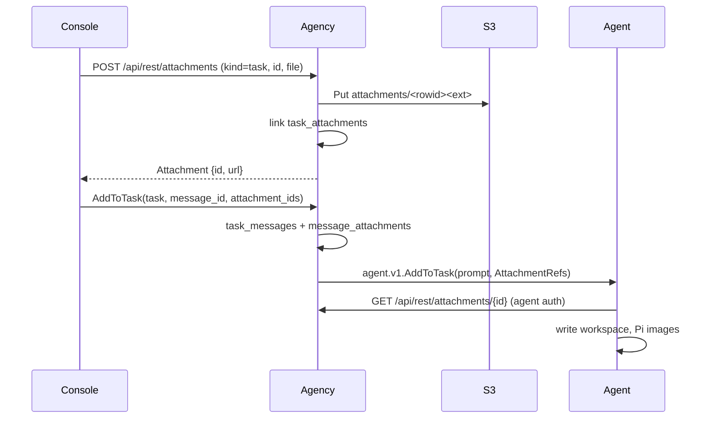
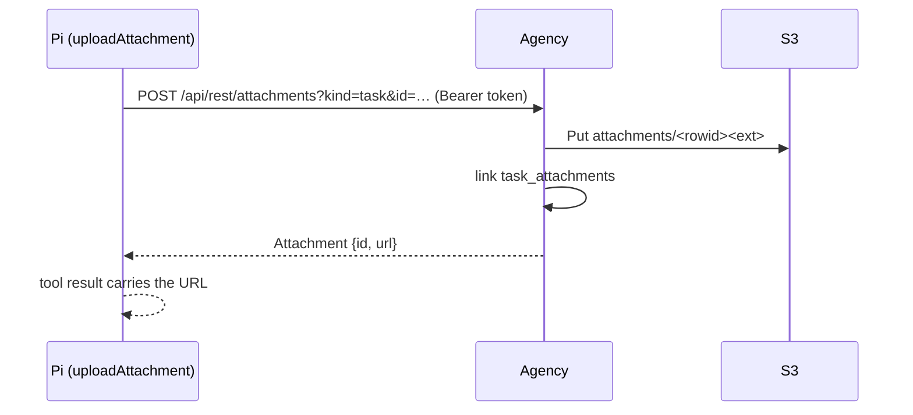

# File storage & attachments

Status: **plan of record**, not yet implemented. Terms live in
[`../VOCABULARY.md`](../VOCABULARY.md); the map is
[`ARCHITECTURE.md`](ARCHITECTURE.md); work is tracked in the
[issue tracker](https://github.com/cherrypidotdev/cherrypi/issues).

CherryPi gains a single **object-storage** back end (any S3-compatible
endpoint) behind a small agency REST surface. It carries three kinds of
user/agent-supplied bytes:

- **Task attachments** — files and images attached to a task, and the files
  the agent uploads back as artifacts.
- **Message attachments** — the files attached to one user prompt in a task's
  console (a message may carry several).
- **Pictures** — an uploadable picture for a user, an agent (replacing its
  jdenticon avatar) and for a project.

The agency is the only component that talks to S3. The browser uploads and
downloads over the agency's basic-auth surface; the agent downloads the files
for a task over a REST route (using its tunnel credential) and uploads
artifacts through a bundled Pi tool. Nothing but the agency ever sees the S3
credentials.

## Decisions (locked)

1. **Agency-proxied, single bucket.** The agency owns the S3 client and serves
   both uploads and content under its existing auth. No presigned URLs and no
   public bucket. (Presigning is a later optimization if bandwidth becomes a
   problem, see _Open items_.)
2. **S3 is configured by `CHERRYPI_S3_*` env vars**, full state in
   [_Configuration_](#configuration). With no endpoint/bucket configured the
   feature is **disabled**: upload endpoints answer `503`, and no attachment or
   picture is ever written. Nothing else in the app depends on S3.
3. **`attachments` stores storage data only.** The table is a plain blob
   registry: rowid, storage key, filename, content type, size, audit columns.
   It has **no owner columns**. Ownership is expressed by separate link
   tables, so an attachment can be linked to several places without changing
   the registry.
4. **Ownership lives in link tables.** `task_attachments` links a task to its
   files (the tray, including agent artifacts); `message_attachments` links one
   message to several attachments. A user's/agent's/project's picture is
   referenced by a `picture_attachment_id` column. Deleting a link deletes nothing in S3;
   orphaned blobs are reclaimed by GC (see _Lifecycle_).
5. **Uploads are bound to a real owner.** A task upload needs an existing task;
   a picture needs an existing agent/project; a message link is created when
   the prompt is accepted. There is no free-floating staging, so the GC has a
   small surface. The create-task form creates the task (draft) before
   accepting attachments.
6. **The agent pulls files, it is not given bytes.** `agent.v1.CreateTask` /
   `AddToTask` carry `repeated AttachmentRef` (id, filename, content type,
   size, relative URL), never the bytes. The agent fetches each one from the
   agency REST route with its tunnel credential, writes it into the task
   workspace, and hands images to Pi as `images` content. This keeps the
   tunnel RPC small and lets a re-run re-fetch.
7. **Images are content, files are paths.** An image attachment is also passed
   to Pi as base64 `ImageContent` (the model sees it) **and** written to disk;
   any other attachment is written to disk and the agent appends a
   deterministic `--- attached: … ---` trailer listing the absolute paths,
   which the console strips before rendering.
8. **Agents publish artifacts through a bundled Pi tool.** A preloaded
   extension registers `uploadAttachment(path)`: it uploads the workspace file
   to the task's attachment tray and returns the REST URL so the model can
   embed it in its message. Attachments are transient, per-message context;
   durable outputs go through `setTaskArtifacts`. The tool authenticates with
   the agent's personal access token, read from the token file on every call
   (see _Attachment upload_).
9. **Attachment URLs are browser-preauthorized.** The content route sits behind
   the agency's basic-auth realm; the same-origin SPA already holds that entry,
   so any URL the agency returns renders directly in the console with no
   per-object signing. There is no per-object ACL — every agency user can fetch
   every attachment, matching the current single-tenant model.
10. **Hard limits and safe serving.** A per-file byte cap and a per-message
    count cap are enforced server-side. A missing or generic
    (`application/octet-stream`) upload type is inferred from the filename, so
    an image uploaded by an agent still renders as an image. Content is served
    `nosniff`; scriptable types (`text/html`, `image/svg+xml`, XML) are forced
    to `Content-Disposition: attachment`. Only the safe raster image types
    (`image/png`, `image/jpeg`, `image/webp`, `image/gif`) are inline.

## Concepts

- **Attachment** — one stored object's metadata: rowid, `storage_key`,
  `filename`, `content_type`, `size`, `created_by`, `created_at`, plus a
  server-computed `url`. It knows nothing about who owns it.
- **Storage key** — the opaque S3 object name, `attachments/<id><ext>`; the
  rowid is the object identity and the original extension is preserved (see
  [_Storage keys_](#storage-keys)).
- **Task attachment** — a `task_attachments` link; shown in the task's
  attachment tray. Attachments are transient, per-message context; an agent's
  durable output belongs in the artifact set instead.
- **Message attachment** — a `message_attachments` link to one
  `task_messages` row; shown with that prompt in the console. A message may
  have several.
- **Artifact** — an A2A output the running agent published through
  `setTaskArtifacts`; it renders in the task's long-lived Artifacts tab.
- **Picture** — the single attachment referenced by a user's/agent's/project's
  `picture_attachment_id`. When absent the existing jdenticon is used.

## Data model

### Agency SQLite — new migration `agency/server/sql/sqlite/migrations/016_attachments.sql`

```sql
-- The blob registry: storage data only. `id` is the rowid and is the S3
-- object name (plus the original extension); nothing else is needed to locate
-- the bytes. Ownership is never stored here.
CREATE TABLE attachments (
  id INTEGER PRIMARY KEY AUTOINCREMENT,
  storage_key TEXT NOT NULL UNIQUE,
  filename TEXT NOT NULL,
  content_type TEXT NOT NULL DEFAULT 'application/octet-stream',
  size INTEGER NOT NULL,
  created_by TEXT NOT NULL DEFAULT '',
  created_at INTEGER NOT NULL
);

-- A task's file tray (user uploads and agent artifacts). A blob may be linked
-- once per task; the link cascades with the task.
CREATE TABLE task_attachments (
  -- Task links key on `tasks.rowid`, not the mutable `<prefix>-<seq>` id.
  task_rowid INTEGER NOT NULL REFERENCES tasks (rowid) ON DELETE CASCADE,
  attachment_id INTEGER NOT NULL REFERENCES attachments (id) ON DELETE CASCADE,
  position INTEGER NOT NULL DEFAULT 0,
  created_at INTEGER NOT NULL,
  PRIMARY KEY (task_rowid, attachment_id)
);
CREATE INDEX idx_task_attachments_attachment ON task_attachments (attachment_id);

-- The agency's ordered log of the user prompts it sent a task. `id` is the
-- client-supplied (or agency-generated) message id. The nth row lines up with
-- the nth UserMessage in Pi's history, so the console can align them.
CREATE TABLE task_messages (
  id TEXT PRIMARY KEY,
  task_rowid INTEGER NOT NULL REFERENCES tasks (rowid) ON DELETE CASCADE,
  text TEXT NOT NULL,
  created_at INTEGER NOT NULL
);
CREATE INDEX idx_task_messages_task ON task_messages (task_rowid, created_at, id);

-- A user message's files (many per message). The link is created when the
-- prompt is accepted; an attachment must already exist via the upload route.
CREATE TABLE message_attachments (
  message_id TEXT NOT NULL REFERENCES task_messages (id) ON DELETE CASCADE,
  attachment_id INTEGER NOT NULL REFERENCES attachments (id) ON DELETE CASCADE,
  position INTEGER NOT NULL DEFAULT 0,
  PRIMARY KEY (message_id, attachment_id)
);
CREATE INDEX idx_message_attachments_attachment ON message_attachments (attachment_id);

-- A project's / agent's picture is a foreign key to one attachment row, NULL
-- when it uses the jdenticon fallback.
ALTER TABLE projects ADD COLUMN picture_attachment_id INTEGER REFERENCES attachments (id) ON DELETE SET NULL;
ALTER TABLE agents   ADD COLUMN picture_attachment_id INTEGER REFERENCES attachments (id) ON DELETE SET NULL;
```

`AUTOINCREMENT` guarantees an id is never reused after a delete, so a deleted
object can never be shadowed by a new upload. The registry row is immutable;
a picture replacement is a new row plus a delete of the old one.

### Lifecycle

An attachment is **live** while any of these reference it:

- `task_attachments.attachment_id`;
- `message_attachments.attachment_id`;
- `projects.picture_attachment_id` or `agents.picture_attachment_id`.

Because the registry has no owner, deletes only remove links (FK cascades), and
a **GC pass** reclaims blobs that became unreferenced plus their S3 objects:

- after a task/project/agent delete, and after a picture replacement, run the
  pass best-effort for the affected ids;
- a periodic sweep catches the rest.

The pass deletes the S3 object first, then the registry row. Both are
idempotent, so a crash between them just leaves a row whose object is missing
(the next pass retries the delete).

`task_messages` rows are written when the agency accepts a prompt: the
scheduler records a task's first prompt when it starts (linking every tray
file that is not yet on a message), and `AddToTask` records each follow-up with
the `attachment_ids` it carries. If an upload happens but the prompt is never
sent, the attachment stays a task attachment — a message link only exists for
messages that were sent.

## Configuration

Read in `cmd/agency/appcontext/config.go`, following the existing `Config`
pattern:

| Env var | Required | Default | Meaning |
| --- | --- | --- | --- |
| `CHERRYPI_S3_ENDPOINT` | to enable | — | S3 endpoint URL, e.g. `https://s3.us-east-1.amazonaws.com` or a MinIO URL. |
| `CHERRYPI_S3_BUCKET` | to enable | — | Bucket name. |
| `CHERRYPI_S3_REGION` | no | `us-east-1` | Signing region. |
| `CHERRYPI_S3_ACCESS_KEY_ID` | no | AWS default chain | Static access key; empty falls back to the SDK's default credential chain (IAM role, env, shared config). |
| `CHERRYPI_S3_SECRET_ACCESS_KEY` | no | AWS default chain | Static secret. |
| `CHERRYPI_S3_FORCE_PATH_STYLE` | no | `false` | `true` for MinIO and most non-AWS endpoints. |
| `CHERRYPI_S3_KEY_PREFIX` | no | empty | Prefix prepended to every key, so one bucket can host several agencies. |
| `CHERRYPI_ATTACHMENT_MAX_BYTES` | no | `26214400` (25 MiB) | Per-file upload cap. |
| `CHERRYPI_ATTACHMENT_MAX_PER_MESSAGE` | no | `10` | Attachments allowed per message/send. |

`Storage.Enabled()` is true only when both endpoint and bucket are set. The
compose file gains a MinIO service and these variables for single-box DX; the release
images read the production variables from the environment.

## Storage layer

New package `agency/server/internal/storage`, wrapping the official AWS SDK v2
(`github.com/aws/aws-sdk-go-v2/{config,credentials,service/s3}`):

```go
type Store interface {
    Enabled() bool
    // Put streams body to key. size may be -1 for an unknown length (the SDK
    // then signs a streaming payload).
    Put(ctx context.Context, key string, body io.Reader, contentType string, size int64) error
    Get(ctx context.Context, key string) (io.ReadCloser, string, error) // body, contentType
    Delete(ctx context.Context, key string) error
}
```

The client is built once at startup with `BaseEndpoint` + `UsePathStyle` when
`CHERRYPI_S3_FORCE_PATH_STYLE` is set. An interface (not the concrete client)
is what `internal/attachments` depends on, so tests use an in-memory fake and
need no network or credentials. The SDK's own retryer handles transient S3
errors; the agency adds no retry loop.

### Storage keys

The object name is derived only from the attachment row: with the optional
`CHERRYPI_S3_KEY_PREFIX` (which ends in `/` when set):

```
[<prefix>]attachments/<id><ext>
```

- `<id>` is the `attachments.id` rowid.
- `<ext>` **preserves** the original filename's extension, lowercased and
  sanitized to `[a-z0-9]{1,10}` (e.g. `report.v2.PDF` → `.pdf`). A filename
  with no usable extension falls back to the extension mapped from the content
  type (`.png`, `.pdf`, `.zip`, …), and finally to no extension. The extension
  is the only user-derived part of the key; the path and filename stem are
  never used.
- The full key is stored in `attachments.storage_key`, so a later change to
  `CHERRYPI_S3_KEY_PREFIX` never repoints or loses existing objects.

The id is known only after the row is inserted, and the extension comes from
the upload's filename, so the upload flow is **insert row → derive key →
stream the bytes to S3 → update `size`**. A failed S3 write deletes the row,
leaving no dangling metadata.

## Auth on the REST routes

`/api/rest/attachments*` accepts a user credential/session/PAT or an agent
credential/PAT (the rest of `/api/*` keeps user-only auth):

| Caller | Credential | Used for |
| --- | --- | --- |
| Browser | Session cookie or user credential/PAT | Upload, download, delete, pictures. |
| Agent (Go) | Bearer agent personal access token (legacy tunnel credential) | Download the files for a task. |
| Pi extension | Bearer agent personal access token | Upload an artifact. |

`/api/rest/attachments*` uses a combined middleware (the rest of `/api/*`
keeps user-only auth): it accepts a user session/PAT/Basic, then an agent PAT
or legacy tunnel credential. There is no artifact-token authority; the agent's
personal access token is the one credential the tunnel, the Pi tools and the
artifact upload all share.

> **Phase 1.5 update.** The per-process, task-scoped artifact token described
> in the implementation notes below was removed. The artifact tools use the
> agent's personal access token (the same one the tunnel and agent tools use),
> read from `$CHERRYPI_DIR/agent.token` on every call.

## Protocol

### New `agency/v1/attachments.proto`

The message is the only addition: uploads, downloads, and deletes are byte
streams and live on the REST routes below (Connect-Web cannot client-stream a
request body, and `` cannot speak Connect). There is no
`AttachmentService`.

```proto
// Attachment is one stored blob's metadata. `url` is the agency-proxied
// content route; the browser fetches it with its existing basic auth.
message Attachment {
  int64 id = 1;
  string filename = 2;
  string content_type = 3;
  int64 size = 4;
  string url = 5;
  google.protobuf.Timestamp created_at = 6;
  string created_by = 7;
}
```

### Additions to existing agency protos

- `Task.attachments` — `repeated Attachment`, the task's tray
  (`task_attachments`), ordered by position. Enriched on `GetTask` only;
  `ListTasks` leaves it empty so a table render never loads attachment rows.
- `Task.messages` — `repeated TaskMessage`, the agency's prompt log
  (`task_messages`), oldest-first, `GetTask` only. This replaces a separate
  "get task prompts" RPC.

  ```proto
  message TaskMessage {
    string id = 1;      // the message id
    string text = 2;
    google.protobuf.Timestamp created_at = 3;
    // The message's attachments (message_attachments), in order.
    repeated Attachment attachments = 4;
  }
  ```

- `Project.picture` / `Agent.picture` — `Attachment` (unset when none), backed
  by `projects.picture_attachment_id` / `actors.picture_attachment_id`. The
  user directory returns the same shape for `User.picture`.
- `agency.v1.AddToTaskRequest` gains `repeated int64 attachment_ids` and an
  optional `string message_id`; `AddToTaskResponse` echoes the message id. The
  initial prompt's files are the task's tray, recorded as the first message by
  the scheduler when the task starts (see _Lifecycle_). `CreateTaskRequest`
  needs no attachment fields: the create form makes the draft, uploads against
  it, then queues.
- `agency.v1.UpdateProjectRequest` / `UpdateAgentRequest` gain no picture
  field: the picture is owned by the REST upload/delete routes.

### `agent/v1` task delivery

```proto
// AttachmentRef names one agency attachment for the agent to pull. The URL is
// the agency-relative content route; the agent joins it with its configured
// agency URL and authenticates with its tunnel credential.
message AttachmentRef {
  int64 id = 1;
  string filename = 2;
  string content_type = 3;
  int64 size = 4;
  string url = 5;
}
```

`CreateTaskRequest` and `AddToTaskRequest` gain
`repeated AttachmentRef attachments`. The agent:

1. `GET`s each `url` (basic auth with its tunnel credential) into
   `<workspace>/attachments/<filename>` (de-duplicating a name collision with a
   numeric suffix), bounded by the byte cap; a failed download fails the run
   before Pi is prompted.
2. For each image, base64-encodes the bytes it just wrote and adds
   `{type: image, data: …, mimeType: content_type}` to Pi's `images`.
3. Appends a trailer to the prompt text, one markdown link per file carrying
   the agency attachment id and the local path:
   `<user text>\n\n--- attached: [mockup.png (#7)](/…/attachments/mockup.png), … ---`.

The trailer is **self-describing**: the id lets the console resolve the exact
files a message carried. `parseAttachmentTrailer` splits the visible text from
the ids, `TaskConsole` looks them up in `Task.attachments`, and renders an
`AttachmentChips` row under that user bubble. This keeps the model aware of the
on-disk paths, hides the raw note, and pins the right chips to the right
message without fragile history alignment. (Ceiling: the note is still part of
Pi's persisted user message; the upgrade path is a tiny Pi extension or an
`attachments` context entry — see _Open items_.)

### Attachment upload (bundled Pi extension)

A new embedded extension (`extension_assets/upload_attachment.ts`, loaded the
same way as `set_task_urls.ts`) registers the tool:

```
uploadAttachment(path) -> { url, attachment_id }
```

- `path` is a file inside the task workspace (absolute or relative to the
  workspace cwd). The tool refuses paths outside it.
- The tool `POST`s the file to `POST /api/rest/attachments?kind=task&id=<task
id>` with `Authorization: Bearer <agent personal access token>`, reads the
  returned `Attachment`, and returns a short text containing the **URL** so the
  model can embed it in its message, e.g. ``.
- The agency links the blob to the task (`task_attachments`) and returns the
  `Attachment` JSON. Because the URL is browser-preauthorized, the console's
  markdown renderer (`MarkdownText.vue`, `html: false`, images enabled) shows
  the image with no extra work.

The agent injects `CHERRYPI_AGENCY_URL`, `CHERRYPI_TASK_ID`, and the path to
its personal access token (`CHERRYPI_AGENT_TOKEN_FILE`) into the Pi child
environment. The token itself is not placed in the environment.

#### Token

The agent's personal access token is a long-lived, rotatable actor credential
(see [`auth.md`](auth.md#phase-15-implementation-notes)). It grants the agent's
full permissions, so the artifact tool needs no narrower token. The agent
mints one through `AgentService` (or bootstraps it once with the legacy tunnel
credential) and caches it at `$CHERRYPI_DIR/agent.token` (0600); the tools read
the file on every call, so a rotation reaches a running Pi without a respawn.

## HTTP routes (agency)

Registered in `cmd/agency/main.go`:

| Route | Auth | Purpose |
| --- | --- | --- |
| `POST /api/rest/attachments?kind=task\|agent_picture\|project_picture\|user_picture&id=<owner>` | user session/PAT/Basic, or agent PAT/credential (`user_picture` is user-only) | Streaming multipart upload of **one** file per request; `file` part supplies filename/content type. Inserts the blob and its link (tray row, or sets the picture column, replacing and GC-ing the old picture). Returns the `Attachment` as protojson. |
| `GET /api/rest/attachments/{id}` | user or agent | Streams the object with its content type; `inline` for safe image types, `attachment` otherwise; `Cache-Control: private, max-age=…`; `X-Content-Type-Options: nosniff`. |
| `DELETE /api/rest/attachments/{id}` | user | Deletes every link and the blob (and object). Clearing a current picture also resets the owner's column. |

The upload handler uses `r.MultipartReader` and streams the `file` part straight
into `Store.Put` (via a bounded temp file when the reader is not seekable), so
the bytes are never held in memory whole. `http.MaxBytesReader` bounds the
request before the first byte reaches S3. One file per request keeps the flow
simple; the client loops for multi-file selections.

`GET` participates in the browser's cached basic-auth entry, so
`">` works with no extra headers.

## Flows

### Attach files to a message



The initial task prompt follows the same path with `CreateTask`: the agency
passes the tray's `AttachmentRef`s when the scheduler starts the task. The
files were uploaded against the (draft) task id, so they are already linked.

### Upload an attachment from a run



The model then writes `` (or links it) in its response; the console
renders it because the browser is already authorized.

### Set a user/agent/project picture

Upload (`kind=agent_picture`, `id=<agentId>`; or `kind=user_picture`,
`id=<actorId>`) inserts the blob, sets the owner's `picture_attachment_id`, and
GCs the previous picture in the same request. A user may only set their own
picture; administrators may set anyone's. The console shows the returned `url`
immediately. `DELETE /api/rest/attachments/{id}` clears the picture and the UI
falls back to the jdenticon. Uploading a picture is atomic: no candidate row
can be orphaned.

## Frontend

- **`lib/attachments.ts`** — `isImageAttachment`, `formatFileSize`, and
  `stripAttachmentTrailer` (hides the agent's `--- attached: … ---` path note
  from a rendered user message).
- **Components** (`components/attachments/`): `AttachmentList` (image
  thumbnails / download links, optional remove), `AttachmentUploadButton`
  (multi-file picker that uploads against a task, agent, or project), and
  `PictureUpload` (current picture or jdenticon fallback, with replace/remove).
  They share `composables/useAttachmentUpload`, which owns the upload loop,
  the busy flag, and the error toast.
- **Task detail** (`TaskView.vue`): an **Attachments** tray in the details
  drawer lists the task's files and removes them; its upload button is offered
  only before the task starts (a draft/queued tray is delivered by the
  scheduler) — once started, files go through the message composer, which
  stages them as chips, sends them as `attachmentIds`, and clears them. The
  composer also accepts files pasted from the clipboard (an image or files) or
  dropped anywhere on the console, with a drop overlay while a drag is over it;
  both paths upload through the same composable and stage next to the prompt.
  `TaskConsole`
  parses each user message's linked trailer, strips it, and renders the
  message's attachments as inline `AttachmentChips` (image thumbnail or file
  link) under the bubble.
- **Draft prompt** (`TaskPrompt.vue`): the prompt renders full width as
  Markdown with the task's tray shown as removable chips. Editing opens a
  Write/Preview toggle — Write is a plain Markdown textarea that accepts
  pasted, dropped, or picked files (uploaded to the task tray through the same
  composable), Preview renders the draft exactly as the prompt box does, and
  Ctrl/Cmd+Enter saves while a bare Enter inserts a newline.
- **Agent settings → General** and **Project settings → General**:
  `PictureUpload` bound to the agent/project.
- **Avatars**: `AgentHeader`, the agent list, the project header, and the
  projects nav render `picture.url` when present, falling back to `toSvg`.

Component tests cover the tray's image/file rendering and remove, the upload
button's success/failure, the shared upload composable's owner binding and
partial failure, the composer's paste/drop staging, and the draft prompt's
Write/Preview toggle, Ctrl+Enter save, and paste/drop tray staging.

## SDK (`@cherrypi/sdk`)

`AgencyClient` gains:

- `uploadAttachment(input: { file: Blob; filename?: string; taskId?: string;
projectId?: string; agentId?: string }): Promise<Attachment>` — wraps the
  streaming multipart route (the one place the SDK uses `fetch` instead of
  Connect; documented as such, mirroring the SDK-wrapped WebSockets). Picture
  uploads pass `agentId`/`projectId`; a successful upload has already set the
  picture.
- `deleteAttachment(id)`.
- `addToTask` gains an `AddToTaskOptions` with `attachmentIds` and
  `messageId`, and returns the message id.

`Attachment`, `TaskMessage`, `Task.attachments`, `Task.messages`,
`Project.picture`, and `Agent.picture` come from the regenerated protobuf-ES
stubs, so the frontend gets them for free.

## Security & limits

- Content is only reachable through the authenticated agency; there is no
  public URL and no unsigned redirect.
- **Browser-preauthorized**: attachment URLs need no signature because the
  browser's basic-auth entry authorizes every same-origin request. This is fine
  for the current single-tenant model, where every user sees everything; a
  per-object ACL would be needed before multi-user auth (see the `Multi-user
dashboard auth` backlog issue).
- `nosniff` always; `text/html`, `image/svg+xml`, and XML-ish types are always
  `Content-Disposition: attachment` so a stored upload cannot run script on
  the agency origin.
- Uploads are capped by `CHERRYPI_ATTACHMENT_MAX_BYTES` and per-message count;
  `http.MaxBytesReader` bounds the body so an oversized upload fails fast
  rather than buffering.
- Filenames are sanitized (`filepath.Base`, control characters stripped) before
  being stored or written into a workspace; the storage key's only
  user-derived part is the sanitized extension.
- S3 credentials are only in the agency process. The agent holds its personal
  access token (and, during the migration, its tunnel credential); the browser
  holds only its session or user credential.
- The artifact tool refuses paths outside the task workspace and re-checks the
  byte cap server-side.

## Phasing

1. **Config + storage** — `CHERRYPI_S3_*` config, `internal/storage`, compose
   MinIO service, docs. No user-visible change; the store reports disabled
   without config.
2. **Blob registry + REST** — migration, sqlc queries, `internal/attachments`,
   streaming REST upload/download/delete with the combined user/agent auth, the
   `attachments.proto` `Attachment` message, `task_attachments`, GC.
3. **Messages + task UI** — `task_messages`/`message_attachments`,
   `Task.messages`/`Task.attachments`, SDK methods/inputs, picker/chips/tray
   components, console + draft prompt wiring.
4. **Agent pull** — `agent.v1.AttachmentRef` on CreateTask/AddToTask, agent
   REST download, workspace writes, Pi images, prompt trailer, console
   stripping; agent tests with the mock Pi.
5. **Attachment upload** — `upload_attachment.ts`, the per-task Pi env and
   console rendering of artifact URLs (now using the agent's personal access
   token).
6. **Pictures** — `picture_attachment_id` columns, `Project.picture`/
   `Agent.picture`, picture upload/clear, agent + project settings UI,
   sidebar/header/list fallbacks.

Each phase keeps `make test`, `make format_check`, and `vue-tsc` green.

## Docs & vocabulary

- `VOCABULARY.md`: **Attachment**, **Artifact**, **Picture**.
- `docs/ARCHITECTURE.md`: the storage subsystem, the four attachment tables,
  the agency-proxied routes and their three credentials, and the "S3 is
  agency-only" security note.
- `compose.yaml`: the `CHERRYPI_S3_*` variables and a MinIO dev service.

## Implementation notes

Shipped across six commits (config + storage, blob registry + REST, message
log, agent pull, artifact tool, pictures). A few points differ from the plan:

- Task links key on `tasks.rowid` (`task_attachments.task_rowid`,
  `task_messages.task_rowid`), matching the repo's existing convention; a
  project prefix change never touches them.
- The initial prompt is recorded when the task **starts**, not at creation, so
  a draft's tray uploads link to the first message without extra state; a
  follow-up is recorded at `AddToTask`. There is no `CreateTaskRequest.
attachment_ids` — the create form makes the draft first.
- The artifact tools use the agent's personal access token (read from
  `$CHERRYPI_DIR/agent.token`) and the agency URL and task id injected into the
  Pi child environment; the earlier per-spawn artifact token was removed in
  phase 1.5.
- Per-message attachment chips render inline under each replayed user message
  (from the trailer's ids), live in the composer, and in the task tray.
- Foreign keys are off in this store, so link cleanup on task/attachment delete
  is explicit (the plan's cascades are illustrative).

## Open items

- **Presigned downloads** if agency bandwidth becomes the bottleneck; the
  storage interface already isolates the URL construction.
- **Very large task attachments** — the browser→agency upload streams, but the
  agent downloads over plain REST; a ranged/resumable download would help very
  large files.
- **Per-object ACLs** before multi-user auth, so an attachment URL is not
  readable by every agency user.
- **Artifact credential hardening** — the artifact tools share the agent's
  full-permission personal access token; a narrower or single-use token could
  be revisited if a deployment needs it.
- **Extension↔agent IPC**: the artifact tool talks to the agency directly with
  the agent's token; a local agent socket could keep even the token out of the
  Pi process if that ever matters.
- **Attachment trailer** — the linked-trailer workaround ships (ids render
  inline chips); the remaining cosmetic step is to carry the paths outside the
  message text (a Pi extension or context entry) so the persisted user message
  stays exactly what the user typed and replay needs no stripping.
- **Rich previews** (PDF thumbnails, image lightbox) after the basics land.
