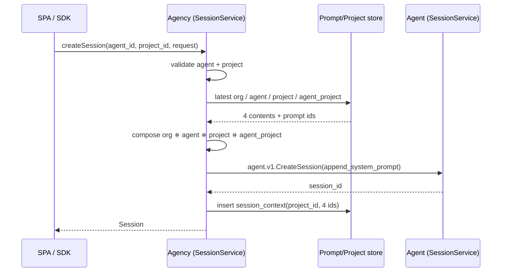

# Projects & prompts

Status: **plan of record**, not yet implemented. Supersedes
[`projects.draft.md`](projects.draft.md). Terms live in
[`../VOCABULARY.md`](../VOCABULARY.md); the map is
[`ARCHITECTURE.md`](ARCHITECTURE.md); work is tracked in the
[issue tracker](https://github.com/cherrypidotdev/cherrypi/issues).

A **project** is an agency-level grouping of [sessions](../VOCABULARY.md#session)
that carries a **project prompt**. The agency gains six versioned **prompt
scopes** — organization, project, team, team-project, agent, and agent-project
— injected into a Pi session's system prompt in that order. Sessions can be created _within_ a
project and never move between projects.

## Decisions (locked)

1. **Projects are agency-wide.** A project is not owned by an agent; sessions
   on any agent can belong to any project. The agent-project prompt is a
   per-agent override for a shared project.
2. **The session→project link lives in the agency.** Agents stay
   project-agnostic (`agent.v1` knows nothing about projects or prompt
   scopes); the agency records the link and enriches its session responses.
3. **A project's slug is immutable.** It is derived once at creation and is
   the project's stable route handle (`/projects/:slug`); name and description
   stay editable.
4. **Projects are archivable.** Archiving a project archives all its sessions
   (best-effort fan-out over the tunnel). Un-archiving the project clears only
   the project's flag — it does **not** unarchive its sessions.
5. **Deleting a project requires every one of its sessions to be deleted
   first.** While any session (archived or not) is still associated, deletion
   fails with `FailedPrecondition`.
6. **Projects get a dedicated `/projects` section** (nav entry, agency-sidebar
   list, and a project detail page), not a Settings tab.
7. **Prompts are append-only and versioned.** Every write inserts a new
   version; the UI always shows the latest. A session pins the exact versions
   it used and is never affected by later edits.
8. **The agency composes the system prompt** and passes one opaque string to
   the agent, which appends it to Pi's system prompt. The draft's order
   (`org → agent → project → agent-project`) is enforced in one place.
9. **Membership gates sessions.** A project has member agents; only a member
   agent can create a session in it. Removing (or leaving) a project deletes
   that agent's sessions there — deletion, never archive — after an explicit
   confirmation.
10. **Agent and project navigation.** Agent pages are keyed by the agent's
    immutable `username` (`/agents/:username`), with Overview, Usage,
    Terminals, RDP, and Settings tabs. Project detail is
    `/projects/:slug` with Overview, Usage, and Settings tabs. The project
    Danger zone archives (never hard-deletes) from the UI.

## Concepts

- **Project** — `id`, `name`, `slug`, `description`, a jdenticon logo seeded
  from the id, and a prompt. Sessions belong to at most one project; a session
  without one is an **orphan**.
- **Prompt scope** — one of `org` (agency settings), `agent` (agent settings
  and agent creation), `project` (project settings), `agent_project` (per
  agent × project, edited in agent settings).
- **Session context** — the agency-side row binding a session to its project
  (nullable) and to the four prompt versions it was created with.

## Data model

### Agency SQLite — new migration `agency/server/sql/sqlite/migrations/002_projects.sql`

```sql
CREATE TABLE projects (
  id TEXT PRIMARY KEY,
  name TEXT NOT NULL,
  slug TEXT NOT NULL UNIQUE,
  description TEXT NOT NULL DEFAULT '',
  -- Set when the project is archived; clears on un-archive. Archiving also
  -- archives the project's sessions (see ProjectService.ArchiveProject).
  archived_at INTEGER,
  created_at INTEGER NOT NULL,
  updated_at INTEGER NOT NULL
);

-- Append-only prompt history. `version` increments per (scope, agent, project)
-- key; the latest version is the live prompt. Org rows have NULL owners.
CREATE TABLE prompts (
  id INTEGER PRIMARY KEY,
  scope TEXT NOT NULL CHECK (scope IN ('org', 'agent', 'project', 'agent_project')),
  agent_id TEXT REFERENCES agents (id) ON DELETE CASCADE,
  project_id TEXT REFERENCES projects (id) ON DELETE CASCADE,
  content TEXT NOT NULL,
  version INTEGER NOT NULL,
  created_at INTEGER NOT NULL
);
CREATE INDEX idx_prompts_scope_agent_project ON prompts (scope, agent_id, project_id, version DESC);

-- One row per session created through the agency. Prompts are pinned by id so
-- edits never change an existing session; `project_id` is how the agency groups
-- sessions. Cascades with its agent; sessions deleted on the agent drop their
-- row explicitly (see SessionService.DeleteSession).
CREATE TABLE session_context (
  agent_id TEXT NOT NULL REFERENCES agents (id) ON DELETE CASCADE,
  session_id TEXT NOT NULL,
  project_id TEXT REFERENCES projects (id),
  org_prompt_id INTEGER REFERENCES prompts (id),
  agent_prompt_id INTEGER REFERENCES prompts (id),
  project_prompt_id INTEGER REFERENCES prompts (id),
  agent_project_prompt_id INTEGER REFERENCES prompts (id),
  created_at INTEGER NOT NULL,
  PRIMARY KEY (agent_id, session_id)
);
CREATE INDEX idx_session_context_project ON session_context (project_id);
```

Nullable `project_id` on `session_context` (no `ON DELETE` action) plus the
delete guard means the column is never exposed to a dangling project.

### Agent SQLite — new migration `agent/sql/migrations/009_session_system_prompt.sql`

```sql
ALTER TABLE sessions ADD COLUMN append_system_prompt TEXT NOT NULL DEFAULT '';
```

The composed prompt is persisted with the session so a reaped/resumed Pi
process (and `RetrySession`) reapplies exactly the same text; agents never ask
the agency again.

## Protocol

### `agency/v1/projects.proto` (new)

```proto
service ProjectService {
  rpc ListProjects(ListProjectsRequest) returns (ListProjectsResponse);
  rpc GetProject(GetProjectRequest) returns (GetProjectResponse);
  rpc CreateProject(CreateProjectRequest) returns (CreateProjectResponse);
  // UpdateProject changes name and description; the slug is immutable.
  rpc UpdateProject(UpdateProjectRequest) returns (UpdateProjectResponse);
  // ArchiveProject archives the project and best-effort archives all of its
  // sessions over the tunnel. Agents that are offline are reported back.
  rpc ArchiveProject(ArchiveProjectRequest) returns (ArchiveProjectResponse);
  // UnarchiveProject clears the project flag only; sessions stay archived.
  rpc UnarchiveProject(UnarchiveProjectRequest) returns (UnarchiveProjectResponse);
  rpc DeleteProject(DeleteProjectRequest) returns (DeleteProjectResponse);
}

message Project {
  string id = 1;
  string name = 2;
  string slug = 3;
  string description = 4;
  google.protobuf.Timestamp created_at = 5;
  google.protobuf.Timestamp updated_at = 6;
  google.protobuf.Timestamp archived_at = 7;
}
```

`CreateProjectRequest` carries `name`, `slug`, and `description`;
`UpdateProjectRequest` carries only `name` and `description` (the slug is set
once at creation). Slugs are lower-kebab, unique, auto-suggested from the name
when omitted, and used as the detail route param (`/projects/:slug`).
`ArchiveProjectResponse` carries the updated project plus the ids of offline
agents whose sessions could not be archived.

### `agency/v1/prompts.proto` (new)

```proto
enum PromptScope {
  PROMPT_SCOPE_UNSPECIFIED = 0;
  PROMPT_SCOPE_ORG = 1;
  PROMPT_SCOPE_AGENT = 2;
  PROMPT_SCOPE_PROJECT = 3;
  PROMPT_SCOPE_AGENT_PROJECT = 4;
  // Added later: the owning teams' general and per-project prompts.
  PROMPT_SCOPE_TEAM = 6;
  PROMPT_SCOPE_TEAM_PROJECT = 7;
}

service PromptService {
  // Latest version for a scope; empty content when none was ever set.
  rpc GetPrompt(GetPromptRequest) returns (GetPromptResponse);
  // Appends a new version when the content changed; returns the new latest.
  rpc SetPrompt(SetPromptRequest) returns (SetPromptResponse);
  // Every project's latest agent-project prompt for one agent, for the agent
  // settings page (projects without a prompt appear with empty content).
  rpc ListAgentProjectPrompts(ListAgentProjectPromptsRequest)
      returns (ListAgentProjectPromptsResponse);
}

message Prompt { string content = 1; int64 version = 2; }
```

`GetPromptRequest`/`SetPromptRequest` carry `scope`, `agent_id`, `project_id`
according to the scope; the service rejects mismatched combinations with
`InvalidArgument`.

### `agent/v1/session.proto`

- `CreateSessionRequest.append_system_prompt = 9` — the composed system prompt.
- No project or scope fields; the agent treats the text as opaque.

### `agency/v1/session.proto`

- `CreateSessionRequest.project_id = 3` — the project the session is created
  in (empty = orphan). It is an agency concept and is stripped before the
  forward.
- `AgentSession.project_id = 3` — set by `ListAllSessions` so every client can
  group sessions without a second round-trip.
- `CreateAgentRequest.prompt = 4` — the initial agent prompt (optional),
  inserted as the first `agent` version at registration.

## Session creation flow



Composition joins non-empty parts with `\n\n`. A missing prompt contributes
nothing and its id stays NULL. `session_context` is inserted after the agent
returns; a failure there is logged and leaves the session ungrouped rather than
failing the create.

## Agent: Pi injection

`CreateOptions` gains `AppendSystemPrompt`; `Manager.Create` stores it in the
new column. `Session.ensureRunningLocked` appends
`--append-system-prompt <text>` after `cfg.PiArgs` whenever the stored value is
non-empty, so every spawn — first run, resume after reap, and retry — carries
the same prompt. The title generator's one-shot `pi --print` child does **not**
receive it.

## Archive & unarchive

`ArchiveProject` sets the project's `archived_at`, then groups the project's
`session_context` rows by agent and calls the worker's `ArchiveSession` for each
session on the connected agents. Agents whose tunnel is down cannot be reached;
they are returned in `offline_agents` (the project is still archived, and their
sessions are archived when the operator retries the archive once they are
online). Session rows are unchanged on the agency side.

`UnarchiveProject` clears only the project's flag. It deliberately does **not**
unarchive the project's sessions; each filtered out of the active list remains
archived until the operator unarchives it individually.

## Project deletion

`DeleteProject` returns `FailedPrecondition` while any `session_context` row
references the project — so every session must be **deleted** first, not merely
archived. The check is entirely agency-side, so it is deterministic even when
the owning agents are offline. `SessionService.DeleteSession` removes the
session's `session_context` row after the worker confirms deletion, which is how
sessions become eligible for removal.

## Frontend

- **Agency sidebar** (`AppShell.vue`) shows Projects, Agents, Teams, and Users
  directories (the signed-in actor's accessible projects, owned/shared-team
  agents, teams, and teammates), with the inbox, user settings, org settings for
  admins, theme switch, and app version around them.
- **Agent page** (`AgentView.vue`) holds the agent identity and tabs for
  Overview, Usage, Terminals, RDP, and Settings. Settings → Security contains
  owners, teams, credentials, activity, and runtime logs.
- **Projects** nav entry and routes: `/projects` (list + create, active and
  archived sections) and `/projects/:slug` (Overview hero + usage + composer +
  tasks, Usage, and Settings for General, Tasks, Access, and Danger zone).
- **Session create** (`SessionsView.vue`) gains an optional project picker,
  pre-selected when opened from a project page.
- **Agency settings** (`SettingsView.vue`) gains an **organization prompt**
  editor.
- **Agent settings** (`AgentSettingsView.vue`) gains the **agent prompt**
  editor and a per-project **agent-project prompt** list.
- **Agent creation** (`AgentsView.vue`) gains an optional prompt field.
- New composables `useProjects` and `usePrompts`; `useSessions` returns each
  session's `projectId` (via `listAllSessions(agentId)`), keeping the existing
  2–5 s polling.

## SDK (`@cherrypi/sdk`)

New `ProjectService`/`PromptService` clients plus `AgencyClient` methods:
`listProjects`, `getProject`, `createProject`, `updateProject`,
`deleteProject`, `getPrompt`, `setPrompt`, `listAgentProjectPrompts`.
`createSession` gains `projectId`; `listAllSessions` entries gain `projectId`;
`createAgent` gains `prompt`.

## Phasing

Each step ends buildable and green.

1. **Schema & codegen** — agency migration `002`, queries (`projects.sql`,
   `prompts.sql`, `session_context.sql`), `sqlc generate`; agent migration
   `009` + queries; `buf generate` after the proto additions.
2. **Agency services** — `projects` and `prompts` packages over the store;
   `ProjectService` and `PromptService` handlers; wire into `appcontext` and
   `grpc.go`.
3. **Session context & injection** — extend `SessionServer.CreateSession` to
   resolve/compose/record; `AgentSession.project_id` enrichment in
   `ListAllSessions`; context cleanup in `DeleteSession`; agent
   `append_system_prompt` plumbing and Pi flag.
4. **SDK** — regenerate stubs, add methods and types, update
   `agency/sdk/js/README.md`.
5. **Frontend** — composables, routes, project pages, sidebar grouping, prompt
   editors, session/agent form fields.
6. **Docs & tests** — `VOCABULARY.md` (Project, Prompt, orphan), `ARCHITECTURE.md`
   (data model, session lifecycle), the issue-tracker check-off; agent test
   asserting `--append-system-prompt` on spawn; agency tests for composition
   order, prompt versioning, and the delete guard; frontend vitest for grouping.

## Membership & navigation (follow-up)

> **Superseded by auth phase 5.** Project access is now role-based (owner /
> member / viewer) over `project_actor_memberships` and
> `project_team_memberships`; `project_agents` was migrated into direct grants
> and dropped. See [`auth.md`](auth.md#phase-5-implementation-notes).

- `project_agents(project_id, agent_id)` is the membership join; new agents
  start with none, and existing `session_context` rows are backfilled into it.
- `ProjectService` gains `ListProjectAgents` (members with session counts),
  `ListAgentProjects`, `AddProjectAgent`, and `RemoveProjectAgent`. Removal
  deletes the agent's sessions in the project over the tunnel and then drops the
  membership, failing with `FailedPrecondition` while the agent is offline.
- `SessionService.CreateSession` rejects a non-member agent, and
  `PromptService.ListAgentProjectPrompts` only lists the agent's member
  projects.
- Frontend: agent routes are keyed by `:username` and expose Overview, Usage,
  Terminals, RDP, and Settings tabs. Project detail creates tasks inline; its
  Settings tab holds General (name, description, read-only slug), Tasks (prefix,
  prompt, tags), Access (teams and direct grants), and Danger zone (archive).

## Open items

- Whether `agent_project` prompts should be seeded/duplicated when a new
  project is created (plan assumes no — rows appear on first edit).
- Project logo uploads (plan: jdenticon only, matching agents).
