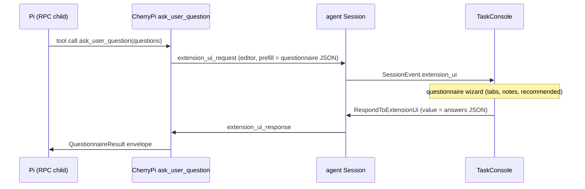

# Questionnaire in the web session console

CherryPi ships its own `ask_user_question` Pi extension (bundled with the agent)
and renders it as a tabbed wizard in the web session console: every question is
visible up front, the user moves freely between tabs, and all answers — plus an
optional note each — are committed together. In-progress answers are drafted in
`sessionStorage`, a one-choice answer advances to the next unanswered question,
and the finished questionnaire stays in the transcript as a read-only review.

Status: **shipped** as a bundled Pi extension plus a frontend wizard. The
earlier frontend-only experiment that drove the stock extension's sequential
dialogs is kept at the bottom as history.

## What the extension provides

`agent/internal/session/extension_assets/ask_user_question.ts` registers the
`ask_user_question` tool with a schema richer than the upstream extension's:

| Feature | Detail |
| --- | --- |
| Questions per call | 1–10 (all shown at once) |
| Options per question | 2–4, plus an always-appended `Type something.` custom row |
| `recommended` | Optional per option; the wizard highlights it |
| Notes | One free-form note per answer, including custom answers |
| HTML | Question text is raw HTML/Markdown, sanitized and rendered |
| Answer required | Selecting the custom row counts even with empty text |

The agent installs the bundled extensions into `$CHERRYPI_DIR/extensions` and
loads them with `pi --extension`. Pi keeps the **first registration per tool
name**, and command-line extensions load before package extensions, so
CherryPi's `ask_user_question` takes precedence over any question tool another
extension may register. CherryPi images do not install a question extension,
and the tool description says so.

## RPC transport: one dialog, one notification

Pi's RPC extension-UI sub-protocol only exposes `select`, `confirm`, `input`,
and `editor` (all string/boolean). The extension therefore encodes the whole
questionnaire into a single `editor` request:

- `title` is a human summary (`CherryPi questionnaire (3 questions)`) that the
  inbox notification and webhook show.
- `prefill` is the questionnaire JSON: `{ "kind": "cherrypi.questionnaire",
"questions": [...] }`.
- The answer is one JSON `value`: `{ "answers": [{ "index", "options"?,
"custom"?, "notes"? }] }`.

Because the whole set travels in one dialog, the session goes `waiting_for_input`
once, so the inbox and the `user_input_requested` webhook fire **once** and the
webhook payload carries every question (the agent parses the prefill marker).

- Console: [`QuestionnaireWizard.vue`](../agency/frontend/src/components/tasks/QuestionnaireWizard.vue)
  renders the tabs and [`QuestionEditor.vue`](../agency/frontend/src/components/tasks/QuestionEditor.vue)
  renders one question (options, recommended badge, custom input, note).
  [`TaskConsole.vue`](../agency/frontend/src/components/tasks/TaskConsole.vue)
  rebuilds the questionnaire from the `ask_user_question` tool call (live and in
  history), routes the single batch dialog to the wizard, and answers it once
  with every answer. Because Pi persists no extension-UI records, the agent
  replays the unanswered pending dialog from the session row whenever a watcher
  subscribes — so the wizard survives a reload. Non-questionnaire dialogs still
  use [`ExtensionUiPrompt.vue`](../agency/frontend/src/components/tasks/ExtensionUiPrompt.vue).
- Agent: [`session.go`](../agent/internal/session/session.go) forwards the
  dialog, persists it while waiting, and enriches the webhook payload with the
  parsed questions.
- Terminal Pi: the extension falls back to a sequential `select`/`input` walker
  (with a note prompt) when `ctx.mode !== "rpc"`. CherryPi always runs
  `pi --mode rpc`, so the walker is only for plain `pi` usage.

A reload or reconnect re-renders the wizard from the replayed tool call plus the
pending-dialog replay. The wizard drafts every edit in `sessionStorage` (keyed
by task + questionnaire call), so a reload restores the answers instead of
asking the user to re-answer; the draft is dropped once the answers are handed
to the agent.

## Wizard behavior

- **Drafts.** `QuestionnaireWizard.vue` persists the current answers under
  `cherrypi.questionnaire.draft.<task>:<callId>` and restores them on mount. A
  new questionnaire has a new call id, so it never inherits an old draft; the
  draft is removed when the answers are submitted and the durable transcript
  takes over.
- **Auto-advance.** Picking an option on a one-choice question selects it and
  jumps to the next unanswered question (wrapping around). Changing an existing
  answer stays put, a multi-select question keeps collecting ticks, and picking
  `Type something.` never advances because it needs typing.
- **Review.** The bundled extension returns the answers in the tool result's
  `details` (`{ answers, cancelled }`). `TaskEvent.ToolExecution.details_json`
  carries that field through the live stream and through history replay, so a
  finished questionnaire renders at the tool call's place in the transcript by
  reusing [`QuestionnaireWizard.vue`](../agency/frontend/src/components/tasks/QuestionnaireWizard.vue)
  in `readonly` mode: the same tabs and option rows, chosen options highlighted,
  custom answers and notes shown as text, no `Decline`/`Submit` footer and no
  inputs, while the tabs stay navigable. Both the agency's canonical history
  parser and the agent's Pi-session fallback keep the field; the questionnaire's
  `ask_user_question` call is lifted out of the collapsed activity group so it is
  never hidden.

## Earlier analysis (historical)

The first attempt rendered the wizard purely in the console and drove the stock
`@juicesharp/rpiv-ask-user-question` extension's sequential dialogs
(`rpc-fallback.ts`), re-encoding each answer as `"N. Label — description"`, the
`"Type something."` sentinel, and `"1,3"` for multi-select. That worked but
could not support notes, a `recommended` flag, HTML question text, more than
four questions, a single inbox notification, or a webhook carrying the whole
question set — hence the bundled extension.

### Why the stock transport alone cannot do it

Three independent limits, all verified against the pinned Pi **0.99.1**:

1. Pi's RPC extension-UI sub-protocol exposes only `select`, `confirm`,
   `input`, `editor` (blocking) plus fire-and-forget methods
   (`notify`/`setStatus`/`setWidget`/`setTitle`/`set_editor_text`).
2. `ui.custom()` **returns `undefined`** in RPC mode — no custom components can
   be rendered from the extension side.
3. Pi RPC has **no generic `extension_event` outbound**; extension events
   (`pi.events`) are in-process only.

The shipped extension sidesteps all three by using `editor` as a structured
transport and rendering the wizard in the host.

## References

- `agent/internal/session/extension_assets/ask_user_question.ts`
- `agent/internal/session/extensions.go` (`InstallExtensions`)
- `agent/internal/session/session.go` (`handleExtensionUI`, `questionnaireQuestions`)
- `agency/frontend/src/lib/questionnaire.ts`
- `agency/frontend/src/components/tasks/QuestionnaireWizard.vue`
- `agency/frontend/src/components/tasks/QuestionEditor.vue`
- `agency/frontend/src/components/tasks/TaskConsole.vue`
- `shared/proto/agent/v1/task.proto` (`ExtensionUiRequest`, `RespondToExtensionUi`, `ToolExecution.details_json`)
