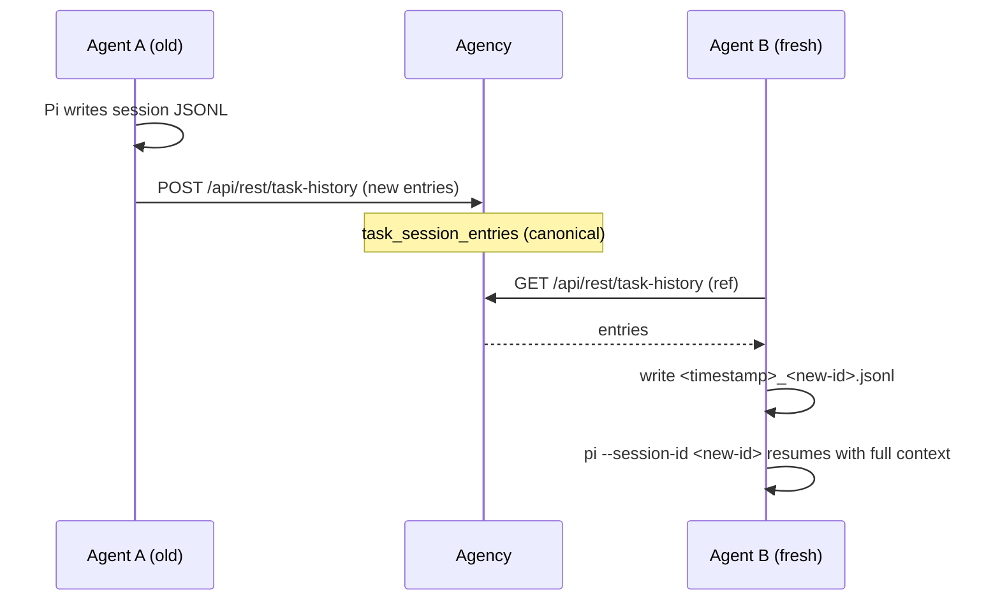
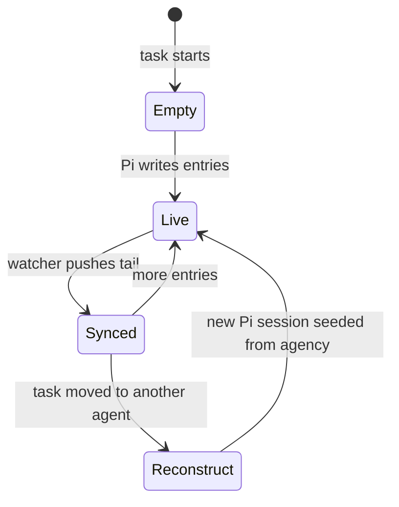

# Session history

How a [task](../VOCABULARY.md#task)'s Pi conversation survives its
[agent](../VOCABULARY.md#agent). The agency is the canonical home of the
history; an agent (and its workspace) is treated as ephemeral, so a task can be
replayed onto a fresh agent under a new Pi session id.

## Problem

Pi stores a conversation as an append-only JSONL tree on the agent's disk
(`~/.pi/agent/sessions/--<cwd>--/<timestamp>_<session-id>.jsonl`, see Pi's
[session format](https://github.com/earendil-works/pi/blob/main/packages/coding-agent/docs/session-format.md)).
Before this change the agency only knew the _id_ of that session
(`tasks.session_id`) and reached the file over the tunnel:

- `GetTaskHistory` forwarded a page request to the agent.
- `WatchTask` streamed live events from the agent.

So the conversation lived and died with one machine. A task whose agent was
replaced, recycled, or whose workspace was cleaned up lost its transcript and
could not be continued anywhere else — even though the task row, its prompt,
tags, links, and artifacts all live in the agency.

## Design

The agency keeps every non-header line of a task's Pi session in
`task_session_entries`, keyed by the agency task rather than by the agent-side
Pi session id. The agent is a cache: it tails its local Pi file and pushes new
entries, and it rebuilds that file from the agency when asked to continue on a
new machine.

### Storage

`task_session_entries` (migration `024_task_session_history.sql`):

| column | meaning |
| --- | --- |
| `task_id` | the agency task the entry belongs to |
| `seq` | the agency's 1-based order; doubles as the history page cursor |
| `entry_id` | Pi's entry id, unique per task so replayed pushes are idempotent |
| `parent_id` | Pi's tree parent (the conversation is a tree, not a list) |
| `type` | Pi entry type (`message`, `model_change`, `compaction`, …) |
| `raw` | the verbatim JSONL line, replayed into a new session file |

`tasks.session_agent_id` records the agent that owns the current
`tasks.session_id`. It survives a later reassignment, so the scheduler can tell
a **same-agent resume** (reuse the warm Pi session) from a **cross-agent
continuation** (start fresh and seed from the stored history).

### Sync protocol

The agent authenticates with its personal access token (or legacy tunnel
credential) and names the task by its stable `(project_id, seq)` reference —
the same reference the agent-tool resolve route uses, so the sync survives a
project-prefix rename.

- `POST /api/rest/task-history` — `{project_id, seq, entries:[{id, parent_id,
type, raw}]}` appends entries. Duplicates are ignored (`(task_id, entry_id)` is
  unique), so a retried push after a lost response is safe.
- `GET /api/rest/task-history?project_id=&seq=` — the full ordered history;
  `&meta=1` returns only the tip id and count. A different agent than the
  assignee is rejected with `403`.

The agent runs a per-session watcher while Pi is alive (default 1s) that pushes
the entries appended since the last flush, plus a final flush when Pi exits.
Because the push is cursor-based and idempotent, a dropped flush only widens
the window the next reconcile closes.

### De-sync resolution

On every Pi spawn the agent reconciles the agency's stored tip with its local
file (and once per run before Pi starts):

- **Agency behind, fast-forward** — the agency's tip is an ancestor of the local
  tip, i.e. the agency is missing a suffix. The agent pushes the suffix and the
  merge is a fast-forward. This is what recovers pushes lost while the agency
  was unreachable or the agent was mid-crash.
- **Agency ahead / empty local** — the local file is missing (a fresh agent, or
  a cleaned-up workspace) or the agency's tip is not in the local chain
  (divergence). The agency is canonical: the agent writes a new session file
  whose header carries the current Pi session id and whose entries are the
  agency's stored lines. This is the "continue on another fresh agent" path.
- **Neither** — both sides agree; only the tail is pushed.

The reconcile is best-effort and never blocks a run: a failure leaves the local
Pi session untouched and the next tick retries.

## Pi feasibility

Pi natively supports reconstructing a session from raw entries; the agent does
not need Pi cooperation beyond `--session-id`:

- `--session-id <id>` resolves a session by reading the **header id** of every
  `.jsonl` in the session directory (`SessionManager.findById`), so the
  timestamp in the filename does not matter. If no file matches, Pi creates a
  new session with that id.
- The file format is documented and stable: a `session` header
  (`{type,version,id,timestamp,cwd}`) followed by `id`/`parentId` entries.
  `SessionManager` migrates older versions on load.
- Pi's own `SessionManager.forkFrom(sourcePath, targetCwd, sessionDir, {id})`
  implements exactly this: copy every non-header entry under a new id with a
  fresh header and `parentSession` pointing at the source. The agent's
  reconstruction writes the same shape (without a cross-machine
  `parentSession`, which would be a dead path).

A local experiment with the installed Pi confirmed that a hand-written JSONL is
discovered by `findById`, opened, and used as the LLM context, and that
`forkFrom` produces a new-id file with the copied tree.

The agency serves `GetTaskHistory` from its own store (paginated by `seq`),
falling back to the agent only for a task whose history predates the store or
has not synced yet. The console therefore renders a finished task even when its
agent is offline. The bundled `getTaskHistory` [agent tool](../VOCABULARY.md#agent-tool)
reads the same store in newest-page-first pages (`limit`, `cursor`), so a
running task can review another task's conversation without either `listTasks`
or `getTask` carrying it.

## Lifecycle

- **First run** — agency history is empty; the agent pushes as Pi writes.
- **Reassign + queue** — the scheduler sees `session_agent_id != picked agent`,
  starts a fresh agent session (composing the system prompt again), and the
  agent reconstructs the conversation from the store before spawning Pi.
- **Same-agent respawn** — `session_agent_id == picked agent` and the session
  was not cleaned up; the agent reuses its warm Pi session and fast-forwards
  any entries the agency missed.
- **Cleanup + follow-up** — the Cleanup tab deletes the agent's workspace, Pi
  JSONL, and session record, and marks `tasks.session_deleted_at`. The agency
  keeps the conversation, so the task page stays readable; the scheduler
  treats the next start as a fresh session (like a cross-agent continuation),
  and the agent reconstructs the stored history before delivering the
  follow-up. `SetTaskSession` clears the mark once the new session exists, so
  later follow-ups resume it normally.

## Migrating an existing task

A task that started before automatic sync has its history only in the agent's
Pi file. `history_migrated` is derived from the store (the task has at least
one entry), so a continuously-synced task reports migrated on its own.

The agency exposes a one-shot migration:

- `TaskService.MigrateTaskHistory` forwards `agent.v1.SyncTaskHistory` to the
  owning agent. The agent resets its sync state and reconciles immediately,
  pushing the local file even though its Pi process is reaped.
- The task page offers **Migrate storage to Agency** while the task has a
  session and is not yet migrated. Deleting such a task opens a dialog that
  offers to migrate first, or delete without migrating (losing the history).
- The Agent Settings **Cleanup** tab marks each session migrated or not.
  Cleanup deletes only the agent's workspace and Pi JSONL (plus its session
  record), keeping the agency-stored conversation and the task itself. An
  un-migrated session is migrated into the agency first; if that push fails the
  deletion is refused rather than dropping the history. The task's page keeps
  rendering the transcript and a follow-up starts a fresh Pi session that
  replays it.

Deleting a task (as opposed to cleaning up its session) removes the task, its
stored history (cascade), and — through the agent — its workspace and Pi file.

## Non-goals

- Live transcript streaming still flows agent → agency over the existing event
  stream/`WatchTask`; this change is about durability, not latency.
- The agency does not interpret the conversation beyond the console projection
  (`taskhistory.Page`). Entry `raw` stays the source of truth.
- Workspace files are not stored; only the conversation. Attachments and
  artifacts already have their own durable storage.
