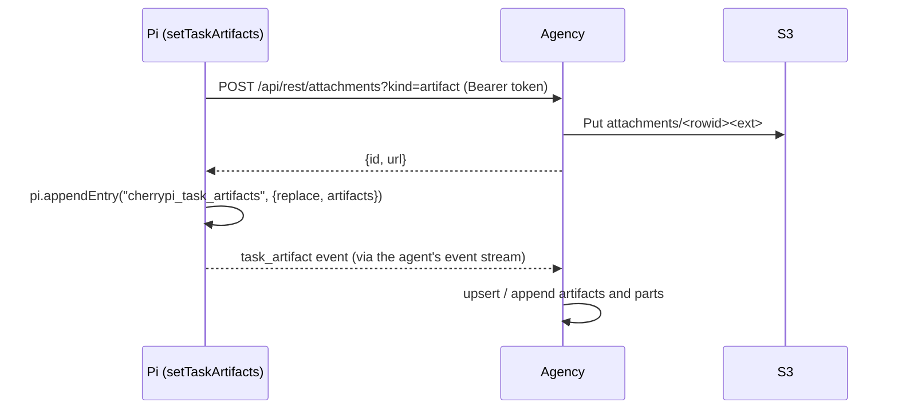

# Task artifacts (A2A)

Status: **implemented**. Terms live in
[`../VOCABULARY.md`](../VOCABULARY.md); the map is
[`ARCHITECTURE.md`](ARCHITECTURE.md).

A **task artifact** is an output an agent produces for its task — a report, a
chart, a screenshot, structured data. CherryPi follows the
[Google A2A](https://a2a-protocol.org/latest/specification/) model: an artifact
is a `Task` output, **not** a message, and the agent publishes it as an
artifact-update event. The console renders a task's artifacts in a dedicated
panel, separate from the prompt/attachment tray. Attachments (`uploadAttachment`)
are transient, per-message context; artifacts are the task's durable result.

## Mapping A2A → CherryPi

| A2A | CherryPi |
| --- | --- |
| `Artifact { artifact_id, name, description, parts[], metadata, extensions }` | `task_artifacts` row + parts; `Artifact` proto on `Task.artifacts` |
| `Part { oneof text \| raw \| url \| data }` | `ArtifactPart { oneof text \| file \| data_json }` |
| `Part.raw` / `Part.url` | a `file` part backed by an attachment (`attachment_id`) or a bare `url` |
| `Part.filename`, `Part.media_type` | `artifact_parts.filename`, `artifact_parts.media_type` |
| `TaskArtifactUpdateEvent { artifact, append, last_chunk }` | the agent's `task_artifact` event: `{ replace, artifacts[{ …, append, last_chunk }] }` |
| `Task.artifacts` | `Task.artifacts` (enriched on `GetTask` only) |

`artifact_id` is unique within the task; `position` preserves discovery order.
`streaming` is true while `last_chunk` is false.

## Storage

Agency SQLite, migration `017_task_artifacts.sql`:

- `task_artifacts` — `(task_rowid, artifact_id)` key, name, description,
  `metadata_json`, `streaming`, `position`, timestamps.
- `artifact_parts` — `(task_rowid, artifact_id)`, `position`, `kind`
  (`text`/`file`/`data`), `text`, `data_json`, `url`, `attachment_id`,
  `filename`, `media_type`, `metadata_json`.

File parts reference the `attachments` blob registry, so the bytes live in S3
like any other attachment and are served through the agency's
browser-preauthorized `/api/rest/attachments/{id}` route. The orphan GC also
treats an `artifact_parts.attachment_id` as a live reference. Task links key on
`tasks.rowid`; foreign keys are off, so task/attachment deletes clean up
artifact rows explicitly.

## Publishing flow

The bundled `setTaskArtifacts` tool takes a list of artifacts whose parts are
`file` (a workspace path, uploaded for the model), `url`, `text`, or `data`.
By default the call **replaces** the task's whole artifact set; `replace:false`
updates only the listed artifacts, and `append:true` + `lastChunk:false`
streams parts into one artifact id across calls. The agent parses the custom Pi
entry and forwards a `task_artifact` event, exactly like `setTaskUrls` forwards
`task_link`.

Artifact files are uploaded as `kind=artifact`, which stores a blob **without**
linking it to the task tray: the artifact part keeps it alive.

## UI

The task details drawer is split into **General / Artifacts / Prompts** tabs.
The Artifacts tab lists each artifact's name and description (with a
`streaming` marker), and renders its parts: images inline, other files as
download links, text as preformatted text, and structured data as pretty JSON.
TaskView polls `GetTask` every few seconds, so artifacts appear while a run is
still going.

## Open items

- **Artifact-scoped metadata/extensions** are stored but not surfaced; render
  them when a use case appears.
- **Push/refresh**: artifacts arrive on the next poll (≤3s); a dedicated
  realtime event could render them instantly.
- **Rich part previews** (PDF, CSV tables) beyond image/text/JSON.
