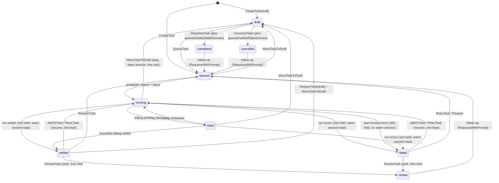
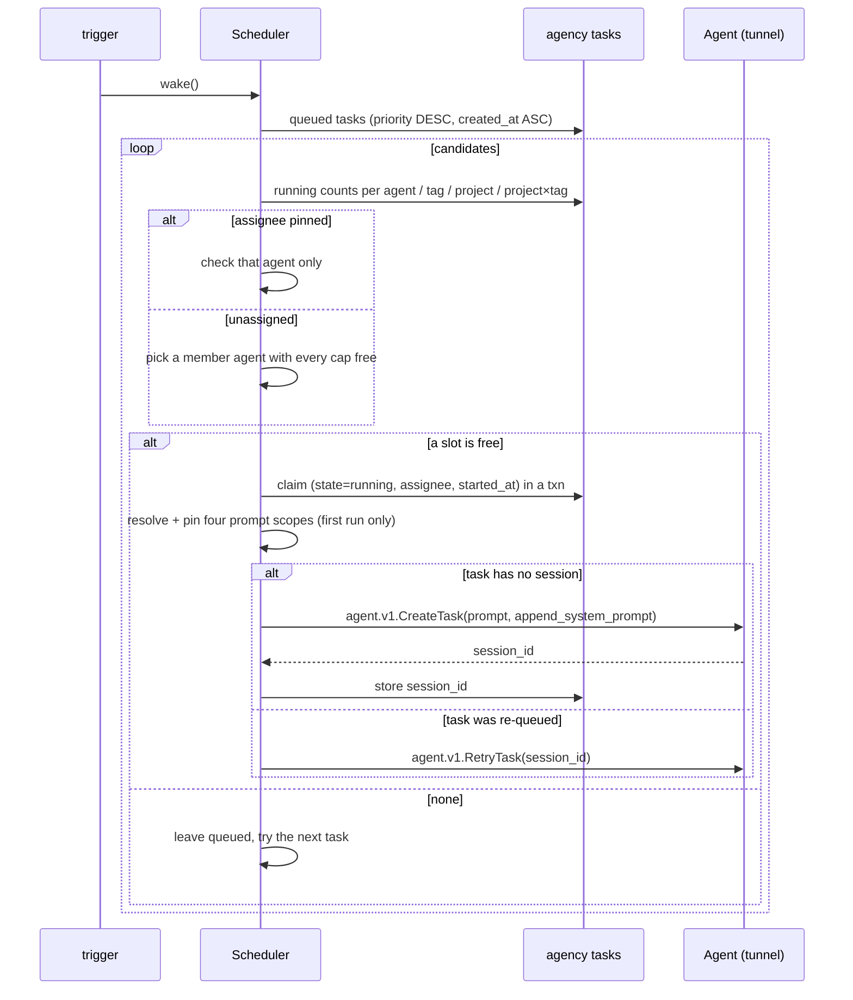

# Tasks

Status: **implemented**. Supersedes
[`tasks.draft.md`](tasks.draft.md). Terms live in
[`../VOCABULARY.md`](../VOCABULARY.md); the map is
[`ARCHITECTURE.md`](ARCHITECTURE.md); work is tracked in the
[issue tracker](https://github.com/cherrypidotdev/cherrypi/issues).

A **task** is CherryPi's unit of work. It replaces the _session_ concept
everywhere in CherryPi — the API, the database, the dashboard — while the
_Pi session_ (the `pi --mode rpc` conversation a task runs) keeps its name.
A task can be drafted, parked in backlog, queued, assigned, scheduled, settled,
and closed out; the agency schedules queued tasks onto agents subject to
per-agent concurrency caps.

> **Rework (CHPI-145).** The state machine and archive changed after the
> text below was written. See [Rework (CHPI-145)](#rework-chpi-145) at the end
> for the current model: `review` is gone, `backlog` sits between draft and
> queue, blocked is a computed flag on `queued`, references have a `kind`, and
> tasks can be archived and merged.

## Decisions (locked)

1. **`Session` becomes `Task` at the wire/DB/UI levels.** Protos
   (`agent.v1.TaskService`, `agency.v1.TaskService`), tables, the SDK, and the
   routes/labels are renamed. The agent's internal `internal/session` package
   and its `Session` type **keep their names**, because that struct wraps a Pi
   session. The word _session_ survives only for Pi's own concept
   (`pi_session_id`, Pi's session file, `--session-id`). This is a lockstep,
   wire-breaking upgrade: **no deprecated aliases**.
2. **Tasks are agency-side work items.** They absorb `session_context`: a task
   owns its prompt, project, assignee, tags, priority, and state, and is bound
   to `(agent_id, session_id)` only when it starts. Draft and queued tasks have
   no session. Agents stay project- and assignee-agnostic.
3. **Lifecycle.** `draft → queued → running → settled`, with `running →
input` while the agent waits on a dialog, `running → failed`, and a return
   to draft from `queued` or `blocked` (a live or resting task is stopped,
   re-queued, or closed out first). A task **settles automatically** when its Pi
   run finishes;
   a run blocked on an extension dialog materializes as `input`. A settled or
   failed task can be sent to `review`, and any non-running task can be closed
   out as `completed` or `cancelled`.
4. **Slots are held until freed.** A `running`, `input`, `settled`, or
   `failed` task counts against the agent's caps. Sending it to `review`,
   closing it out, or parking it as `blocked` (an added blocking reference, or
   a re-queue waiting on one) frees the slot. A settled or failed
   task keeps its warm Pi session so a follow-up prompt (or a retry) resumes it
   on the same session. The follow-up itself re-queues the task, so sending
   never waits on the agent tunnel.
5. **Four caps per agent.** An overall `total` cap (default 1), per-tag caps,
   per-project caps (default 1), and per-project-per-tag caps. A task consumes
   every cap that applies to it (total, each of its tags, its project, each
   project×tag); **all** of them must have room. A tag or project×tag with no
   explicit limit imposes no extra cap beyond `total`/project. Per-tag caps are
   keyed by tag **name** and are global across projects: one `unity-editor` cap
   gates that name in every project, so a single shared resource (a Unity
   Editor instance) limits concurrency even though each project owns its own
   tag row.
6. **Limits live agency-side**, on the agent registry (not on the agent), so
   the scheduler can gate offline agents. They are edited in agent settings.
7. **The scheduler runs in-process in the agency** (single agency instance).
   Queued tasks are drained FIFO by **priority** (manual
   low/normal/high/critical), then by creation time. An explicit assignee
   **pins** the task to that agent; only unassigned tasks are auto-assigned.
   **No auto-retry**: a `failed` task is retried by the user.
8. **Prompt/project edits are draft-only.** Only a `draft` task can change its
   prompt, project, or the rest of its create-time shape wholesale. Attributes
   change in any state through the `set_*`/tag paths — priority, size, assignee
   (not on a running or input task), and add/remove tag — so a queued task can
   be reprioritised, reassigned, or retagged without a round-trip to draft. A
   task that has an assignee also carries per-task model and thinking
   overrides: they are chosen in the create form and from the task console,
   and any actor who may prompt the task may change them. Each agent still has
   default model/thinking values in its Settings page; only the agent's owners
   (or an administrator) may change those defaults, and the scheduler applies
   them to a fresh session that does not pin its own.
9. **Prompts are pinned at first run start and never re-pinned.** Draft/queued
   tasks hold no pins; re-queuing a task and then returning it to draft reuses
   the pins from the first run.
10. **Any task is deletable from any state.** Deleting stops the run (if any),
    removes the agent-side Pi session and workspace, and deletes the agency
    task. Usage history survives, as it does today.
11. **Review, then close out.** A settled or failed task can be sent to
    `review`, a slot-free parked state (light blue) for human review. From any
    resting state (`settled`, `failed`, `review`, `completed`, or `cancelled`),
    a follow-up prompt re-queues the task (the scheduler stashes the prompt and
    resumes the warm session once a slot is free). Closing out a non-running
    task as `completed` (default) or
    `cancelled` (default when `failed`) is a **modal**; the task stays in the
    active lists under that state. There is no task archive. Archiving a
    project still hides its tasks without changing their states.
12. **Backfill.** Pre-existing sessions and `session_context` rows become
    `settled` tasks (slot-free). The pre-settled `completed` state migrates to
    `settled`. Sessions the agency discovers without a task row materialize
    lazily as settled tasks when their agent is reachable.
13. **UI.** Index: a flat table with state tabs (All, Draft, Blocked, Queued,
    Failed, Running, Input, Settled, Review, Completed, Cancelled; each shows
    its count) on their own row, and a full-width search/filter row beneath
    them. Detail: a one-row header (title, clickable project, status,
    priority) plus a details drawer (task id, usage, assignee, tags, created,
    actions). Selecting rows opens a bulk bar pinned to the top of the scroll
    area: the active tab's state moves plus priority, size, assignee, and —
    when the selection shares one project — add/remove tags. An attribute
    change keeps the selection so several can be applied in a row; a state
    move only drops the rows that leave the active tab. Create: a single card
    form. Agent limits: a
    **Concurrency** tab. Tags: a per-project table with a description field,
    under each project's settings. The Tasks UI matches the demo's visual
    language (see _Frontend_).

## Concepts

- **Task** — the work item. `id`, `prompt`, `name`, `project`, `assignee`,
  `priority`, `state`, tags, and (once started) the owning agent + Pi session
  and pinned prompt versions. A task is always created within a project; only
  legacy rows without one are **orphans**. `name` is the hard-set title, shown
  bold; when it is empty the UI renders the prompt's first line in italic and
  dimmed as a temporary title, replaced once an auto-title or a manual rename
  arrives.
- **Task state** — one of `draft`, `blocked`, `queued`, `running`, `input`,
  `settled`, `failed`, `review`, `completed`, `cancelled`. `input` is the
  materialized extension-dialog wait (cyan); `review` parks a done-but-not-yet-
  accepted task (light blue, slot-free); `completed`/`cancelled` are the user's
  close-out states.
- **Priority** — `low`, `normal` (default), `high`, `critical`; used by the
  scheduler's ordering, not by ordering within an agent.
- **Assignee** — the agent a task will run on. Set explicitly when a user pins
  it; otherwise left empty and chosen by the scheduler at start. Once a task has
  started it is permanently bound to that agent (its Pi session lives there).
- **Task tag** — a project-scoped label (`name`, `description`, `color`) used
  both for organization and for scheduling eligibility. A tag's name is unique
  within its project; the same name may exist in other projects. Tags are
  **soft-deleted** (archived) so settled tasks keep rendering them.
- **Scheduler** — the in-process agency component that drains `queued` tasks
  onto eligible agents, atomically claiming + starting them.
- **Concurrency cap** — one of the four per-agent limits above.
- **Legacy task** — a task created by the backfill; it has no session on the
  agency side until enriched from its agent's listing.

## Data model

### Agency SQLite — new migration `agency/server/sql/sqlite/migrations/004_tasks.sql`

```sql
-- Project-scoped task tags. Soft-deleted via archived_at so settled tasks
-- keep rendering the tag; the name is unique within its project
-- case-insensitively.
CREATE TABLE tags (
  id TEXT PRIMARY KEY,
  project_id TEXT REFERENCES projects (id),
  name TEXT NOT NULL,
  description TEXT NOT NULL DEFAULT '',
  color TEXT NOT NULL DEFAULT '',     -- `#rrggbb`; empty picks a default
  archived_at INTEGER,
  created_at INTEGER NOT NULL,
  updated_at INTEGER NOT NULL
);
CREATE UNIQUE INDEX idx_tags_project_name ON tags (project_id, lower(name));

-- The work item. A task owns its prompt; `assignee_agent_id` is the agent that
-- will run (or runs) it. `session_id` is the Pi session on that agent and is
-- empty until the scheduler starts the task. Prompt versions are pinned at
-- first run start and never change afterwards.
CREATE TABLE tasks (
  id TEXT PRIMARY KEY,
  prompt TEXT NOT NULL,
  name TEXT NOT NULL DEFAULT '',
  project_id TEXT REFERENCES projects (id),
  assignee_agent_id TEXT REFERENCES agents (id) ON DELETE SET NULL,
  assignee_pinned INTEGER NOT NULL DEFAULT 0,  -- 1 when a user chose the agent
  priority INTEGER NOT NULL DEFAULT 0,         -- -1 low, 0 normal, 1 high, 2 critical
  state TEXT NOT NULL CHECK (state IN (
    'draft','queued','running','input','settled','failed','completed','cancelled'
  )),
  session_id TEXT NOT NULL DEFAULT '',         -- Pi session id on the agent
  org_prompt_id INTEGER REFERENCES prompts (id),
  agent_prompt_id INTEGER REFERENCES prompts (id),
  project_prompt_id INTEGER REFERENCES prompts (id),
  agent_project_prompt_id INTEGER REFERENCES prompts (id),
  error TEXT NOT NULL DEFAULT '',
  queued_at INTEGER, started_at INTEGER, settled_at INTEGER,
  created_at INTEGER NOT NULL,
  updated_at INTEGER NOT NULL,
  archived_at INTEGER,                           -- per-task archive; NULL = active
);
CREATE INDEX idx_tasks_state ON tasks (state, priority DESC, created_at);
CREATE INDEX idx_tasks_assignee ON tasks (assignee_agent_id, state);
CREATE INDEX idx_tasks_project ON tasks (project_id);

CREATE TABLE task_tags (
  task_id TEXT NOT NULL REFERENCES tasks (id) ON DELETE CASCADE,
  tag_id TEXT NOT NULL REFERENCES tags (id),
  PRIMARY KEY (task_id, tag_id)
);

-- Per-agent concurrency limits (see Decisions 5–6). The agent's `settings`
-- default survives as a row; the three detail tables are sparse.
CREATE TABLE agent_task_limits (
  agent_id TEXT PRIMARY KEY REFERENCES agents (id) ON DELETE CASCADE,
  max_concurrent INTEGER NOT NULL DEFAULT 1,
  max_concurrent_per_project INTEGER NOT NULL DEFAULT 1
);
CREATE TABLE agent_tag_limits (
  agent_id TEXT NOT NULL REFERENCES agents (id) ON DELETE CASCADE,
  tag_name TEXT NOT NULL,              -- lowercased; global across projects
  max_concurrent INTEGER NOT NULL,
  PRIMARY KEY (agent_id, tag_name)
);
CREATE TABLE agent_project_limits (
  agent_id TEXT NOT NULL REFERENCES agents (id) ON DELETE CASCADE,
  project_id TEXT NOT NULL REFERENCES projects (id) ON DELETE CASCADE,
  max_concurrent INTEGER NOT NULL,
  PRIMARY KEY (agent_id, project_id)
);
CREATE TABLE agent_project_tag_limits (
  agent_id TEXT NOT NULL REFERENCES agents (id) ON DELETE CASCADE,
  project_id TEXT NOT NULL REFERENCES projects (id) ON DELETE CASCADE,
  tag_id TEXT NOT NULL REFERENCES tags (id) ON DELETE CASCADE,
  max_concurrent INTEGER NOT NULL,
  PRIMARY KEY (agent_id, project_id, tag_id)
);
```

**Backfill** (same migration, before `session_context` is dropped): every
`session_context` row becomes a `settled` task, preserving its project, agent,
session id, prompt ids, and `created_at`; `prompt`/`name` start empty and are
enriched lazily from the agent's task listing. `project_id` references become
`tasks.project_id`, so `ProjectService`'s session-count queries move to
`tasks`. Migration `006_task_settled_archive` rebuilds the table to widen the
state CHECK, maps any legacy `completed` row to `settled`, renames the terminal
`completed_at` to `settled_at`, and adds `archived_at`.

### Agent SQLite — new migration `agent/sql/migrations/010_tasks.sql`

```sql
-- Archive collapses into task states, so the column and its index go away.
DROP INDEX idx_sessions_archived_at;
ALTER TABLE sessions RENAME TO tasks;
ALTER TABLE tasks DROP COLUMN archived_at;
-- `usage.session_id` identifies the Pi session (the task it belongs to); its
-- FK follows the table rename. Rename the column for clarity.
ALTER TABLE usage RENAME COLUMN session_id TO task_id;
-- `idx_sessions_status` is renamed to `idx_tasks_status`.
```

The rename is mechanical: the internal `session`
package keeps its type names but reads/writes the `tasks` table, and `usage`
rows only get their FK column renamed to `task_id`.

## Protocol

### `shared/proto/agent/v1/task.proto` (renamed from `session.proto`)

`TaskService` with the existing RPCs renamed (`CreateTask`, `AddToTask`,
`StopTask`, `RetryTask`, `DeleteTask`, `RenameTask`, `ListTasks`,
`WatchTask`, `GetTaskHistory`, `GetTaskConfig`, `GetTaskDefaults`,
`SetTaskModel`, `SetTaskThinkingLevel`, `RespondToExtensionUi`). Messages and
the `TaskStatus` enum are renamed. **`ArchiveTask`/`UnarchiveTask` are
removed**, and `Task.archived_at` disappears. `pi_session_id`,
`append_system_prompt`, and every run flag stay. (The state machine below is
agency-side; the agent only knows active/done/failed + its runtime flags.)

### `shared/proto/agency/v1/task.proto` (renamed from `session.proto`)

The agent-scoped forwarding calls are renamed in lockstep. The agency's `Task`
message is now the **work item plus runtime**, so the dashboard needs one
round-trip:

```proto
message Task {
  string id = 1;
  string name = 2;
  string prompt = 3;
  string project_id = 4;            // required; empty only on legacy orphans
  string assignee_agent_id = 5;     // empty = unassigned
  bool assignee_pinned = 6;
  Priority priority = 7;
  TaskState state = 8;
  string agent_id = 9;              // the agent it runs on; empty until started
  string session_id = 10;           // Pi session id; empty until started
  repeated TaskTag tags = 11;
  string error = 12;
  TaskRuntime runtime = 13;         // in-progress/waiting/process-running
  google.protobuf.Timestamp queued_at = 14;
  google.protobuf.Timestamp started_at = 15;
  google.protobuf.Timestamp settled_at = 16;
  google.protobuf.Timestamp created_at = 17;
  google.protobuf.Timestamp updated_at = 18;
  bool archived = 19;
  google.protobuf.Timestamp archived_at = 20;
}
```

`TaskService` adds lifecycle RPCs — `CreateTask`, `UpdateTask` (draft only),
`QueueTask`, `MoveTaskToDraft`, `ReopenTask`, `ArchiveTask` (with an
`outcome`), `UnarchiveTask`, `RetryTask`, `DeleteTask` — alongside
list/stream/config calls. `TaskState` is
`DRAFT/QUEUED/RUNNING/INPUT/SETTLED/FAILED/COMPLETED/CANCELLED`.
`ListTasksRequest` filters by `project_id`, `agent_id`, `state`, `tag_id`, and
a free-text `search`, plus `archived` (false = active list, true = archive);
`ListTasksResponse` reports offline agents whose runtime could not be enriched.
There is no manual `CompleteTask`; a finished run settles automatically, and
`ArchiveTask` requires a `completed`/`cancelled` task (passing an `outcome`
closes a non-terminal task out first).

`agency/v1/tag.proto` (new) carries `TagService`: `ListTags`, `CreateTag`,
`UpdateTag`, `ArchiveTag`, `RestoreTag`.

Agent limits join `agency.v1.AgentService` (`GetAgentTaskLimits` /
`UpdateAgentTaskLimits`), since they are per-agent registry settings.

## Questionnaire

A running task can ask the user structured questions with the
`ask_user_question` tool. It comes from a **bundled Pi extension**
(`agent/internal/session/extension_assets/ask_user_question.ts`) loaded with
`pi --extension`; because command-line extensions register before package
extensions and Pi keeps the first registration per tool name, CherryPi's
tool wins over any question tool another extension may register. CherryPi
images do not install a question extension.

A call carries 1-10 questions, each with 2-4 options, an optional
`recommended` flag, and an always-appended `Type something.` custom row. In
RPC mode the extension sends **one** `editor` dialog whose prefill is the
questionnaire JSON (marked `kind: "cherrypi.questionnaire"`) and expects one
JSON answer with every answer and its optional note; the console renders it as
a tabbed wizard. One dialog means the session goes `waiting_for_input` once, so
the inbox and the `user_input_requested` webhook fire once and the webhook
payload carries every question. Question text is raw HTML/Markdown. See
[`questionnaire_wizard.md`](questionnaire_wizard.md) for the full design.

## Task links

A task carries a read-only list of labeled links (`agency.v1.TaskLink`:
`url` + `label`) that its agent publishes while it runs — a PR, an issue, a
deployment. The agency exposes them as `Task.links` and renders them in every
task list and in the detail drawer; users cannot edit them.

The agent gets the `setTaskUrls(urls: {url, label}[])` tool from a **bundled Pi
extension** (loaded with `pi --extension`, installed from
`agent/internal/session/extension_assets`). Pi has no way to register a tool
over the RPC protocol, so an extension is the only injection point. `setTaskUrls`
records the complete list as a custom `cherrypi_task_urls` session entry
(`pi.appendEntry`); the session's `entry_appended` handling turns that into a
`task_link` event on the existing agent → agency event hub, and the agency's
events consumer replaces the task's `task_links` rows. Every call replaces the
whole list (an empty list clears it), and the agency keeps only absolute http(s)
URLs, deduplicated by URL.

## Scheduler

### State machine



The scheduler's periodic **reconcile** (and the read path's runtime
enrichment) flips a `running` task to `settled` once its agent reports the run
finished. `AddToTask` on a resting task (`settled`, `failed`, `completed`, or
`cancelled`) stashes the prompt and re-queues it; the scheduler resumes the
warm session (or starts a fresh one) and delivers the prompt once a slot is
free and the agent is reachable. `ReviewTask` parks a settled or failed task
for human review and releases its slot; `CloseOutTask` closes a non-running
task out as `completed` or `cancelled` and releases its slot.

`MoveTaskToDraft` from `running` calls the agent's `StopTask` and leaves the
Pi session + workspace in place. Re-queuing a task that already has a
`session_id` resumes it (agent `RetryTask` when the previous run was
interrupted) instead of creating a new session.

### Drain loop

The scheduler is a single goroutine holding a `sync.Mutex` and a buffered wake
channel. It is woken by: task creation/queue/reopen, completion/failure/back-to-
draft, an agent's tunnel connecting, a limit edit, and a periodic tick (a
safety net for missed events).



Eligibility for a task is: the state is `queued`; if it has a project, the
candidate agent is a member; if the assignee is set, the candidate is exactly
that agent; and **every** applicable cap has room. The claim flips the state in
a transaction before the agent call, so a second drain cannot double-start a
task; if the agent call fails, the task is marked `failed` with `error` set
instead of re-queued, so a broken agent cannot put it in an immediate
start/retry loop. The user re-queues it once the agent is fixed. The
single-instance agency is assumed.

## Prompt composition & pinning

The four scopes (org → agent → project → agent-project) are resolved **when the
task first starts**, stored as `*_prompt_id` on the task, composed with `\n\n`,
and forwarded as one opaque `append_system_prompt` to `agent.v1.CreateTask`.
Draft and queued tasks hold no pins. Later prompt edits never affect a task
that has started, and re-queuing reuses the original pins — matching the
existing session guarantee while letting a long-drafting task pick up the
current prompts at the moment it actually runs.

## Project interaction

- `ProjectService` counts and deletes **tasks**, not sessions. Deleting a
  project still requires every task deleted first.
- Removing an agent from a project deletes that agent's tasks in the project
  (after confirmation) and still fails while the agent is offline, so the
  agent-side Pi sessions/workspaces can be cleaned up.
- Archiving a project sets only the project flag. Its tasks keep their states
  and simply drop out of active lists; un-archiving brings them back.
- Prompt-scope resolution and membership gating are unchanged, except that
  they now run at task start rather than at session creation.

## Frontend

Terminology and routes change end-to-end: `/tasks` (agency), the project
detail task list, and `/agents/:username/tasks` (+ `/new`, `/:id`). The old
`/sessions` routes disappear. The existing session views (`SessionView`,
`NewSessionView`, `SessionsList`, `AgencySessionsView`, `useSessions`) are
renamed and reshaped.

- **Tasks index (flat table + state tabs).** One table with columns
  State, Task, Priority, Project, Assignee, Tags, Created, Cost, Time, filtered
  by All / Draft / Blocked / Queued / Failed / Running / Input / Settled /
  Review / Completed / Cancelled tabs. Each tab shows its count on its own row,
  with the full-width search/filter row directly below it. The **All** tab
  orders by state by default (`failed`, `input`,
  `settled`, `review`, `running`, `queued`, `blocked`, `draft`, `completed`,
  `cancelled`); a specific
  state tab orders by priority then newest-first. Cost and Time join the
  agent's settled usage by the task's Pi session id. There is no archive
  section. Reused at the agency, project, and agent scopes (with the scope's
  filters fixed).
- **Task detail (header + console + details drawer).** A **one-row** header
  keeps the title, the clickable project, the status badge, and the priority;
  a **Details** button opens a right drawer holding the task id, usage totals,
  assignee, tags, created date, and the actions (Stop run, Send to review,
  Back to draft, Move to Backlog, Re-queue, Close out, Delete). **Back to
  draft** is offered only on a `queued` or `blocked` task: a live or resting
  task is re-queued (or closed out) first; settled, completed, and cancelled
  tasks additionally offer **Move to Backlog**, which parks them without
  queueing them (`ReopenTask` with `queue=false`). **Close out** is disabled while
  a task is running or input; it opens a **modal** offering `completed` or
  `cancelled` (default `completed`, or `cancelled` when the task failed). A
  settled or failed task also has **Send to review**. A `draft` renders its
  initial message as an editable bubble (_Unsent · click to edit_); a
  not-yet-started `blocked` or `queued` task shows the same message **read-only**
  with its state as the hint (`Queued · waiting for a free slot`,
  `Blocked · waiting on blocking references`), so the prompt stays visible until the
  console replaces it. Once a task has started, its stored console transcript
  always renders — returning it to draft no longer hides the history; instead
  the pending follow-up (the next message a re-queue delivers) is shown as the
  last, editable message, while the original prompt stays in the transcript.
  The console renders
  below, with a
  composer that carries a **context meter** (tokens in context against the
  model's window) and per-task **model** and **thinking level** pickers for an
  assigned task. The Write/Preview tabs and those pickers share the top row
  with the Send/Stop/Steer action; the prompt and attachment row sit below.
  The agent settings page still holds the agent-wide defaults,
  which only its owners may change; the task pickers show those defaults as
  their current values and override them for that task. The
  submit button reads **Send** when no run is in flight and **Steer** while one
  is: a steered message is queued by Pi and injected between the run's blocks
  (after the current assistant turn's tool calls, before the next model call),
  whereas interrupting the run first means pressing **Stop**. While Pi holds
  queued messages, the composer shows them as a stack with a **Clear queue**
  action (there is no per-message cancel). A settled or failed task keeps its
  warm Pi
  session, so the composer stays enabled; sending a follow-up re-queues the
  task and the scheduler resumes the warm session. A follow-up to a
  `review`/`completed`/`cancelled` task re-queues it the same way. A task
  whose agent-side session was cleaned up (the agency keeps the transcript)
  still renders its console: a follow-up re-queues it and starts a fresh Pi
  session that replays the stored history before delivering the message. The
  composer carries a **Write**/**Preview** toggle (Preview renders the draft as
  Markdown) and its top border is a drag handle that resizes the follow-up
  textarea for a long prompt.
- **New task (single card form).** The current New Session card plus Assignee
  (Auto-assign / agent list), Project, Tags, and Priority, with **Save as
  draft** and **Queue task** actions. The prompt textarea is resizable (native
  corner grip) and has the same **Write**/**Preview** toggle; Enter and
  Shift+Enter insert a newline, while Ctrl/Cmd+Enter runs the selected target
  (save, backlog, or queue) so a multi-line prompt is the default. The task
  settings sit in a muted panel below the editor, and picked tags render there
  as removable colored chips, like the task details. Picked owning teams and
  leads render there as removable chips too. On project selection the owning
  teams default to the creator's teams attached to that project (and switch
  when the project changes), and the creator starts as a lead because they are
  a project member. Default tags for the project are preselected and stay
  removable. The form offers a **model** and **thinking level** for the task.
  Once an agent is assigned they show its owner-configured defaults as the
  current values, and changing one pins an override for the task. Until an
  assignee is chosen both controls stay visible but disabled.
  The sidebar's **Tasks** row carries a `+` (a
  primary circle at the
  end of the row, which floats over the sidebar border next to the Tasks icon
  while the rail is collapsed) that opens the same form in a modal; it stays
  open after a task is created (keeping the project, priority, and tag picks) so
  several tasks can be queued in a row.
- **Agent settings — Concurrency tab.** Overall `max concurrent tasks`, a
  per-tag limit list, a per-project limit list, and a per-project-per-tag list,
  with add/remove rows and the defaults explained inline.
- **Org settings — Tags.** A table of name (color swatch), description, task
  count, and Edit/Archive actions, with an "Archived" section. Tag descriptions
  explain a tag's purpose next to its limits.
- Tasks live in the task tables at the agency, project, and agent scopes; neither sidebar lists tasks.

**Visual language.** The Tasks UI matches the reviewed demo
(`/tmp/cherrypi-tasks-ui`, the local variant server): near-black background,
rounded bordered cards, subtle `muted` fill for headers, pill badges for state
(zinc draft, brown **Blocked**, amber queued, blue running with a pulsing dot,
cyan **Input**, emerald settled, red failed, light-blue **Review**, teal
completed, gray **Cancelled**), colored tag
chips, and compact single-row toolbars. Restyling other frontend areas is
explicitly out of scope for this epic.

## SDK (`@cherrypi/sdk`)

`SessionService`/`Session` types are renamed to `TaskService`/`Task`; session
methods become task methods (`createTask`, `listTasks`, `listAllTasks`,
`watchTask`, `getTaskHistory`, `deleteTask`, …). New clients for
`TaskService` (lifecycle) and `TagService`, plus agent-limit methods. The
close-out semantics are re-pointed: `closeOutTask(id, outcome)` closes a task
out as `completed`/`cancelled` and leaves it in the active lists,
`reviewTask(id)` parks a settled/failed task for review, and `reopenTask`
returns a closed-out, reviewed, settled, or failed task to draft or the queue.

## Phasing

Each step ends buildable and green.

1. **Rename (behavior-preserving).** Rename protos, SQL migrations + queries,
   Go handlers, the agent's store/API surface, SDK, and the routes/labels.
   Archive still exists at this point; it is removed in step 2.
2. **Schema & backfill.** Agency `004` (tasks metadata, tags, task tags, agent
   limits), agent `010` (rename + drop `archived_at`), the `session_context`
   backfill, and the lazy materialization of untracked sessions as settled
   tasks. Archive leaves the UI/API.
3. **Agency services.** `tasks`/`tags` packages, `TaskService` lifecycle
   (create/update/queue/draft/settle/reopen/retry/delete, archive/unarchive),
   `TagService`, `AgentService` limits, and `ProjectService` moving from
   sessions to tasks.
4. **Scheduler.** The in-process drain loop, eligibility/capacity queries,
   atomic claim + start, prompt pinning, wake triggers, and the reconcile tick
   that materializes `input`/`settled` runs.
5. **SDK.** Regenerated stubs, renamed + new methods, `README.md`.
6. **Frontend.** Route/terminology rename and the new Tasks UI (index, detail
   drawer, create form, Concurrency tab, Tags table, collapsed archive) in the
   demo's visual language.
7. **States & archive.** Materialize `settled` (green) and `input` (light
   blue) from the reconcile tick, add `completed`/`cancelled` close-out states,
   and add the per-task archive (`archived_at`, ArchiveTask / UnarchiveTask)
   gated behind the close-out modal.
8. **Docs & tests.** `VOCABULARY.md` (Task, Task state, Task tag, Scheduler,
   Priority; Session → Pi session), `ARCHITECTURE.md` (data model, scheduler
   subsystem, endpoints), `AGENTS.md` (replace “Sessions, no tasks/locks… no
   queue” with the task/scheduler rule), the issue-tracker check-off; unit
   tests for capacity composition, the state machine, atomic claim, ordering,
   archive, settled reconciliation, and the backfill.

## Open items

- `ListTasks` only returns tasks the agency knows about; a Pi session created
  directly on an agent without a task row is not materialized as a task. The
  lazy backfill the plan sketched is not implemented (agents are only reached
  through the agency).
- Only a failed run feeds the notification/webhook bus. Assigned and settled
  transitions are not emitted yet; they are the natural hook.
- The tasks index has no tag filter yet (state tabs, the agent filter, and a
  free-text search over names, prompts, and task ids).
- The create form has no eligibility preview (a wizard variant was reviewed but
  not chosen).

## Rework (CHPI-145)

The task lifecycle was reworked after this document was first written. The
current model:

- **No `review` state.** A settled or failed task is followed up (which resumes
  the warm session), closed out, or archived. Rows that were in `review`
  migrated to `settled` (migration `041_task_states_archive.sql`).
- **`backlog`** sits between `draft` and `queued`. The ladder is strict:
  `draft → backlog → queued`, `queued → backlog`, and `backlog → draft`. A task
  is only queued from backlog (or at creation). RPCs: `PromoteTask`,
  `DemoteTask`, `QueueTask`, `DequeueTask`. The agent task tools may only create
  a task as `draft` or `backlog` (the create state is required), so an agent
  cannot queue work directly.
- **`blocked` is a computed flag, not a state.** A `queued` task with one or
  more incomplete blocking references reports `blockers > 0`, renders the
  `octagon-pause` counter, and is skipped by the scheduler; completing the last
  reference clears the flag with no state transition. The `tasks.blocked`
  column is gone and the Blocked tab is gone (the Queued tab shows the flag).
- **References have a `kind`**: `blocking`, `informational`, or `supersedes`.
  The `blocking` boolean was replaced (the same migration). A `supersedes` edge
  cancels the referenced task when it is in `draft`, `backlog`, `queued`, or
  `failed`.
- **Task archive** is a boolean (`archived_at`), not a state. Archiving a
  **completed or cancelled** task hides it from the active lists and removes
  its agent-side Pi session and workspace (the agency keeps the conversation).
  No other state can be archived. If the agent is offline the archive still
  succeeds and the cleanup is left for `CleanupTaskSession`; the archived table
  highlights it. `ListTasks` gained an `archived` filter. The Agent → Settings
  → **Cleanup** tab and its `ListAgentSessions` / `DeleteAgentSessions` RPCs
  were removed — archive is the cleanup surface.
- **Merge** (`MergeTasks`) creates a new draft task from selected tasks:
  prompts joined with a `---` rule, unioned tags, the largest size, and
  duplicated attachments, links, and references. All mergees must share a project and an
  assignee, and be in `draft`, `backlog`, `queued`, or `failed`. The merged task
  adds `supersedes` references to the mergees, cancelling each.
- **Per-user settings** (`actor_settings`, `GET/PUT /api/rest/account/preferences`)
  back the first-archive notice (`notify_first_archive`, default true).
- The frontend tabs are All, Draft, Backlog, Queued, Failed, Running, Input,
  Settled, Completed, Cancelled; the archive renders in a collapsed table
  beneath the active one, reusing the same table component with its own All /
  Completed / Cancelled tabs.
- The SDK gained `promoteTask`, `demoteTask`, `dequeueTask`, `mergeTasks`,
  `archiveTask`, `unarchiveTask`, and `cleanupTaskSession`, and lost
  `moveTaskToDraft` and `reviewTask`.

## Task editing (CHPI-153)

Smaller editing gaps closed after the CHPI-145 rework:

- **Completed ↔ Cancelled.** A closed-out task can switch to the other
  close-out outcome. `CloseOutTask` now accepts `completed`/`cancelled` as the
  current state too. The switch is offered from the multi-select bar
  (Completed/Cancelled tabs) and from the task page (a **Change outcome**
  button); a closed-out row's only quick action is **Archive**.
- **Backlog prompt editing.** The prompt is editable while the task has not
  been queued (`draft` or `backlog`). `UpdateTask` gained the attribute-only
  `set_prompt` field, which writes the prompt without touching the rest of the
  task; a queued or started task's prompt stays pinned. Editing the whole draft
  shape (project, tags, model) is still draft-only. A Backlog row's only quick
  action is **Queue**; **Back to Draft** lives on the task page and the
  multi-select bar.
- **Archive from closed-out rows.** Completed and cancelled rows carry the
  quick **Archive** action, and the bulk bar enables Archive only when every
  selected task is closed out. No other state can be archived. The archive's
  own table gained **All / Completed / Cancelled** tabs, styled like the main
  task tabs.
- **Pinned assignee icon.** The literal "pinned" wording next to an assigned
  agent is now a `pin` icon with a tooltip, in both the task table and the
  details drawer.
- **Task links editing.** New `SetTaskLinks` RPC (wrapping the existing
  `tasks.Service.SetLinks`) and an **Edit links** dialog in the task details:
  labeled URL rows, http(s) validation, add/remove, and an empty list to clear.
  The agent's `setTaskUrls` tool and the UI share the same normalization.

## Little QoL improvements (CHPI-163)

- **Reopen to backlog.** `ReopenTask` already accepted `queue=false` for a
  settled/failed/completed/cancelled task, but the UI only exposed the
  queueing path. A settled, completed, or cancelled task now offers **Move to
  Backlog** on the task page and in the multi-select bar (Settled, Completed,
  and Cancelled tabs), parked without a queue call. Failed keeps its Re-queue
  shortcut.
- **Markdown/HTML in the questionnaire.** The wizard already rendered the
  question text through `MarkdownText`; the tab header and the option label and
  description were plain interpolation, so an option that contained `<code>`
  or `<i>` showed the tags. `MarkdownText` gained an `inline` prop that renders
  with `renderInline` inside a `span`, and the question tab, option label, and
  option description use it. User-typed custom answers and notes stay plain
  text.
- **Copy user messages.** A user bubble gets the same hover-revealed copy
  button as an agent response, reusing `copyResponse`, so a prompt can be taken
  back out of the console verbatim.
- **No self-notification on close-out.** Completing or cancelling a task is the
  operator's own action, so `taskTransitionNotifier` skips the inbox entry (and
  its live sound/desktop alert) when the transition's actor is a user. System
  and agent transitions still notify. The inbox is agency-wide and has no
  per-user read state, so the skip is global.
