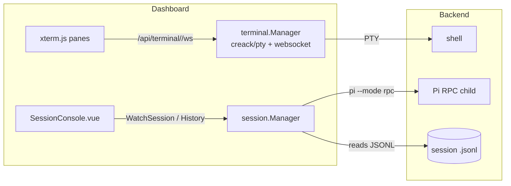
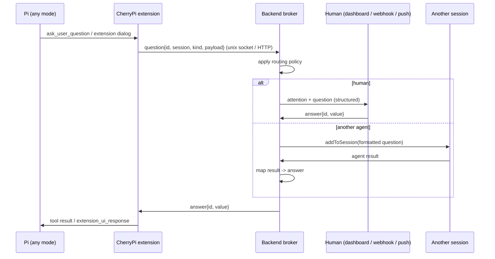

# Terminals, tmux, real TUI, and question routing

Exploration notes (no implementation) for three related ideas:

1. replace the hand-rolled PTY broker with **tmux**;
2. replace the reconstructed web **session console** with a real terminal
   (Pi's TUI);
3. **notify** when a terminal needs attention.

The thread tying them together is the fourth question: **how do questions from
Pi reach a human or another agent?** That is the crux, and it constrains the
first three.

Status: **exploration; one decision taken.** Shell terminals get **server-side
scrollback without tmux** (§2.5). TUI takeover, notifications, and the question
bus remain exploratory.

> **Post-rework note.** This analysis predates the agency/agent split, so the
> paths below are the pre-rework layout: today `server/backend` → `agent`,
> `server/frontend` → `agency/frontend`, and `sdk/js` → `agency/sdk/js`. The
> server-side scrollback it argues for (§2.5) now runs on the agent
> (`agent/internal/terminal/manager.go`, replayed to consumers that attach
> late), which replaced the client-side IndexedDB history §1 describes.

## TL;DR

- **tmux is a viable but unneeded backend for _shell_ terminals.** It adds
  persistence, multi-viewer, and attention hooks, but its copy-mode scrolling
  and extra lifecycle are a poor fit. The one thing it uniquely fixes — output
  lost while detached — is solved by a server-side scrollback ring (§2.5).
  Decision: **no tmux.**
- **Pi's TUI is not a drop-in replacement for the console.** RPC and TUI are
  mutually exclusive per session, and the console is built entirely on the
  structured RPC event stream (deltas, tool phases, usage, extension dialogs).
  A pure terminal loses all of it. Make TUI an optional **takeover mode**, not a
  replacement.
- **tmux does not solve question routing.** Its control mode gives you raw pane
  bytes (`%output`) and `capture-pane` gives you grid text — not `select` /
  `confirm` semantics. Screen-scraping an agent's TUI is brittle.
- **The robust answer is an out-of-band, structured channel owned by CherryPi**
  (a CherryPi extension that talks to the backend over a socket, plus the RPC
  `extension_ui_request` path we already have). Then questions, answers,
  notifications, and agent-to-agent routing are all transport-independent, and
  the terminal is _only a viewport_. This is the real fix; tmux and TUI become
  orthogonal conveniences.

## 1. What we have today

- **Shell terminals** — `server/backend/internal/terminal/manager.go` spawns a
  shell per terminal with `creack/pty`; `server.go` bridges it to a WebSocket.
  Terminals are in-memory, owner-scoped, and a newer attachment takes over an
  older one (`Terminal.attach`). The single `readLoop` **discards output while
  no client is attached**; the browser compensates with per-terminal IndexedDB
  history (`server/frontend/src/lib/terminalHistory.ts`). Terminals die with the
  server (`CloseAll` at shutdown).
- **Session console** — `server/frontend/src/components/sessions/SessionConsole.vue`
  reconstructs the conversation from `SessionEvent`s: `WatchSession` for live
  events, `GetSessionHistory` for paging, `internal/session/history.go` for
  parsing Pi's JSONL. Extension dialogs arrive as `extension_ui_request` and are
  answered with `RespondToExtensionUi`
  (`internal/session/session.go` → `handleExtensionUI`).
- **The RPC child** is spawned as `pi --mode rpc --session-id <id>`
  (`internal/session/session.go:293`). It is the only control plane; there is no
  TTY.
- **Attention today** — a blocking dialog sets `waiting` / status
  `WAITING_INPUT` and fires the outbound `user_input_requested` webhook
  (`internal/session/session.go:1049`, `internal/webhook/webhook.go`). The
  dashboard has **no** browser notification, tab badge, or sound.

## 2. tmux as the terminal backend

The refactor is server-side only: keep `CreateTerminal`/`Attach`/`Resize`/`Close`
and the WebSocket framing; swap the child process from "shell under a PTY" to "a
`tmux attach` client under a PTY" (or a tmux control-mode reader).

### 2.1 What tmux adds over a raw PTY

- **Persistence** — the tmux server outlives the Go process. A broker restart
  reattaches to live shells instead of losing them. (A container restart still
  loses everything; make that explicit.)
- **Server-side scrollback** — `capture-pane -p -S -` can replay history to a
  fresh client, so we stop discarding output when nobody is attached and can
  drop or shrink the IndexedDB workaround.
- **Attach/detach, multi-viewer** — several browser tabs (or a human `tmux
attach` over SSH) can watch the same shell; `attach -r` gives read-only
  viewers, and `-f ignore-size` stops a viewer from resizing the pane.
- **Attention primitives** — `monitor-activity`, `monitor-bell`,
  `alert-activity` / `alert-bell` / `alert-silence` hooks, `pane-exited` /
  `pane-died`, and `remain-on-exit`. A hook can `run-shell` a POST to the
  backend ("pane needs attention").
- **Programmatic inspection** — `list-panes -F '#{pane_current_command}
#{pane_dead} #{window_activity_flag} …'`, `display-message -p`, and format
  **subscriptions** (`refresh-client -B`, which push `%subscription-changed`) let
  us poll or subscribe instead of guessing.
- **Control mode (`-CC`)** — a documented text protocol: command output wrapped
  in `%begin`/`%end`/`%error`, async `%output %pane <bytes>` (raw bytes, octal-
  escaped for control chars), pane/window/session notifications, flow control
  (`pause-after` / `%pause` / `%extended-output`). Useful for a structured
  broker that also wants to query tmux state.

### 2.2 What it costs / risks

- **Version sensitivity.** The new event/monitor system (`set-hook -B`,
  `wait-for -E`) is **tmux 3.8+**; the `alert-*` hooks and `monitor-*` options are
  much older. Target Debian's tmux 3.3–3.4 and stay on hooks + format polling,
  or pin a newer tmux in the image.
- **A second lifecycle to own.** tmux sockets, `TMUX_TMPDIR`, stale sessions,
  `destroy-unattached`, and cleanup on `CloseTerminal` all need policy. `-L
<socket>` / `-S <path>` keep it isolated per container.
- **Ownership model mismatch.** Today terminals are scoped to the credential
  that created them; tmux sessions are server-wide. We would keep the owner in
  the backend's `Terminal` record and refuse `attach`/`send-keys` for
  non-owners (as now).
- **Multi-client sizing.** Several clients can attach; sizing follows the
  `window-size` option. Read-only / `ignore-size` clients avoid a small viewer
  shrinking the shell. Needs a deliberate choice.
- **Error surface.** "tmux server not running", "session not found", "pane
  died" become states to translate back into the existing `Terminal`/`ErrNotFound`
  vocabulary.

### 2.3 Migration sketch

1. Keep the store/db record and the WebSocket contract unchanged.
2. On create: `tmux -L cherrypi new-session -d -s <id> -c <cwd>` (root/session
   cwd as today). Record `id` in the manager.
3. On attach: spawn `tmux -L cherrypi attach -t <id>` under the existing
   `creack/pty`, and reuse `Terminal.attach`'s byte pump (input/resize/takeover).
   Resize maps to the PTY size; tmux propagates it.
4. Optional: a control-mode reader per session to supply `capture-pane` history
   on reconnect and to subscribe to `window_activity_flag` / `window_bell_flag`.
5. On close: `tmux kill-session -t <id>`; on shutdown keep sessions (durability)
   or `kill-server` (current semantics) — a policy decision.

The frontend's `TerminalPane.vue` / `useTerminals.ts` barely change; the only
visible change is that history can come from tmux instead of IndexedDB.

### 2.4 Verdict

**Demoted.** tmux would buy durability, multi-viewer, and server-side
scrollback, but it imposes its own scroll model (copy mode, prefix keys) and a
second process lifecycle — and every benefit except SSH-attachable sessions is
reachable without it. Keep the raw PTY broker and add server-side scrollback
(§2.5). tmux stays an option only if SSH-attachable sessions or its hooks are
later wanted.

### 2.5 Chosen: server-side scrollback, no tmux

The current architecture _already_ stores and replays output — client-side, in
IndexedDB (`server/frontend/src/lib/terminalHistory.ts`, 1 MiB per terminal,
whole-chunk pruning, best-effort). What it lacks:

- the server's `readLoop` **discards PTY output while no client is attached**
  (`internal/terminal/manager.go`), so gaps appear when nobody is watching;
- history is **per browser**, so another device, incognito, or cleared site data
  has none.

The fix is a **bounded scrollback ring on each `Terminal`**:

- `readLoop` copies every chunk into the ring _before_ forwarding it, so output
  produced while detached is retained.
- On attach, the server **replays the ring before any live output**. Ordering is
  guaranteed by holding the new attachment's write lock across the snapshot, so
  a live chunk can never overtake the replay — and a chunk can never be both
  replayed and delivered live.
- Eviction drops **whole chunks**, so a replay never begins mid-escape; the cap
  defaults to 1 MiB (`Config.HistoryBytes`).
- Because the ring lives server-side, a second device that attaches to the same
  terminal sees the same screen — closing the cross-device gap. The frontend
  additionally adopts live terminals the saved layout does not reference.

This makes the server the single authority for scrollback, so the client-side
IndexedDB store is removed rather than duplicated. Native xterm.js scrolling is
unchanged: no copy mode, no prefix key, no tmux process. Raw-byte replay still
inherits the usual caveats (truncation, alternate-screen apps); a server-side VT
emulator is the deferred upgrade path if exact reattach for `vim`/`less` becomes
a requirement.

Implementation lives on the `feat/server-side-terminal-history` branch.

## 3. Replacing the console with a real terminal

The console is not a terminal; it is a **structured renderer** of Pi's RPC
events. Making it "a real terminal" means running Pi's TUI (`pi` on a PTY, no
`--mode rpc`) and attaching xterm.js.

### 3.1 The hard constraint

Pi's session file is a single-writer, append-only tree. RPC and TUI are
alternative front-ends to the same session: **one live writer at a time**. You
cannot RPC-drive a session and watch its TUI simultaneously. So "real terminal"
is mutually exclusive with the structured console _per session, at a point in
time_ — not per deployment.

Everything the dashboard currently shows comes from the control plane being RPC:

| Dashboard feature | Source | Lost in pure TUI? |
| --- | --- | --- |
| Streaming text/thinking | `message_update` deltas | yes |
| Tool call phases / args / results | `tool_execution_*` | partly (JSONL tail is delayed) |
| Token/cost/live rates | `get_session_stats` + `usage` table | yes (live) |
| Status badge / running flag | `agent_state_changed`, run events | heuristic only |
| Extension dialogs (`select`/`confirm`/…) | `extension_ui_request` | only by scraping the TUI |
| History paging | JSONL parse | yes-ish (still on disk) |

### 3.2 Options

**A. Pure TUI, console removed.** `pi --session-id <id>` in a PTY/tmux, xterm.js
attached. Pros: the real Pi experience — overlays, `/` commands, themes, inline
images, keyboard shortcuts, the questionnaire wizard tab bar. Cons: the whole
structured dashboard surface above is gone; attention/questions require screen
scraping; the JSONL is the only machine-readable byproduct and only _after_
entries are written.

**B. Keep RPC, keep the console, add a "take over in terminal" action.** Per
session the backend stops the RPC child (sending the pending prompt through
Pi's own persistence) and starts `pi --session-id <id>` in tmux; the dashboard
attaches a terminal tab. When the human is done, detach, stop the TUI, and
resume RPC (recovery already knows how to re-send/nudge a pending prompt —
`Retry`/recovery path in `manager.go`). Pros: structured by default, full TUI on
demand, one code path for both; the session file is the handoff. Cons: two
lifecycles to sequence; a takeover while a run is in flight needs care; in TUI
mode the terminal's dialogs are answered in the terminal, not the dashboard.

**C. Terminal-rendered console over RPC.** Keep RPC as the control plane but
render events into a terminal-like UI (xterm.js or a TUI-style Vue view). This
is cosmetic — it is the current console with different chrome, not Pi's TUI.

**D. Out-of-band extension + TUI view.** Run the TUI but have a CherryPi
extension own the _structured_ parts (questions, notifications, status) over a
socket to the backend. The terminal shows the TUI; the dashboard still gets
structured attention and questions without parsing the screen. See §5.

### 3.3 Practical terminal gaps to plan for

- Modified keys (`Shift+Enter`, `Alt+Enter`) need tmux `extended-keys on` and,
  on tmux 3.5+, `extended-keys-format csi-u` ([Pi's tmux doc][pi-tmux]).
- Inline images use kitty/iTerm2 protocols; xterm.js needs an addon, and tmux
  passthrough/`allow-passthrough` may be required.
- Pi `tuiMode: "fullscreen"` manages its own viewport; `regular` leans on the
  terminal's scrollback. A browser terminal probably wants `fullscreen`.
- OSC 8 hyperlinks, OSC 52 clipboard, OSC 133 prompt zones, and true color are
  all in play; xterm.js covers most, verify the rest.

### 3.4 Verdict

**Do not replace the console; add TUI as an optional takeover mode (B).**
Combined with §5 (D), even the takeover session can keep emitting structured
attention/questions. Keep RPC as the default because the dashboard is built on
it.

## 4. Notifications when a terminal needs attention

### 4.1 What Pi itself emits

Verified against the installed package (0.87.1; the repo pins 0.99.1, so treat
as directional):

- **No attention bell / desktop notification.** Pi emits OSC 133 prompt zones
  (`\x1b]133;A/B/C\x07`), OSC 52 clipboard, and — only when
  `terminal.showTerminalProgress` is on — OSC 9;4 progress. There is no
  "finished" or "waiting for you" signal, and no setting for one.
- **Window title** is set (`pi - <session> - <cwd>`), which a browser can watch.
- **Extensions can notify** via `ctx.ui.notify()` (fire-and-forget), but only if
  an extension chooses to; the `notify` record is in the RPC extension-UI
  protocol and would be lost in pure TUI apart from the TUI's own rendering.

### 4.2 Channels we can build on

1. **Backend structured signal (best).** We already know `waiting_for_input` in
   `handleExtensionUI` and fire `user_input_requested`. Add a dashboard/browser
   delivery (WebSocket push, Notification API, tab title/favicon badge, sound)
   and/or push webhooks. This works regardless of how the session is rendered,
   _provided_ questions go through the structured channel (§5).
2. **tmux-side signals (for shell panes and, at best, as a fallback for TUI).**
   `monitor-bell` + `alert-bell`, `monitor-activity` + `alert-activity`,
   `monitor-silence` + `alert-silence`, and `pane-exited` hooks; a hook can
   `run-shell` a POST to the backend. Caveat: Pi does not ring the bell on an
   input wait, and "activity" fires on _any_ output, so this is heuristic.
   `pane-command-finished` needs OSC 133 (Pi emits it) and can mark command
   boundaries, not "the editor is waiting".
3. **Terminal escape passthrough to the browser.** The community pattern for
   remote agent notifications is an OSC 777 sequence
   (`\033]777;notify;Title;Body\007`) wrapped in tmux passthrough
   (`\033Ptmux;\033…\033\\`) with `allow-passthrough on`. xterm.js does not show
   desktop notifications by itself, but a browser parser hook could. This is a
   _presentation_ path, not a control path — fine as an add-on, wrong as the
   source of truth.

### 4.3 Verdict

**Drive notifications from the structured backend signal.** Use tmux hooks only
as a supplement for raw shell panes (long build finished, bell, pane died), and
treat OSC 777 passthrough as optional polish. Do not make attention detection
depend on scraping a TUI.

## 5. The crux: routing questions to a human or another agent

A terminal multiplexer carries **bytes**, not dialogs. tmux control mode's
`%output` is exactly what the program wrote; `capture-pane` is a grid of cells.
An extension's `select`/`confirm`/`input`/`editor` request has no representation
there. To route a question you would have to render the TUI, locate the prompt
text, and synthesize keystrokes (`send-keys`) — brittle across Pi/Pi-package
versions and themes, and it cannot express structured options, multi-select, or
previews reliably. This is the same wall the questionnaire-wizard exploration
hit ([`questionnaire_wizard.md`](./questionnaire_wizard.md)).

**Conclusion: never route questions through the terminal.** Give them their own
structured channel and keep the terminal as a viewport.

### 5.1 A CherryPi question bus

Two things make it work in **both** RPC and TUI:

- In **RPC**, we already intercept `extension_ui_request` in
  `handleExtensionUI`. That is the bus on the Pi side.
- In **TUI**, extensions still run in-process (`ctx.mode === "tui"`, `ctx.hasUI`).
  A CherryPi extension can (a) register the question tool itself and call the
  backend from `execute()`, or (b) subscribe to the in-process event the
  questionnaire extension already emits (`rpiv:ask-user:prompt`, per
  `questionnaire_wizard.md`) and forward it. Either way the question never has
  to be read off the screen.

Because the transport is a backend socket, the same broker also serves
**notifications** (§4) and **agent-to-agent routing** without caring whether Pi
is rendering a TUI or is headless.

### 5.2 Routing policy

- **By question metadata**: route `ask_user_question` / `confirm` /
  destructive-command prompts to a human; route informational ones to an
  orchestrator agent.
- **By session role**: a session can be designated "ask my parent", "ask the
  reviewer agent", or "escalate to human".
- **Auto-answer**: a cheap model or a rule table answers low-risk questions and
  records the decision; anything uncertain escalates.
- **Fan-out / race**: ask N agents, take the majority (mirrors how the
  `SubagentWorkflow` judge pattern is described elsewhere).
- **Audit**: every question/answer is a row (`usage`-style), so "who answered
  what, when" survives deletion.

### 5.3 Composition with §2–§4

- Shell terminals under tmux: structured attention via tmux hooks (cheap).
- Pi sessions under RPC: structured attention via `extension_ui_request`
  (already exists) — add browser delivery.
- Pi sessions under TUI takeover: run the CherryPi extension so questions still
  reach the bus; the terminal shows the TUI, the dashboard still shows the
  question.
- Multi-agent routing is a broker concern, independent of all of the above.

### 5.4 Alternatives, for the record

- **Session-file tail.** A watcher tails the JSONL to detect a tool call in
  progress. Read-only, delayed, and gives no answer path. Fine as a safety net;
  not a transport.
- **`send-keys` + `capture-pane`.** Screen-scraping; rejected as above.
- **PTY proxy / wrapper that parses ANSI.** Still screen-scraping, plus it fights
  tmux.
- **Pi upstream: forward extension events over RPC** (option B in the wizard
  doc). Generic and useful, but only helps RPC hosts; the bus above subsumes it.

## 6. Recommended direction & phasing

1. **Question bus first** (independent of terminals): structured question/answer
   and attention events, a routing policy hook, and browser/webhook delivery.
   This is the highest-leverage change and unblocks the questionnaire wizard,
   multi-agent routing, and notifications.
2. **Browser attention UX**: push question/attention events over a WebSocket,
   add tab badge/title and the Notification API, and surface
   `user_input_requested` in the UI.
3. **Server-side terminal scrollback + cross-device reconnect** _(this branch,
   `feat/server-side-terminal-history`)_: bounded per-terminal ring, replay on
   attach, drop the IndexedDB store, adopt live terminals on a fresh device. No
   tmux (§2.4).
4. **Optional TUI takeover mode** per session (stop RPC → `pi --session-id`
   under a PTY → attach → detach → resume RPC), with the CherryPi extension
   keeping the structured channel alive. tmux is not required for this either.

## 7. Open questions

- What is the right scrollback cap per terminal (memory vs depth)? _(defaulted
  to 1 MiB)_
- Should terminals **survive a broker restart**? Currently they do not, and
  scrollback dies with them.
- For TUI takeover, what happens to an **in-flight run** — wait for
  `agent_settled`, or allow interrupting?
- Is the question bus a **unix socket** (same container) or an HTTP endpoint
  (also usable by a plugin/another agent on the network)?
- Where does routing policy live — agent settings, session metadata, or a
  dedicated `RoutingService`?
- If we adopt TUI, do we ship a **CherryPi question tool** (fork) or keep the
  stock extension plus a forwarding companion extension?

## References

- Current code: `server/backend/internal/terminal/manager.go`,
  `server/backend/internal/terminal/server.go`,
  `server/backend/internal/session/session.go` (`handleExtensionUI`),
  `server/backend/internal/session/history.go`,
  `server/frontend/src/components/sessions/SessionConsole.vue`,
  `server/frontend/src/components/terminals/TerminalPane.vue`,
  `server/backend/proto/agent/v1/terminal.proto`,
  `server/backend/internal/webhook/webhook.go`.
- Prior exploration: [`questionnaire_wizard.md`](./questionnaire_wizard.md);
  backlog "TUI-attach session mode" in CHPI-56.
- Pi docs: `docs/rpc.md`, `docs/rpc-extension-ui.md`, `docs/cli-integration.md`,
  `docs/session-format.md`, `docs/tmux.md`, `docs/tui.md` (installed package).
- tmux: [Control Mode][tmux-control] (protocol, `%output`, subscriptions, flow
  control), [Events][tmux-events] (hooks, `alert-*`, monitors, `wait-for -E`),
  [tmux(1)][tmux-man] (`monitor-activity`, `monitor-bell`, `capture-pane`,
  `pipe-pane`, `window-size`, `attach -r`/`ignore-size`).
- Notification pattern: OSC 777 + tmux passthrough with `allow-passthrough on`
  ([claude-tmux-notify][osc777]).

[pi-tmux]: https://github.com/earendil-works/pi/blob/main/packages/coding-agent/docs/tmux.md
[tmux-control]: https://github.com/tmux/tmux/wiki/Control-Mode
[tmux-events]: https://github.com/tmux/tmux/wiki/Events
[tmux-man]: https://man7.org/linux/man-pages/man1/tmux.1.html
[osc777]: https://github.com/jamespan/claude-tmux-notify
